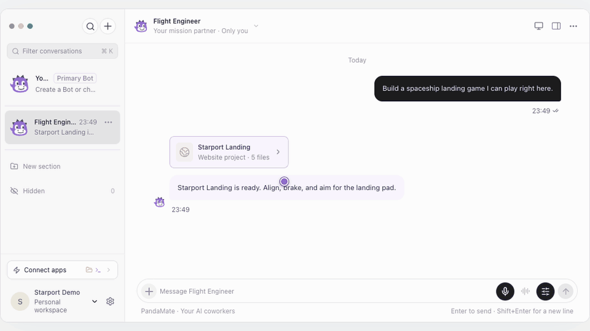
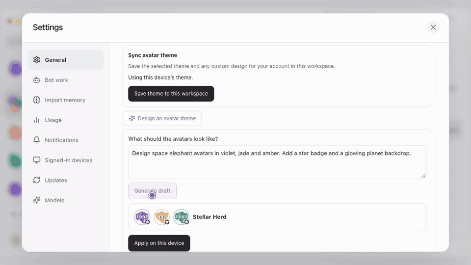
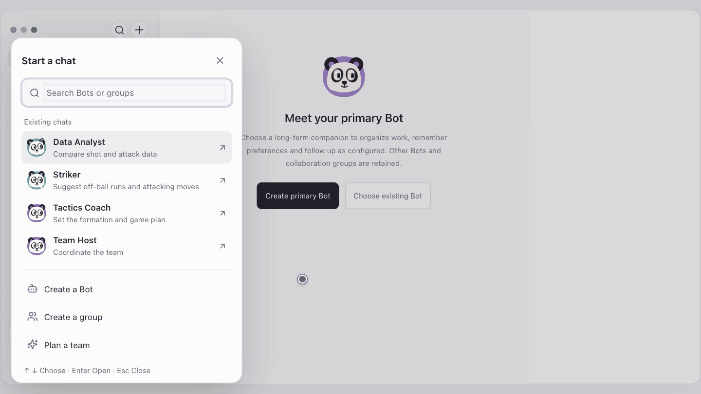
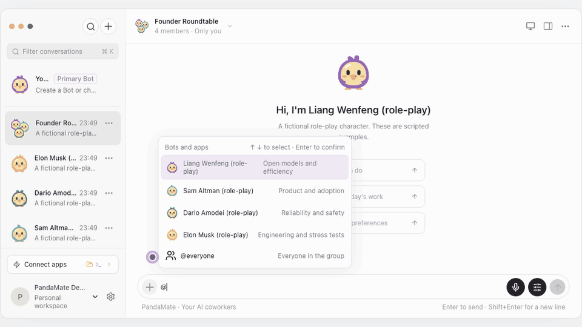
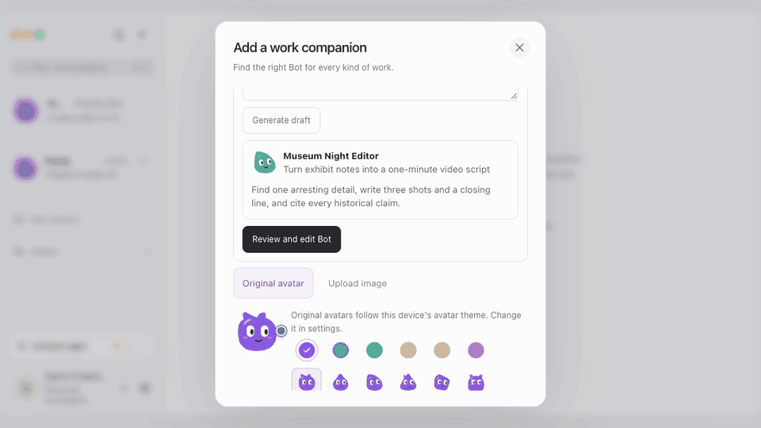

# PandaMate

[简体中文](README.md) · English

**Build a team of AI coworkers in chat and open the websites and files they deliver.** PandaMate is an open-source, self-hosted Grok Bot alternative. Bots use Pi to delegate, search the web, and operate a work computer.

**[Download the latest release](https://github.com/zhiruiai/PandaMate/releases/latest)** · **[Start a workspace](#quick-start)** · **[Watch more demos](#demos)** · [Creator kit](#creator-kit)

**Starport Landing.** Open a five-file web game from chat, align the ship, brake, and make a soft landing in the preview.



These demos were recorded in isolated workspaces using sample conversations, files, and scripted model replies.

## Quick start

| I want to | Start here |
| --- | --- |
| See what PandaMate does | Watch the recorded demo above. You can also preview a [meeting action list](docs/demo/meeting-actions.en.gif) or a [pizza fraction lab](docs/demo/pizza-fractions.en.gif). |
| Self-host and use the web app | On Linux x64, download the server archive and follow its bundled README. You can also run from source below. [Latest release](https://github.com/zhiruiai/PandaMate/releases/latest) |
| Use the Apple Silicon Mac client | Download the desktop archive and connect it to a running PandaMate server. The client requires a separate server and uses ad-hoc signing without Apple notarization. [Desktop connection guide](docs/desktop-client.md) |

Current releases include a Linux x64 server archive, an Apple Silicon Mac client, and source for all platforms. The Flutter mobile app is available as source.

### Run from source

Download or clone this repository. Install the stable Rust toolchain, Node.js 22.19 or later (24 recommended), and npm. Run these commands from the repository root.

```sh
npm ci
npm run configure:local
npm run dev
```

1. Open the product URL printed in the terminal and register a personal or team account.
2. Open **Settings → Models** in your workspace. Enter the model provider URL, model name, and API key. Save the profile, then choose **Set as default**.
3. Open a direct Bot chat and copy the sample below to get your first file deliverable.
4. If your server can reach Exa over HTTPS, ask a workspace Bot to find the official Pi Coding Agent documentation, summarize three points, and cite its sources. Expand the search record above the reply to review them. [Web research setup](server/api/deployment/README.md#execution-boundary)

Run `configure:local` once to create the local configuration. Use `npm run dev` for later launches. To initialize a separate operations account on the first launch, run `npm run dev -- --init-operator`. [Operations setup](docs/operations-console.md)

**Try this message**

> Turn these fictional meeting notes into a Markdown action list with owners, due dates, and open questions. Riley submits the script on Wednesday. Morgan finishes the cover on Friday. The team still needs to agree on a launch date. Deliver the file in this chat.

### Work on this computer

When the client and PandaMate server run on the same machine, choose **Settings → Computer → Local** to use an isolated browser on that machine. If your server runs elsewhere, the isolated browser runs there. To operate native apps on your current Mac, pair a dedicated Worker under **Your computer**, grant Screen Recording and Accessibility, then enable desktop control in the conversation’s computer panel. [Pairing and permissions](docs/computer.md#配对设备)

Found a use for PandaMate? Star the repo to follow releases, or share your first task and any setup trouble in [Issues](https://github.com/zhiruiai/PandaMate/issues).

## Demos

### Learn, create, and get work done

| Scenario | What to watch | Demo |
| --- | --- | --- |
| After-School Adventure Crew | Try a wrong answer, then use two quarters of a pizza to make one half. | [Pizza Fraction Lab](docs/demo/pizza-fractions.en.gif) |
| Short Video Studio | One water drop, one phone, three shots. Switch between the shot list and voiceover in the delivered project. | [A Film in One Drop](docs/demo/short-video-storyboard.en.gif) |
| Meeting Action Team | Create a team from a template and turn fictional meeting notes into an action list with owners and due dates. | [Meeting action list](docs/demo/meeting-actions.en.gif) |

Find all three in **Bot template library → Team templates**. Review the roles and edit them before creating a team. Watch the avatar react when a Bot is [idle, working, waiting for you, or finished](docs/demo/avatar-states.en.gif).

<details>
<summary>Three short video ideas · Space elephants, football tactics, founder roundtable</summary>

**Dress the workspace as a space elephant crew.** Describe an avatar theme, review the proposed colorways, and save it to see the characters change.



**How would an AI coach play French-style counterattacks?** Start a seven-a-side tactics room with a coach, a striker, and a data analyst. Pick high pressing and quick attacks down the wings and see how the coach builds the plan.



[Watch the coach respond to the tactical choices](docs/demo/chat-choices.en.gif)

**Founder Roundtable.** Use `@everyone` to ask four role-play characters how they would build an AI tutor on one old computer. See how the pitches differ on adoption, efficiency, safety, and engineering.



</details>

<details>
<summary>More demos · Create a Bot, run a team, check sources, and open deliverables</summary>

**Hire a museum night-shift editor.** Describe the video producer you need, review the proposed Bot profile, rename it, and open its chat.



**Give the whole team a new look.** Switch between pandas, dinosaurs, chicks, and elephants and see the change across the chat. [Avatar themes GIF](docs/demo/avatar-themes.en.gif)

**Assemble a launch team.** Start with a team template, review its three roles, rename the group, and create the chat. [Team template GIF](docs/demo/team-templates.en.gif)

**Schedule a weekday briefing.** Choose the days and time and check the next run in Routines. [Scheduled briefing GIF](docs/demo/scheduled-brief.en.gif)

**Have the next research run cite its sources.** Review a built-in research skill and save it as a draft for a specific Bot. [Skill draft GIF](docs/demo/skill-library.en.gif)

**Follow the answer back to its sources.** Expand the search record and see the pages the Bot visited. [Web research GIF](docs/demo/web-research.en.gif)

**Browse a weekend bookshop.** Open the multi-file website, navigate to its reading list, and switch to the stylesheet in Source. [Website preview GIF](docs/demo/website-preview.en.gif)

</details>

## What you can do

| Use case | Features |
| --- | --- |
| AI coworkers and multi-agent collaboration | Direct and group chats, Bot mentions, delegation, and question cards. Describe a Bot or a team, review the draft, and create it. |
| Web search and deliverables | Search public pages and review sources. Preview documents, spreadsheets, media, and multi-file websites in chat. [File previews](docs/file-previews.md) |
| Workflow automation and agent skills | Schedule tasks with a time zone or trigger them with a webhook. Results return to the original conversation. Save repeatable instructions as Bot skills for review. [Webhooks](docs/routine-webhooks.md) |
| Computer use and browser automation | Pair a dedicated Worker in **Settings → Computer** or use a configured cloud computer. The server host provides an isolated work browser. A standalone macOS Worker can operate the local desktop after explicit opt-in and system permission. [Computer setup](docs/computer.md) |
| MCP tools and human-in-the-loop approvals | Connect apps through the Model Context Protocol (MCP). Approve specific requests in chat. A private takeover pauses Bot input and observation. |

The web app supports PWA installation. The desktop and mobile clients connect to the same workspace service. [Electron desktop](docs/desktop-client.md) · [Flutter mobile](mobile/README.md)

## Creator kit

### 20 seconds · Land a spacecraft from a chat

Open with “I asked an AI coworker for a mini-game. I can play it right here in chat.”

| Time | Shot and caption |
| --- | --- |
| 00–03s | Flash the spacecraft just above the landing pad. Caption “Can you fly a spaceship inside a chat?” |
| 03–08s | Return to the request and the web artifact card, then open the preview. Caption “The deliverable is a playable website.” |
| 08–16s | Cut to the descent and show the flight controls. Leave a beat for touchdown. Caption “Adjust thrust. Prepare to land.” |
| 16–20s | Hold on the landing result. End card “PandaMate · Open source, self-hosted.” |

[Starport Landing GIF](docs/demo/orbital-landing.en.gif)

### 28 seconds · Plan a seven-a-side counterattack with an AI coach

| Time | Shot and caption |
| --- | --- |
| 00–04s | Flash the coach's reply. Opening voiceover “How would an AI team play French-style counterattacks?” [Question card GIF](docs/demo/chat-choices.en.gif) |
| 04–10s | Cut from picking roles to the new chat. Caption “Coach, striker, and analyst reporting in.” [Team setup GIF](docs/demo/group-chat.en.gif) |
| 10–18s | Pick high pressing and quick attacks down the wings. Cut to the coach's reply. Caption “New tactics received.” [Question card GIF](docs/demo/chat-choices.en.gif) |
| 18–28s | Cut between panda, chick, and elephant avatars and end on the group chat with its new look. Caption “PandaMate · Open source, self-hosted.” [Avatar themes GIF](docs/demo/avatar-themes.en.gif) |

Another angle is “Four founders in a role-play, one old computer.” Cut between their pitches and ask viewers which idea they would try. [Founder Roundtable GIF](docs/demo/founder-debate.en.gif)

For vertical video, crop to the action. Keep the artifact button, role names, and landing result visible so viewers can follow along with the sound off.

## Build and deploy

A Rust service handles identity, permissions, application data, and scheduling, and stores state in SQLite. Pi Coding Agent provides the Bot agent harness. Separate workers handle MCP, document parsing, and computer use. The React product and operations sites are built separately and use separate API entry points and sign-in sessions. [Architecture](docs/architecture.md)

| Command | Purpose |
| --- | --- |
| `npm run build` | Compile the Rust service and build the product and operations sites |
| `npm start` | Start the built service with local configuration |
| `npm run client:dev` | Run the Electron client and connect it to the product service |
| `npm test` | Run backend, web, worker, and desktop client tests |
| `npm run check:source` · `npm run check:privacy` | Check source rules and scan publishable files for private values |
| `npm run backend:package -- --release --out release/backend` | Assemble a release package for the current platform |

Use HTTPS for production. Configure the product and operations entry points separately and store data outside the release package. Model providers, third-party apps, remote computers, and local speech each have their own setup. Flutter includes Android and iOS source and test workflows. Native installation and device testing are separate steps. [Service deployment](server/api/deployment/README.md) · [Source releases](docs/source-release.md) · [Verification coverage](docs/verification.md)

GitHub Actions builds the first release and the daily downloads. [Automated release workflow](docs/source-release.md#github-自动发布)

## Source map

Developers and AI agents can use this map to find the entry points, implementation, and checks for a change.

| Area | Where to start | Relevant checks |
| --- | --- | --- |
| Product UI | [Web entry](web/src/main.tsx), [UI source](web/src/), [static assets](web/public/) | `npm run test:web` |
| Separate operations site | [Operations entry](operations/main.tsx), [operations pages](operations/src/) | `npm run build:operations` |
| Rust API, permissions, and persistence | [Service entry](server/api/src/main.rs), [API implementation](server/api/src/), [integration tests](server/api/tests/) | `npm run backend:test` |
| Pi, MCP, document, and computer workers | [Workers](server/workers/), [native helpers](server/native/) | `npm run test:runtime` |
| Electron and Flutter | [Desktop](desktop/), [mobile](mobile/) | `npm run client:test` · [Flutter checks](mobile/README.md#develop-and-verify) |
| Shared types and protocols | [Shared source](shared/) | `npm run test:web` · `npm run test:runtime` |
| Build, export, and privacy checks | [Scripts](scripts/), [source checks](scripts/source/) | `npm run check:source` · `npm run check:privacy` |

Development commands live in [package.json](package.json) and continuous integration in [.github/workflows/ci.yml](.github/workflows/ci.yml). The Rust service determines permissions and task state. For changes involving permissions or writes, trace the behavior through the API, persistence, and tests. [Contribution guide](CONTRIBUTING.md)

## Data and external services

Workspace data lives on the service managed by the deployer. Model requests go to the configured provider. Public web research sends query terms or public URLs to Exa. Connected apps and computer workers use their configured endpoints and permissions. Store deployment settings, model credentials, runtime data, and browser profiles outside source control. [External apps](docs/app-connections.md) · [Security](SECURITY.md)

## Acknowledgments and open-source credits

Thanks to everyone who tries PandaMate, reports issues, shares reproductions, or improves the docs and translations. Thanks also to the maintainers of these upstream projects.

| Area | Upstream projects and components |
| --- | --- |
| Agent execution and tool connections | [Pi Coding Agent](https://github.com/earendil-works/pi) provides the Bot execution harness. The [MCP TypeScript SDK](https://github.com/modelcontextprotocol/typescript-sdk) connects external tools. |
| Server and storage | [Tokio](https://tokio.rs/) and [Axum](https://github.com/tokio-rs/axum) support the Rust service. [SQLx](https://github.com/transact-rs/sqlx) accesses [SQLite](https://sqlite.org/). |
| Web, desktop, and mobile | [React](https://react.dev/) and [Vite](https://vite.dev/) power the web front end. [Electron](https://www.electronjs.org/) and [Flutter](https://flutter.dev/) are used for the desktop and mobile clients, respectively. |
| Documents, icons, and fonts | [PDF.js](https://mozilla.github.io/pdf.js/) and [Mammoth.js](https://github.com/mwilliamson/mammoth.js) handle document previews and parsing. [Lucide](https://lucide.dev/) provides UI icons. The Chinese font in Flutter web is derived from [Noto Sans SC](https://fonts.google.com/noto/specimen/Noto+Sans+SC). |
| Markdown and images | [react-markdown](https://github.com/remarkjs/react-markdown) and [remark-gfm](https://github.com/remarkjs/remark-gfm) render messages and skill documents. [sharp](https://sharp.pixelplumbing.com/) processes image attachments. |
| Optional execution environments | [Playwright](https://playwright.dev/) and [Chromium](https://www.chromium.org/) support browser use. [whisper.cpp](https://github.com/ggml-org/whisper.cpp) handles local speech transcription. |

PandaMate is an independent project. For the original product reference, see the [official Grok Bot introduction](https://x.ai/news/introducing-grok-bot).

Lockfiles record dependency versions. Dependencies retain their original licenses. The packaged service includes a license inventory for its compiled Rust and bundled web dependencies. [NOTICE](NOTICE) · [Third-party licenses](THIRD_PARTY.md)

## Contributing and license

Bug reproductions, documentation improvements, and code changes are welcome. Use sample data in reproductions and include the checks you ran. [Contribution guide](CONTRIBUTING.md)

PandaMate’s original code is available under the [MIT License](LICENSE). See the [third-party notices](THIRD_PARTY.md) for dependency licenses.
