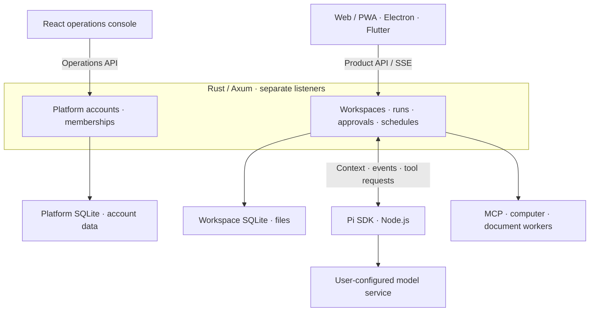

# BambooShift — Self-hosted AI coworker teams

English · [简体中文](README.zh-CN.md)

**BambooShift is a self-hosted workspace for AI coworker teams and an open-source Grok Bot alternative.** Assign work, approve actions, and open the websites and files your team delivers in one chat. Pi powers delegation, web research, and computer use.

**[Try the live demo](https://zhiruiai.github.io/BambooShift/)** · **[Download the latest release](https://github.com/zhiruiai/BambooShift/releases/latest)** · **[Supported platforms](#supported-platforms)** · **[Start a workspace](#quick-start)** · **[Contribute](CONTRIBUTING.md)** · [Tech stack and architecture](#tech-stack-and-architecture) · [More demos](#demos) · [Creator kit](#creator-kit)

**One request. A whole AI team. A game you can open and play.** Open Starport Landing from the chat, check its five files in Source, then fly the spacecraft to a soft landing. The browser demo requires no account or API key.


These demos were recorded in isolated workspaces using sample conversations, files, and scripted model replies.

## Supported platforms

| Platform | How to use BambooShift |
| --- | --- |
| **Web / PWA** | Open the workspace in a Windows, macOS, Linux, or mobile browser. Install as a PWA when your browser supports it. |
| **Windows x64** | Choose a release with a Windows x64 client ZIP. Extract the entire archive and run `BambooShift.exe`. The unsigned portable client connects to a running server. [Windows setup](docs/desktop-client.md#windows-x64) |
| **macOS Apple Silicon** | Download the desktop ZIP and connect to a running server. The client uses ad-hoc signing without Apple notarization. Intel Macs can use the web app. [Desktop setup](docs/desktop-client.md) |
| **Linux x64** | Download the prebuilt server, follow the bundled README, and open the workspace in your browser. [Server deployment](server/api/deployment/README.md) |
| **Android / iOS** | Use a mobile browser. The native Flutter app is available as source. [Mobile source](mobile/README.md) |

Clients share one BambooShift server. The connected work computer executes Bot computer actions. For older releases, select the equivalent platform asset and use the executable named in its release notes. [Latest release](https://github.com/zhiruiai/BambooShift/releases/latest)

## Quick start

If you already have a server, open its workspace in your browser or connect the desktop client to its address. To host your own server, [install the Linux x64 server archive](server/api/deployment/README.md#install-and-configure) or start from source below.

### Run from source

Download or clone this repository. Install the stable Rust toolchain, Node.js 22.19 or later (24 recommended), and npm. Run these commands from the repository root.

```sh
npm ci
npm run configure:local
npm run dev
```

1. Open the product URL printed in the terminal and register a personal or team account.
2. Open **Settings → Models** in your workspace. Enter the model provider URL, model name, and API key. Save the profile, then choose **Set as default**.
3. Open a direct Bot chat and copy the sample below to get your first file deliverable.
4. If your server can reach Exa over HTTPS, ask a workspace Bot to find the official Pi Coding Agent documentation, summarize three points, and cite its sources. Expand the search record above the reply to review them. [Web research setup](server/api/deployment/README.md#execution-boundary)

Run `configure:local` once to create the local configuration. Use `npm run dev` for later launches. To initialize a separate operations account on the first launch, run `npm run dev -- --init-operator`. [Operations setup](docs/operations-console.md)

### Try your first task

Paste this message into a Bot chat. Open the file from the Bot's reply to check the action list.

```text
Turn these fictional meeting notes into a Markdown action list with owners, due dates, and open questions.
Riley submits the script on Wednesday. Morgan finishes the cover on Friday.
The team still needs to agree on a launch date. Deliver the file in this chat.
```

### Add a skill to a Bot

On the web or desktop, open **Connect apps → Packaged skills**. Preview the instructions, choose a local Bot, and save a draft. After approval, select the skill with `/` in that Bot’s direct chat. On Flutter, open **+ → Use skill** in the composer. The Bot loads the selected, reviewed instructions for that run.

Use **Import SKILL.md** in the Bot’s skill editor to start from a local skill file on Web, desktop, or Flutter. Review the imported instructions in the editor, then save and approve the draft.

### Choose a local or cloud computer

- **Local browser.** Choose **Settings → Computer → Local** to open an isolated browser on the server machine. It runs on your current device when the client and server are on that same device.
- **Native Mac apps.** Pair a dedicated Worker on your current Mac under **Your computer**, grant Screen Recording and Accessibility, then enable desktop control in the chat’s computer panel.
- **Cloud execution.** Use a cloud computer your administrator has linked, or connect a Worker you run on a separate computer or cloud server. [Execution locations](docs/computer.md#选择执行位置)

Star the repo to bookmark it. For release notifications, choose **Watch → Custom → Releases**. Share your first task in [Issues](https://github.com/zhiruiai/BambooShift/issues), or use the [installation and compatibility form](https://github.com/zhiruiai/BambooShift/issues/new?template=installation.yml).

## Demos

### Learn, create, and get work done

| Scenario | What to watch | Demo |
| --- | --- | --- |
| After-School Adventure Crew | Try a wrong answer, then use two quarters of a pizza to make one half. | [Pizza Fraction Lab](docs/demo/pizza-fractions.en.gif) |
| Short Video Studio | One water drop, one phone, three shots. Switch between the shot list and voiceover in the delivered project. | [A Film in One Drop](docs/demo/short-video-storyboard.en.gif) |
| Meeting Action Team | Create a team from a template and turn fictional meeting notes into an action list with owners and due dates. | [Meeting action list](docs/demo/meeting-actions.en.gif) |

Find all three in **Bot template library → Team templates**. Review the roles and edit them before creating a team. Watch the avatar react when a Bot is [idle, working, waiting for you, or finished](docs/demo/avatar-states.en.gif).

<details>
<summary>Three short video ideas · Space elephants, football tactics, founder roundtable</summary>

**Dress the workspace as a space elephant crew.** Describe an avatar theme, review the proposed colorways, and save it to see the characters change.


**How would an AI coach play French-style counterattacks?** Start a seven-a-side tactics room with a coach, a striker, and a data analyst. Pick high pressing and quick attacks down the wings and see how the coach builds the plan.


[Watch the coach respond to the tactical choices](docs/demo/chat-choices.en.gif)

**Founder Roundtable.** Use `@everyone` to ask four role-play characters how they would build an AI tutor on one old computer. See how the pitches differ on adoption, efficiency, safety, and engineering.


</details>

<details>
<summary>More demos · Create a Bot, run a team, check sources, and open deliverables</summary>

**Hire a museum night-shift editor.** Describe the video producer you need, review the proposed Bot profile, rename it, and open its chat.


**Give the whole team a new look.** Switch between pandas, dinosaurs, chicks, and elephants and see the change across the chat. [Avatar themes GIF](docs/demo/avatar-themes.en.gif)

**Assemble a launch team.** Start with a team template, review its three roles, rename the group, and create the chat. [Team template GIF](docs/demo/team-templates.en.gif)

**Schedule a weekday briefing.** Choose the days and time and check the next run in Routines. [Scheduled briefing GIF](docs/demo/scheduled-brief.en.gif)

**Have the next research run cite its sources.** Review a built-in research skill and save it as a draft for a specific Bot. [Skill draft GIF](docs/demo/skill-library.en.gif)

**Follow the answer back to its sources.** Expand the search record and see the pages the Bot visited. [Web research GIF](docs/demo/web-research.en.gif)

**Browse a weekend bookshop.** Open the multi-file website, navigate to its reading list, and switch to the stylesheet in Source. [Website preview GIF](docs/demo/website-preview.en.gif)

</details>

## What you can do

If you have used Grok Bot, start with these familiar workflows. Assign work, review actions, take control, and receive deliverables in the same workspace.

| What you want to do | Where to do it in BambooShift |
| --- | --- |
| Build a team and assign work | Start with a Bot or team template, or describe the team to draft. Assign tasks in direct or group chat, mention a Bot, and let coworkers delegate. [Team setup](docs/bot-settings-and-teams.md) |
| Use web search, apps, and a work computer | Bots can search public pages with sources or use connected Model Context Protocol (MCP) tools. **Settings → Computer** offers a server-hosted isolated browser, a configured cloud computer, and dedicated Worker pairing. [Computer setup](docs/computer.md) |
| Approve an action or take over | Review and approve specific requests in chat. Open the Bot’s screen to follow its work. A private takeover pauses Bot input and observation. |
| Open a finished deliverable | Preview documents, spreadsheets, media, and multi-file sites in chat. Play a delivered site, switch to Source, or download the project. [File previews](docs/file-previews.md) |
| Reuse skills and automate routines | Review and enable reusable agent skills. Schedule a routine by time zone or trigger it with a webhook, then receive the result in the original chat. [Webhooks](docs/routine-webhooks.md) |

## Tech stack and architecture

BambooShift separates model inference, workspace authorization, and computer execution. A chat request starts a Pi run with the workspace’s configuration. Pi streams messages and tool requests. Actions that require approval appear in the chat. Results and files return to the conversation, where you can preview, play, or inspect the source of a delivered website.



| Layer | Stack and responsibility |
| --- | --- |
| Client | React, TypeScript, and Vite build the web app and PWA. Electron provides the desktop connection shell. Flutter provides the native mobile source. [Web](web/src/) · [Desktop](desktop/) · [Mobile](mobile/) |
| API and data | Rust, Axum, Tokio, and SQLx/SQLite manage identity, workspace data, chat events, approval receipts, and scheduled routines. Product and operations entry points use separate sessions. [Rust service](server/api/) |
| Agent harness | The Pi Coding Agent SDK runs in a supervised Node.js worker. The workspace selects the model service and scopes delegation and skill versions. [Pi worker](server/workers/pi-worker/) |
| Tools and execution | Separate workers handle MCP, document parsing, and computer use. Playwright drives isolated browsers. macOS desktop control requires a dedicated helper and system permission. [Workers](server/workers/) · [Computer setup](docs/computer.md) |

[Architecture and authorization](docs/architecture.md) · [Source releases and verification](docs/source-release.md)

## Creator kit

### 20 seconds · Land a spacecraft from a chat

Open with “I asked an AI coworker for a mini-game. I can play it right here in chat.”

| Time | Shot and caption |
| --- | --- |
| 00–03s | Flash the spacecraft just above the landing pad. Caption “Can you fly a spaceship inside a chat?” |
| 03–08s | Return to the request and the web artifact card, then open the preview. Caption “The deliverable is a playable website.” |
| 08–16s | Cut to the descent and show the flight controls. Leave a beat for touchdown. Caption “Adjust thrust. Prepare to land.” |
| 16–20s | Hold on the landing result. End card “BambooShift · Open source, self-hosted.” |

[Starport Landing GIF](docs/demo/orbital-landing.en.gif)

### 28 seconds · Plan a seven-a-side counterattack with an AI coach

| Time | Shot and caption |
| --- | --- |
| 00–04s | Flash the coach's reply. Opening voiceover “How would an AI team play French-style counterattacks?” [Question card GIF](docs/demo/chat-choices.en.gif) |
| 04–10s | Cut from picking roles to the new chat. Caption “Coach, striker, and analyst reporting in.” [Team setup GIF](docs/demo/group-chat.en.gif) |
| 10–18s | Pick high pressing and quick attacks down the wings. Cut to the coach's reply. Caption “New tactics received.” [Question card GIF](docs/demo/chat-choices.en.gif) |
| 18–28s | Cut between panda, chick, and elephant avatars and end on the group chat with its new look. Caption “BambooShift · Open source, self-hosted.” [Avatar themes GIF](docs/demo/avatar-themes.en.gif) |

Another angle is “Four founders in a role-play, one old computer.” Cut between their pitches and ask viewers which idea they would try. [Founder Roundtable GIF](docs/demo/founder-debate.en.gif)

For vertical video, crop to the action. Keep the artifact button, role names, and landing result visible so viewers can follow along with the sound off.

## Build and deploy

| Command | Purpose |
| --- | --- |
| `npm run build` | Compile the Rust service and build the product and operations sites |
| `npm start` | Start the built service with local configuration |
| `npm run client:dev` | Run the Electron client and connect it to the product service |
| `npm test` | Run backend, web, worker, and desktop client tests |
| `npm run check:source` · `npm run check:privacy` | Check source rules and scan publishable files for private values |
| `npm run backend:package -- --release --out release/backend` | Assemble a release package for the current platform |

Use HTTPS for production. Configure the product and operations entry points separately and store data outside the release package. Model providers, third-party apps, remote computers, and local speech each have their own setup. Flutter includes Android and iOS source and test workflows. Native installation and device testing are separate steps. [Service deployment](server/api/deployment/README.md) · [Source releases](docs/source-release.md) · [Verification coverage](docs/verification.md)

GitHub Actions builds the first release and the daily downloads. [Automated release workflow](docs/source-release.md#github-自动发布)

## Source map

Developers and AI agents can use this map to find the entry points, implementation, and checks for a change.

| Area | Where to start | Relevant checks |
| --- | --- | --- |
| Product UI | [Web entry](web/src/main.tsx), [UI source](web/src/), [static assets](web/public/) | `npm run test:web` |
| Separate operations site | [Operations entry](operations/main.tsx), [operations pages](operations/src/) | `npm run build:operations` |
| Rust API, permissions, and persistence | [Service entry](server/api/src/main.rs), [API implementation](server/api/src/), [integration tests](server/api/tests/) | `npm run backend:test` |
| Pi, MCP, document, and computer workers | [Workers](server/workers/), [native helpers](server/native/) | `npm run test:runtime` |
| Electron and Flutter | [Desktop](desktop/), [mobile](mobile/) | `npm run client:test` · [Flutter checks](mobile/README.md#develop-and-verify) |
| Shared types and protocols | [Shared source](shared/) | `npm run test:web` · `npm run test:runtime` |
| Build, export, and privacy checks | [Scripts](scripts/), [source checks](scripts/source/) | `npm run check:source` · `npm run check:privacy` |

Development commands live in [package.json](package.json) and continuous integration in [.github/workflows/ci.yml](.github/workflows/ci.yml). The Rust service determines permissions and task state. For changes involving permissions or writes, trace the behavior through the API, persistence, and tests. [Contribution guide](CONTRIBUTING.md)

## Data and external services

Workspace data lives on the service managed by the deployer. Model requests go to the configured provider. Public web research sends query terms or public URLs to Exa. Connected apps and computer workers use their configured endpoints and permissions. Store deployment settings, model credentials, runtime data, and browser profiles outside source control. [External apps](docs/app-connections.md) · [Security](SECURITY.md)

## Acknowledgments and open-source credits

Thanks to everyone who tries BambooShift, reports issues, shares reproductions, or improves the docs and translations. Thanks also to the maintainers of these upstream projects.

| Area | Upstream projects and components |
| --- | --- |
| Agent execution and tool connections | [Pi Coding Agent](https://github.com/earendil-works/pi) provides the Bot execution harness. The [MCP TypeScript SDK](https://github.com/modelcontextprotocol/typescript-sdk) connects external tools. |
| Server and storage | [Tokio](https://tokio.rs/) and [Axum](https://github.com/tokio-rs/axum) support the Rust service. [SQLx](https://github.com/transact-rs/sqlx) accesses [SQLite](https://sqlite.org/). |
| Web, desktop, and mobile | [React](https://react.dev/) and [Vite](https://vite.dev/) power the web front end. [Electron](https://www.electronjs.org/) and [Flutter](https://flutter.dev/) are used for the desktop and mobile clients, respectively. |
| Documents, icons, and fonts | [PDF.js](https://mozilla.github.io/pdf.js/) and [Mammoth.js](https://github.com/mwilliamson/mammoth.js) handle document previews and parsing. [Lucide](https://lucide.dev/) provides UI icons. The Chinese font in Flutter web is derived from [Noto Sans SC](https://fonts.google.com/noto/specimen/Noto+Sans+SC). |
| Markdown and images | [react-markdown](https://github.com/remarkjs/react-markdown) and [remark-gfm](https://github.com/remarkjs/remark-gfm) render messages and skill documents. [sharp](https://sharp.pixelplumbing.com/) processes image attachments. |
| Optional execution environments | [Playwright](https://playwright.dev/) and [Chromium](https://www.chromium.org/) support browser use. [whisper.cpp](https://github.com/ggml-org/whisper.cpp) handles local speech transcription. |

BambooShift is an independent project. For the original product reference, see the [official Grok Bot introduction](https://x.ai/news/introducing-grok-bot).

Lockfiles record dependency versions. Dependencies retain their original licenses. The packaged service includes a license inventory for its compiled Rust and bundled web dependencies. [NOTICE](NOTICE) · [Third-party licenses](THIRD_PARTY.md)

## Contributing and license

Bug reproductions, documentation improvements, and code changes are welcome. Use sample data in reproductions and include the checks you ran. [Contribution guide](CONTRIBUTING.md)

Run `npm run dev:preview` after installing the project to try a real chat and file delivery with a local scripted model. The preview requires no model key. [First contribution](CONTRIBUTING.md#run-a-sample-task-locally)

BambooShift’s original code is available under the [MIT License](LICENSE). See the [third-party notices](THIRD_PARTY.md) for dependency licenses.
