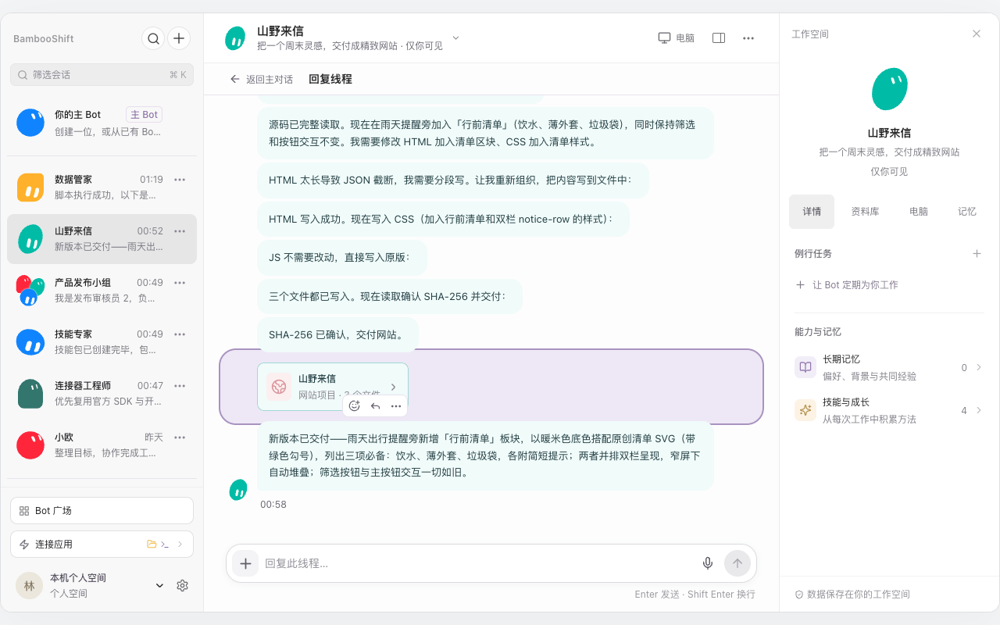
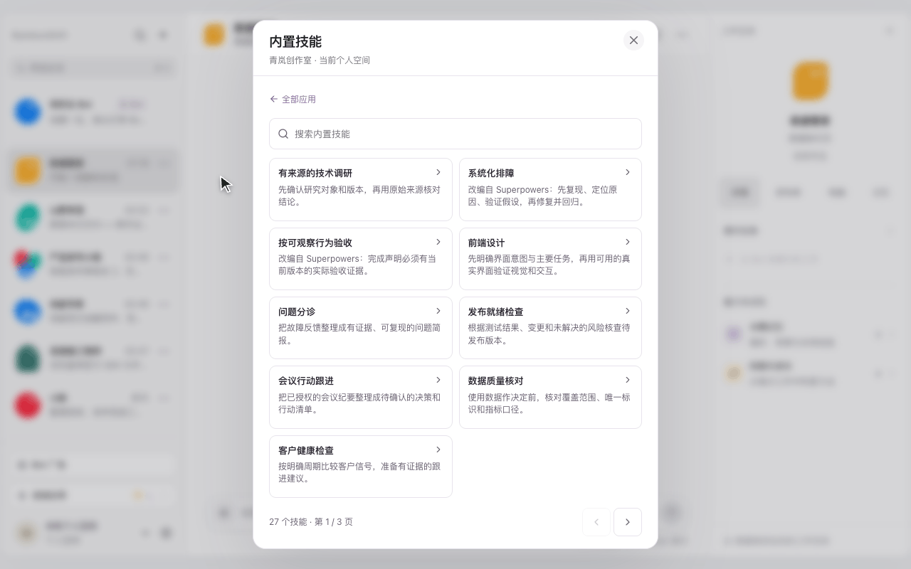

# aihubot


English · [简体中文](README.zh-CN.md)

aihubot is a self-hosted workspace where you give a Bot or a small team a task and get the work back in the conversation. A website arrives with a preview and a version history. You can open an earlier version, compare what changed, then return to the original thread to ask for the next edit.

[Play a delivered website](https://zhiruiai.github.io/aihubot/en/) · [Download aihubot](https://github.com/zhiruiai/aihubot/releases/latest) · [Run from source](#run-from-source) · [Install a skill](#install-and-run-a-skill)



The recording reopens five saved deliveries from a real model run. The playable link above opens Starport Landing, a five-file game from a scripted demo that you can fly in your browser without an account.

## Quick start

### Supported platforms

- **Join a workspace.** Open your server’s product URL in a browser, including on mobile. To use a desktop window, download the macOS Apple Silicon or Windows x64 client and enter the same URL. On Windows, extract the entire ZIP before launching `aihubot.exe`. [Release downloads](https://github.com/zhiruiai/aihubot/releases/latest)
- **Host a workspace.** Install the Linux x64 server archive with Node.js 22.19 or later, or use the source setup below. [Server installation](server/api/deployment/README.md#install-and-configure)
- **Run on this Mac.** In the macOS source preview with the bundled runtime, choose **Start on this computer**. The app starts its own Rust service and opens a personal workspace. The published desktop ZIP connects to a separately running server. [Personal workspace setup](docs/desktop-client.md)

### Run from source

Install stable Rust, Node.js 22.19 or later and npm. Then start the service and web interface from a checkout of this repository.

```sh
git clone https://github.com/zhiruiai/aihubot.git
cd aihubot
npm ci
npm run configure:local
npm run dev
```

Open the product URL printed in the terminal and register an account. Run `npm run dev` for subsequent launches. For a real model, open **Settings → Models**, enter your provider URL, model name and API key, save the profile and select **Set as default**. A Bot inherits the workspace default unless you assign another configured profile.

### Try your first task

Open a Bot’s direct chat and send this message.

> Put these meeting notes in a Markdown action list and deliver the file here. Riley will send the script on Wednesday. Morgan will finish the cover on Friday. We still need to pick a launch date.

Open the file in the reply. You can check whether it preserved both owners and deadlines and kept the launch date open. For a local walkthrough before you connect a provider, `npm run dev:preview` uses a scripted model and a temporary workspace. [Preview instructions](CONTRIBUTING.md#run-a-sample-task-locally)

## Install and run a skill

An aihubot skill is an Agent Skills package. For example, **Data quality review** has four files. Its `SKILL.md` explains the review, `references/review-checklist.md` lists the checks, `scripts/profile_csv.py` counts data issues and `assets/exceptions.csv` provides a template for logging them.

1. As the workspace owner, open a local Bot’s settings. Select **Choose and manage skills → Choose from skill library** and search for **Data quality review**.
2. Select **View instructions and files** to read the package. Check the target Bot, select **Install skill**, then **Done**. The installed version stays selected so you can review it.

**Try the script on your Mac.** Use the bundled macOS personal workspace with local command access enabled and Python 3 installed. Save the following as `orders.csv` and attach it to the Bot’s direct chat.

```csv
order_id,amount
A101,20
A101,20
A102,30,extra
```

Type `/`, select **Data quality review**, then ask the Bot to run the packaged script using `order_id` as the key. Expect **3 rows, 1 duplicate-key row and 1 row with the wrong number of fields**. Open the execution receipt for the exit code and actual output. **Ask each time** requests approval in the chat. **Full access** reuses the owner’s grant on that computer.



The recorded CSV has 10 data rows. The script found two extra occurrences of duplicate keys and two rows with the wrong number of fields. You can also import a skill folder, inspect a previous version or download a reviewed package as a ZIP. [Models, skill packages and script execution](docs/bot-models-and-skills.md)

## Publish from a Bot

Open **Connect apps → Publishing accounts** on desktop or the web. Choose a platform and a local Bot, take over its work browser to sign in, then return control. In chat, ask the Bot to save a draft or publish a particular piece under a named account. The work browser reuses the session while the platform keeps it valid.


| Destination | What you can ask the Bot to do |
| --- | --- |
| **Xiaohongshu** | Attach a cover in chat. The Bot uploads that image to the creator form, fills the title and caption, and checks the thumbnail. [Image note workflow](docs/bot-models-and-skills.md#publish-a-xiaohongshu-image-note) |
| **Zhihu** | Turn a technical finding into an article, check code and sources in the preview, and inspect the submission receipt. [Article workflow](docs/zhihu-articles.md) |
| **CSDN, Toutiao, DEV Community, Medium, WordPress.com** | Start from the official creator page. The Bot checks the account, publication, audience and current editor controls before submitting. |
| **Custom creator sites / Discourse forums** | Owners can save other HTTPS editor addresses. Discourse communities exposing posting tools can also connect through MCP for approved topics and replies. [Forum setup](docs/app-connections.md#discourse-论坛发帖) |

For a cross-post, ask for a separate result from each site. Drafts, moderation and confirmed publication have distinct receipts. Available actions depend on the platform, account rights and media type. [Account setup, coverage and receipts](docs/publishing.md)

## Work with a team

Open the **Bot Gallery** to choose a role or an entire team. Each local Bot starts with web research, browser use, computer use and Agent Desktop skills. Role templates add their own packages. Edit the members before starting a group, or describe the role you need to the **AI Staff Recruiter** and review its proposal. Tools that use the computer still require your permission.

| Try it | What you can inspect |
| --- | --- |
| [Give one brief to three teammates](docs/demo/team-templates.gif) | Three Bots work on one request in a shared chat. Their avatars show when they are working, and each Bot posts its own response. |
| [Build a skill with the Skill Specialist](docs/demo/skill-creation.gif) | Open a Bot-authored, four-file budget skill, restore its reviewed version and run it. Its example reconciles a 3,500 budget with 3,010 spent and 490 remaining. |

These two recordings and the website and CSV recordings above use the local macOS client, its bundled Rust service and a real model. They show a Chinese-language workspace with fictional data. Waiting and debugging time has been edited out. [Recording notes and checksums](docs/demo/recordings.json)

## Tech stack and architecture

The React workspace runs in a browser or Electron. A Rust service owns workspace state, permissions, approvals and execution receipts in SQLite. Pi runs in a supervised worker and requests tools through Rust. The service stores conversations and files on the host you choose. Model requests go to your configured provider, and public web research sends queries or URLs to Exa. A Flutter client is also available as source. [Architecture](docs/architecture.md) · [Mobile client](mobile/README.md)

Skill packages carry their own files and licenses. MCP connections let a Bot discover and call tools on a configured HTTPS service. Feishu, DingTalk and WeCom text bridges are available for separate developer setup and still need validation with real enterprise accounts. Cross-server A2A is at the design stage. [Capabilities and protocol support](docs/capabilities-and-protocols.md) · [IM bridge setup](docs/im-connectors.md)

## Contributing and license

To report a problem, include a small reproduction with sample data, the client you used and what you expected to see. For code changes, the contribution guide maps each part of the project to its tests. [Open an issue](https://github.com/zhiruiai/aihubot/issues) · [Contributing](CONTRIBUTING.md) · [Report a security issue](SECURITY.md)

aihubot’s original code uses the MIT License. Bundled skills, artwork and dependencies retain their upstream licenses. [MIT License](LICENSE) · [Notices](NOTICE) · [Third-party credits](THIRD_PARTY.md)
