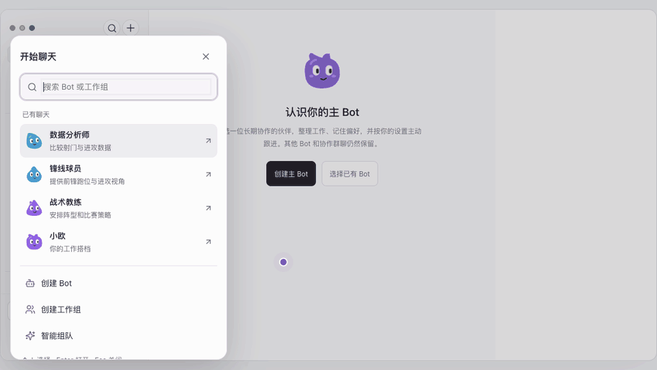
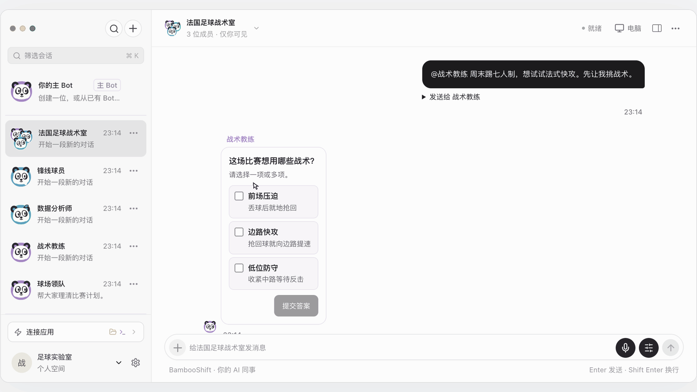
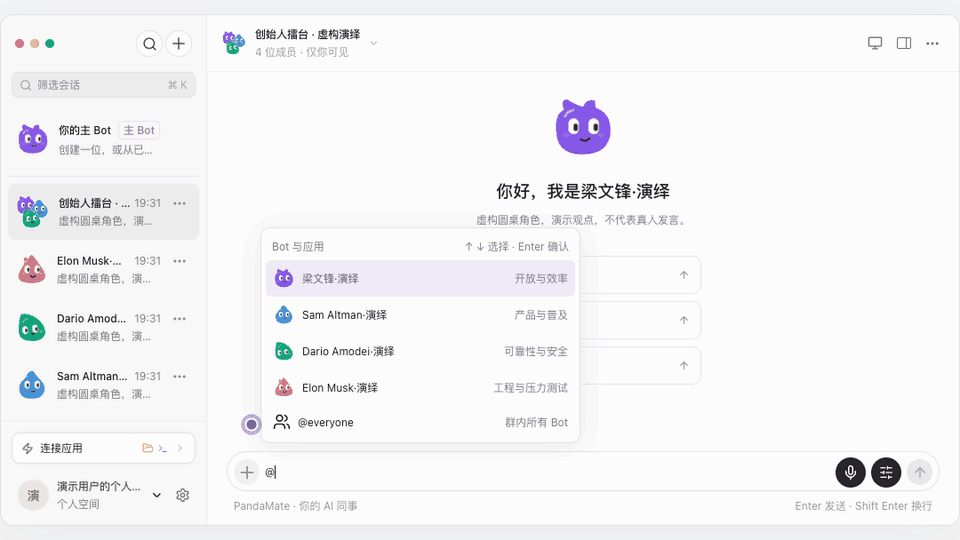
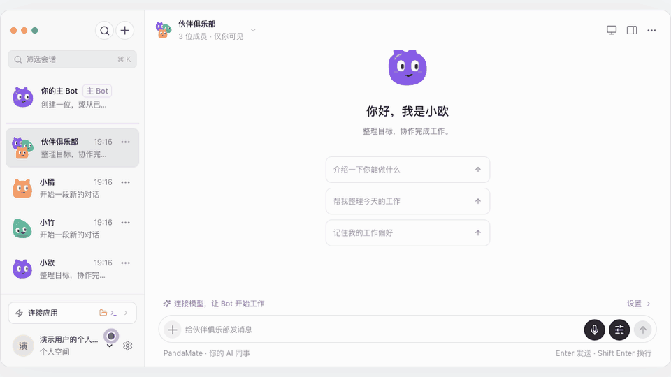
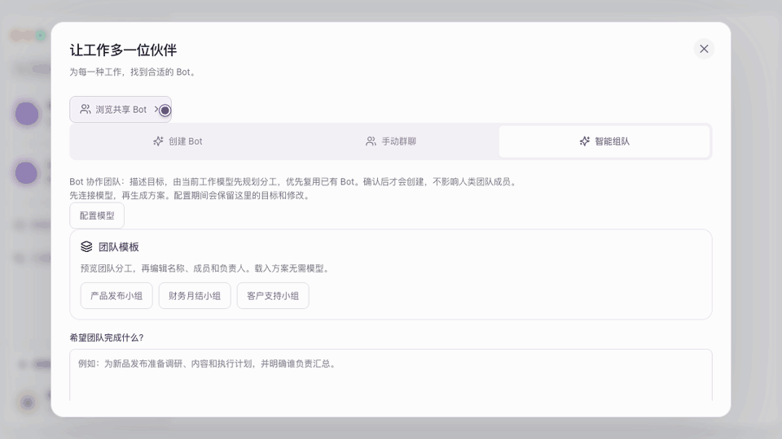
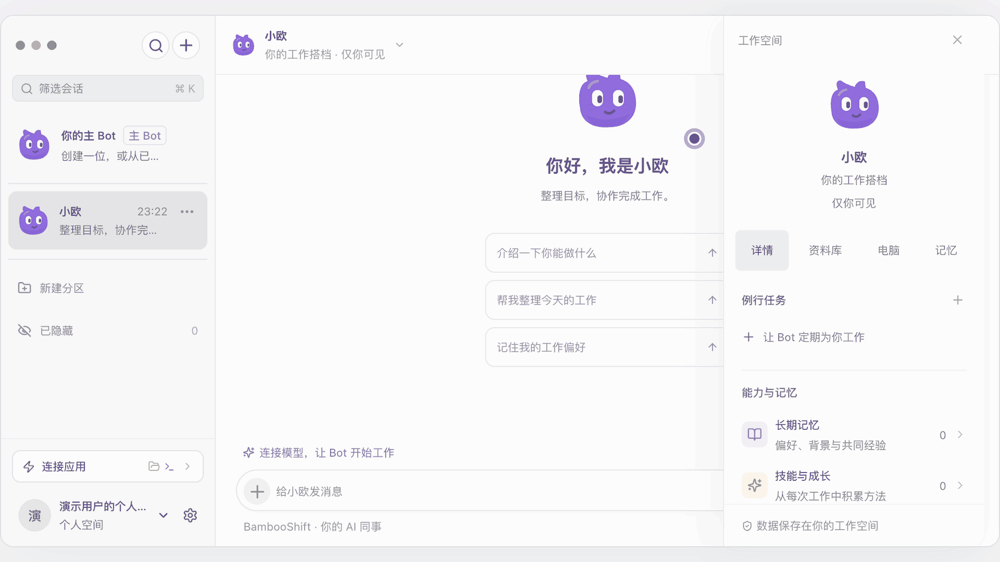
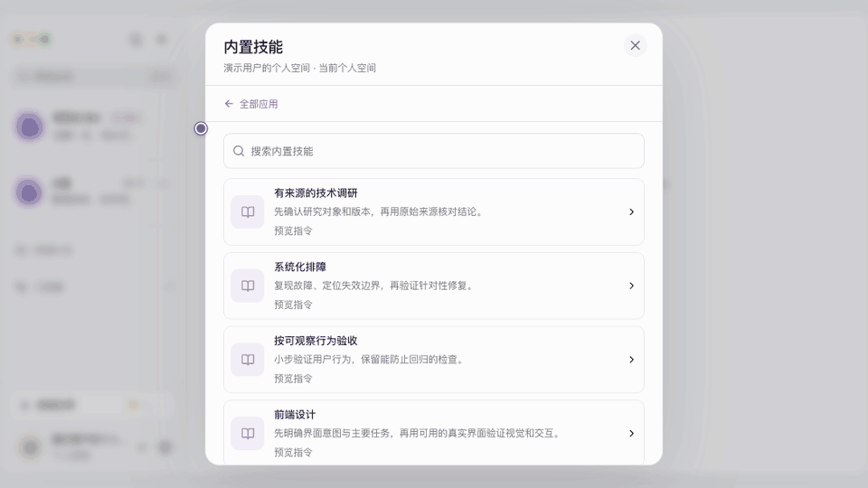

# PandaMate

简体中文 · [English](README.en.md)

**开源、自托管的 Grok Bot 平替。** PandaMate 是面向个人和团队的 AI 协作工作区。让不同的 AI 同事在同一群聊里分工，把重复工作安排成例行任务，在聊天里核对网页来源和预览交付物。

PandaMate is an open-source, self-hosted Grok Bot alternative for AI coworkers and multi-agent collaboration.

[快速开始](#快速开始) · [功能演示](#功能演示) · [创作者取材 · 28 秒脚本](#创作者取材) · [开发与部署](#开发与部署) · [源码导航](#源码导航) · [开源致谢](#开源致谢) · [贡献与许可](#贡献与许可)

## 快速开始

下载或克隆本仓库。安装 Rust 稳定工具链、Node.js 22.19 或更高版本（推荐 24）及 npm，然后在仓库根目录运行。

```sh
npm ci
npm run configure:local
npm run dev
```

1. 打开终端显示的产品地址，注册个人或团队账号。
2. 在工作空间的 **设置 → 模型配置** 填写模型服务地址、模型名称和 API Key。保存后点 **设为默认**。
3. 打开一个 Bot 会话，试试「查找 Pi Coding Agent 的官方文档，总结三个要点并附来源」。回复上方的检索记录可以展开。

`configure:local` 只用于首次创建本地配置。启动已有配置时直接运行 `npm run dev`。如果还要初始化独立的运营账户，首次启动改用 `npm run dev -- --init-operator`。 [运营入口与初始化](docs/operations-console.md)

## 能做什么

| 场景 | 功能 |
| --- | --- |
| AI 同事与多智能体协作 | 单聊、群聊、点名 Bot、角色模板、同事委派和问题卡。可以先预览个人 Bot 或团队草稿，再确认创建。 |
| 带来源的网页检索与交付 | 检索公开网页并回看来源。在聊天中预览文档、表格、媒体和多文件网站项目。 |
| 智能体工作流自动化与技能 | 设置例行任务的时间和时区，查看运行记录。把可复用的做法整理成技能，审核后交给 Bot。 |
| MCP 工具调用与人工审批 | 通过 Model Context Protocol（MCP）连接应用，按具体调用进行人工审批。部署者可分别配置浏览器操作、远程电脑和本地语音转写。 |

网页支持 PWA。桌面端和移动端连接同一套工作空间服务。先启动服务，再按客户端指南连接。 [Electron 桌面端](docs/desktop-client.md) · [Flutter 移动端](mobile/README.md)

## 功能演示

从教练、前锋和数据分析师开始，组一个足球战术室。



<details>
<summary>群聊与个性化 · 问题卡、多人演绎、头像主题</summary>

**临场改战术**。在问题卡勾选前场压迫和边路快攻，教练收到选择后继续布置战术。



**创始人擂台**。全体点名，四个虚构演绎角色各出一招，为同一台旧电脑设计 AI 助教。



**整队换装**。预览熊猫、恐龙、小鸡和大象主题，再回到群聊查看结果。



</details>

<details>
<summary>模板与自动化 · 团队、简报、技能</summary>

**团队模板**。查看三位 Bot 的分工，编辑后创建工作组。



**工作日简报**。选择任务频率和执行时间，核对下一次执行。



**调研技能**。预览内置指令，为指定 Bot 保存一份待审核草稿。



</details>

<details>
<summary>检索与交付 · 公开来源、网站预览</summary>

**网页检索**。展开聊天里的检索记录，核对已读网页和来源。


**多文件网站**。从聊天打开交付物，浏览页面，再切换到源码。


</details>

## 创作者取材

**28 秒短视频｜给 AI 球队一个临场难题**

开场口播「一支 AI 球队，能临场变阵吗？」

| 时间 | 画面与字幕 |
| --- | --- |
| 00–04 秒 | 先闪过教练的回复，配开场口播。字幕「我拉了一个 AI 足球群」。 [问题卡 GIF](docs/demo/chat-choices.gif) |
| 04–10 秒 | 从选角色剪到群聊创建完成。字幕「教练、前锋、数据分析师，就位」。 [组队 GIF](docs/demo/group-chat.gif) |
| 10–16 秒 | 勾选前场压迫和边路快攻，切到教练的续答。字幕「教练收到新战术」。 [问题卡 GIF](docs/demo/chat-choices.gif) |
| 16–22 秒 | 切到「伙伴俱乐部」演示，快切熊猫、小鸡和大象主题。字幕「全工作区一键换装」。 [头像主题 GIF](docs/demo/avatar-themes.gif) |
| 22–28 秒 | 停在换装后的群聊画面。片尾字幕「PandaMate · 开源、自托管」。 [头像主题 GIF](docs/demo/avatar-themes.gif) |

竖屏版可裁到当前操作区，保留角色名、选项和按钮。

**另一条选题｜四位创始人角色，一台旧电脑。** 用 `@everyone` 给四位演绎角色发同一道题「一台旧电脑，怎么做个乡村 AI 助教？每位出一招。」剪出不同角色的回答，结尾请观众选一份方案。 [创始人擂台 GIF](docs/demo/founder-debate.gif)

## 开发与部署

Rust 服务负责身份、权限、业务数据和调度，使用 SQLite 保存状态。Pi 提供 Bot 的智能体执行框架（agent harness）。MCP、文档解析和电脑操作由独立进程处理。React 产品站点和运营站点分别构建，使用不同的 API 入口与登录会话。 [架构](docs/architecture.md)

| 命令 | 用途 |
| --- | --- |
| `npm run build` | 编译 Rust 服务，构建产品站点和运营站点 |
| `npm start` | 使用本地配置启动已构建的服务 |
| `npm run client:dev` | 运行 Electron 客户端并连接产品服务 |
| `npm test` | 运行后端、网页、执行进程与桌面客户端测试 |
| `npm run check:source` · `npm run check:privacy` | 检查源码规范与发布范围内的隐私信息 |
| `npm run backend:package -- --release --out release/backend` | 组装当前平台的发布包 |

生产部署使用 HTTPS。分别配置产品与运营入口，并把数据目录放在发布包外。模型、第三方应用、远程电脑与本地语音各有配置要求。Flutter 提供 Android 和 iOS 源码及测试流程，原生安装和真机验证单独进行。 [服务部署](server/api/deployment/README.md) · [源码发布](docs/source-release.md) · [验证范围](docs/verification.md)

## 源码导航

开发者和 AI 智能体可以按改动范围定位入口、实现和相关检查。

| 改动范围 | 从这里开始 | 相关检查 |
| --- | --- | --- |
| 产品界面 | [网页入口](web/src/main.tsx)、[界面源码](web/src/)、[静态资源](web/public/) | `npm run test:web` |
| 独立运营站 | [运营入口](operations/main.tsx)、[运营页面](operations/src/) | `npm run build:operations` |
| Rust API、权限与持久化 | [服务入口](server/api/src/main.rs)、[API 实现](server/api/src/)、[集成测试](server/api/tests/) | `npm run backend:test` |
| Pi、MCP、文档及电脑执行 | [server/workers/](server/workers/) 与 [server/native/](server/native/) | `npm run test:runtime` |
| Electron 与 Flutter | [desktop/](desktop/) 与 [mobile/](mobile/) | `npm run client:test` · [Flutter 检查](mobile/README.md#develop-and-verify) |
| 跨端类型与协议 | [shared/](shared/) | `npm run test:web` · `npm run test:runtime` |
| 构建、导出与隐私检查 | [scripts/](scripts/) 与 [scripts/source/](scripts/source/) | `npm run check:source` · `npm run check:privacy` |

开发命令定义在 [package.json](package.json)，持续集成流程位于 [.github/workflows/ci.yml](.github/workflows/ci.yml)。权限和任务状态由 Rust 服务判定。涉及权限或数据写入的改动，可沿 API、持久化与测试核对行为。 [贡献指南](CONTRIBUTING.md)

## 数据与外部服务

工作空间数据存储在部署者管理的服务上。模型请求发送给配置的模型服务。公开检索将关键词或公开链接发给 Exa，连接应用和执行电脑则使用各自配置的目标与权限。部署配置、模型密钥、运行数据和浏览器资料应保存在源码版本控制之外。 [外部应用](docs/app-connections.md) · [安全说明](SECURITY.md)

## 开源致谢

感谢以下上游项目的维护者和贡献者。

| 用途 | 上游项目与组件 |
| --- | --- |
| 智能体执行与工具接入 | [Pi Coding Agent](https://github.com/earendil-works/pi) 提供 Bot 执行框架，[MCP TypeScript SDK](https://github.com/modelcontextprotocol/typescript-sdk) 用于连接外部工具。 |
| 服务端与存储 | [Tokio](https://tokio.rs/) 和 [Axum](https://github.com/tokio-rs/axum) 支撑 Rust 服务，[SQLx](https://github.com/transact-rs/sqlx) 访问 [SQLite](https://sqlite.org/)。 |
| 网页、桌面与移动端 | [React](https://react.dev/) 和 [Vite](https://vite.dev/) 用于网页开发和构建，[Electron](https://www.electronjs.org/) 和 [Flutter](https://flutter.dev/) 分别用于桌面端和移动端。 |
| 文档、图标与字体 | [PDF.js](https://mozilla.github.io/pdf.js/) 和 [Mammoth.js](https://github.com/mwilliamson/mammoth.js) 用于文档预览与解析，[Lucide](https://lucide.dev/) 提供界面图标。Flutter 网页端的中文字体派生自 [Noto Sans SC](https://fonts.google.com/noto/specimen/Noto+Sans+SC)。 |
| 可选执行环境 | [Playwright](https://playwright.dev/) 和 [Chromium](https://www.chromium.org/) 用于浏览器操作，[whisper.cpp](https://github.com/ggml-org/whisper.cpp) 用于本地语音转写。 |

PandaMate 是独立开发的项目。作为产品参照，可查阅 [Grok Bot 官方介绍](https://x.ai/news/introducing-grok-bot)。

依赖版本由锁文件记录，各依赖保留原许可证。服务发布包包含所编译 Rust 与网页依赖的许可清单。 [NOTICE](NOTICE) · [第三方许可](THIRD_PARTY.md)

## 贡献与许可

欢迎提交缺陷复现、文档补充与代码改进。请使用示例数据复现问题，并注明相关验证。 [贡献指南](CONTRIBUTING.md)

PandaMate 源码采用 [Apache License 2.0](LICENSE)。
