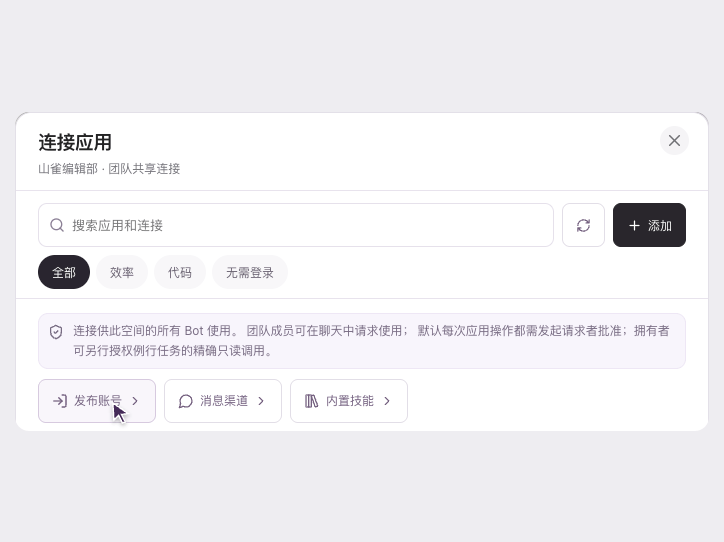

# aihubot


简体中文 · [English](README.md)

aihubot 是一个可以自托管的 AI 团队工作空间。让 Bot 做一个网站，它会把可打开的成品交回聊天。改过几轮后，你仍然能打开第一版，查看哪些文件变了，再回到当时的讨论继续改。交付也可以是一份可复核的数据报告。例如给 Bot 一份 CSV，它会按已安装技能的说明运行包内脚本，把退出码和统计结果交给你。

[试玩「星港降落」](https://zhiruiai.github.io/aihubot/zh.html) · [下载客户端或服务端](https://github.com/zhiruiai/aihubot/releases/latest) · [启动工作空间](#快速开始) · [试装数据质量核对](#给-bot-装一项技能)


## 快速开始

**想先看看效果**，打开上面的「星港降落」。浏览器会直接运行一份已经交付的五文件小游戏，无需登录。这个可玩的示例来自预设对话。要发自己的任务，请打开一个工作空间并连接模型。

### 支持的平台

- **已有团队服务**。在电脑或手机浏览器打开管理员提供的产品地址。Windows x64 和 Apple 芯片 Mac 也可以下载连接客户端，选择「连接已有工作空间」。Windows 用户需完整解压 ZIP 后运行 `aihubot.exe`。[桌面客户端说明](docs/desktop-client.md)
- **自己部署服务**。Linux x64 发布包包含 Rust 服务、网页和执行任务的 Worker。准备 Node.js 22.19 或以上版本，按部署指南安装运行依赖、配置私有数据目录，再启动服务。Android 和 iOS 也提供 Flutter 源码。[Linux 安装指南](server/api/deployment/README.md#install-and-configure) · [移动端源码](mobile/README.md)
- **在这台 Mac 上执行任务**。含内置运行环境的 macOS 客户端可以选择「在这台电脑开始」，直接打开个人空间，免注册。它会在本机启动 Rust 服务和 Pi，退出应用时本机任务停止。这个版本目前通过源码构建，公开发布的 Mac ZIP 需要连接已有服务。[桌面构建与本机权限](docs/desktop-client.md) · [Apple 芯片 Mac 的构建材料](docs/native-image-runtime.md)

### 从源码启动

准备稳定版 Rust、Node.js 22.19 或以上版本（推荐 24）和 npm。在终端运行以下命令。

```sh
git clone https://github.com/zhiruiai/aihubot.git
cd aihubot
npm ci
npm run configure:local
npm run dev
```

打开终端显示的产品地址，注册个人或团队账号。在 **设置 → 模型配置** 填写服务地址、模型名称和 API Key，保存后点 **设为默认**。Bot 会使用这个模型，你也可以在某个 Bot 的设置里单独指定。再次启动已有空间时，直接运行 `npm run dev`。

### 试做第一个任务

在 Bot 单聊发送下面这段话。收到回复后，点文件卡片查看清单。然后告诉同一个 Bot「时间定在周四下午，请更新清单」，看看新交付如何保留了上次的讨论。

> 把这三条模拟会议笔记整理成 Markdown 行动清单，并在聊天里交付文件。周三交脚本，由编辑负责。周五交封面，由设计师负责。下一次评审的时间待定。

如果只是想用本地示例验证一次文件交付，装好依赖后也可以运行 `npm run dev:preview`。这条命令使用临时工作空间和脚本化模型，无需模型密钥。[示例账号和第一条消息](CONTRIBUTING.md#run-a-sample-task-locally)

## 给 Bot 装一项技能

以「数据质量核对」为例。工作空间拥有者可以在网页或桌面客户端完成安装。

1. 打开目标 Bot 的设置，点 **选择与管理技能 → 从技能库选择**，搜索「数据质量核对」。
2. 打开技能包，展开 **查看技能指令与文件**。这个包一共有四个文件。可以先读 `SKILL.md`，再展开 `scripts/profile_csv.py` 看它怎样识别重复主键和列数异常。另两个文件是核对清单和异常记录模板。
3. 点 **安装技能**，看到「已为……启用」后点 **完成**。客户端会打开刚安装的版本。标题下能看到启用状态、版本号和 Bot 名称，点 **SKILL.md** 或 **文件** 即可复查。以后更新技能时，旧版会保留在历史记录。

**亲自跑一次。** 准备一台装有 Python 3 的 Mac。在含内置运行环境的客户端启动页勾选「允许整机操作」，再点「在这台电脑开始」以启用本机命令。将下面四行保存为 `orders.csv`，附在该 Bot 的单聊中。输入 `/` 选「数据质量核对」，再发送「请按 order_id 核对附件，运行技能包内的脚本，把结果发回来」。

```csv
order_id,amount
A101,20
A101,20
A102,30,extra
```

这份样例应得到 3 行记录，其中 1 行主键重复、1 行列数异常。默认按次确认时，在聊天里核对脚本请求并批准。执行回执会显示退出码与实际输出。在 **电脑 → 电脑默认权限** 选择「完全授权」后，该空间拥有者在这台电脑上发起的后续任务会沿用授权。普通命令无需录屏。点按 Mac 原生应用的控件需要系统辅助功能权限，通过整机画面操作另需屏幕录制权限。[脚本运行条件](docs/bot-models-and-skills.md#run-a-bundled-script-on-this-mac) · [Mac 应用权限](docs/desktop-client.md#mac-应用)

已有技能可以用 **导入技能文件夹** 选择含 `SKILL.md` 的目录，连同脚本、参考资料和资源一起安装。也可以请技能专家搜索内置目录，或为当前 Bot 制作多文件技能草稿，由拥有者审阅后启用。前端设计和 Superpowers 工程实践包保留了上游说明与许可证。[Agent Skills 包的导入与版本管理](docs/bot-models-and-skills.md) · [上游来源清单](legal/third-party/community-skills/SOURCES.json)

## 让 Bot 对外发帖

在桌面端或网页端打开 **连接应用 → 发布账号**，选择平台和本地 Bot，在它的工作浏览器中私密接管并登录。归还控制后，可以直接在聊天里说「把这次数据质量核对写成知乎文章，先存草稿」，也可以明确指定账号、稿件和平台，让 Bot 发布。工作浏览器会在登录有效期间复用会话。



| 平台 | 可以交给 Bot 的任务 |
| --- | --- |
| **小红书** | 在聊天中附一张封面。Bot 把选中的图片传到图文编辑器，填写标题、正文并核对缩略图。[图文笔记流程](docs/capabilities-and-protocols.md#小红书图文笔记) |
| **知乎** | 把技术结论、代码示例和来源整理成文章，核对编辑器预览和文章回执。[技术文章流程](docs/zhihu-articles.md) |
| **CSDN、头条号、DEV Community、Medium、WordPress.com** | 打开预置的官方创作入口，按当前编辑器填写内容，核对作者、站点、受众及提交结果。 |
| **自定义创作网站 / Discourse 论坛** | 拥有者可以保存其他平台的 HTTPS 创作地址。提供发帖工具的 Discourse 论坛也可以通过 MCP 连接，在聊天里批准创建主题或回帖。[论坛接入](docs/app-connections.md#discourse-论坛发帖) |

同一份稿件可以分别投到多个平台。Bot 按站点回报草稿、待审核、已公开或结果待核对，附上平台实际返回的作品链接。网页编辑器和可用操作取决于账号权限、内容类型及平台规则。[账号设置、覆盖范围与回执](docs/publishing.md)

## 功能演示

以下四段实录来自独立的 macOS 本机工作空间，使用内置 Rust 服务、真实模型和虚构业务数据。动画省略了等待与调试时间。[录制说明与文件校验](docs/demo/recordings.json)

- **网站交付与修改**。回放五次已保存的交付，打开「变更」核对有哪些文件增删改。切回第一版，再回到交付它的线程继续提要求。[看网站版本实录](docs/demo/website-delivery.gif)
- **三位 Bot 做同一个任务**。从团队模板查看分工，打开群聊，观察三位成员怎样分别回应。[看团队实录](docs/demo/team-templates.gif)
- **核对一份 CSV**。查看四文件技能包及其脚本，再核对执行结果。录制使用的数据有 10 行，其中 2 行主键重复、2 行列数异常。[看数据核对实录](docs/demo/skill-library.gif)
- **把一次做法变成可复用的技能**。审阅 Bot 编写的四文件预算核对包，恢复已审过的第 4 版，然后执行示例。预算为 3500，实际为 3010，差额为 490。[看技能制作与执行实录](docs/demo/skill-creation.gif)

要组建自己的团队，可以从侧栏的 **Bot 广场** 预览现成 Bot、团队及各自的技能，也可以用 `@招聘助理` 描述要补的角色，然后确认它拟好的配置。新建的本地 Bot 自带联网检索、浏览器操作、本机电脑操作和 Agent Desktop 四个基础技能包。需要外部 CLI、设备权限或账号的工具各有自己的配置入口。[Bot 和团队模板](docs/bot-templates.md) · [电脑的执行位置](docs/computer.md#选择执行位置)

## 技术栈与架构

Web/PWA 和 Electron 共用 React 界面。聊天请求先到 Rust/Axum 服务，由它管理工作空间、权限、任务状态和 SQLite 数据。Pi 在独立的 Node.js 进程中调用工作空间配置的模型，需要操作工具时交给 Rust 检查权限。执行回执、文件和网站版本都会回到相应的会话。[架构与数据流](docs/architecture.md) · [网站预览与历史版本](docs/file-previews.md)

业务工具通过 MCP 连接，工作空间可列出并调用已授权服务的工具。飞书、钉钉和企业微信的双向文本桥接目前是独立的开发者入口，已有协议测试，实网企业账号尚待验证。跨服务的 Agent2Agent（A2A）处于设计阶段。[协议实现范围](docs/capabilities-and-protocols.md) · [企业消息桥接](docs/im-connectors.md) · [A2A 提案](docs/bot-federation.md)

修改产品界面从 `web/src/` 开始，任务状态与权限检查在 `server/api/`，工具执行代码在 `server/workers/`。运行 `npm test` 可检查后端、Web、Worker 和桌面端，`npm run build` 会构建服务与前端。[开发命令](package.json) · [验证范围](docs/verification.md)

## 贡献与许可

欢迎带一份可复现的任务、布局问题或文档修正来参与。报告技能问题时，写明平台、技能版本和期望输出，示例附件请使用虚构数据。[贡献指南](CONTRIBUTING.md) · [提交问题](https://github.com/zhiruiai/aihubot/issues) · [安全问题报告](SECURITY.md)

aihubot 的原创代码采用 MIT 许可。Pi、MCP SDK、Cordis、社区技能和其他依赖保留各自的许可与署名。[MIT 许可证](LICENSE) · [NOTICE](NOTICE) · [第三方许可](THIRD_PARTY.md)
