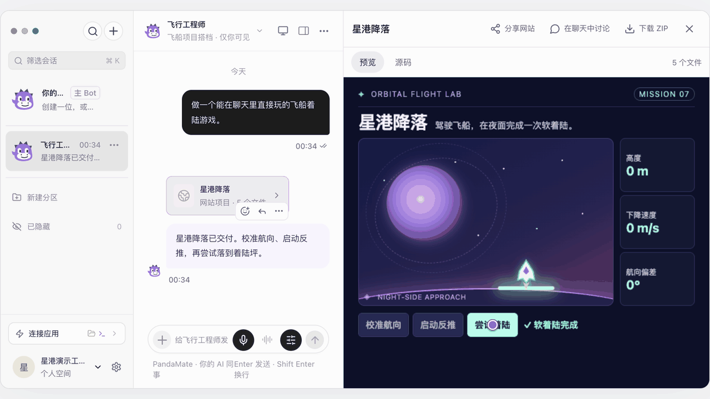
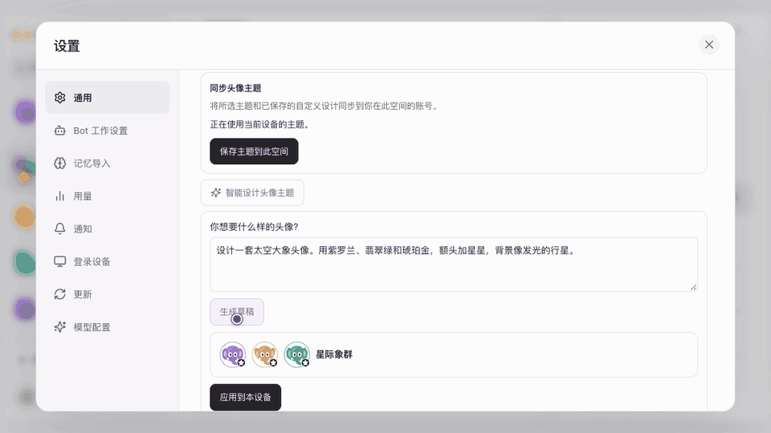
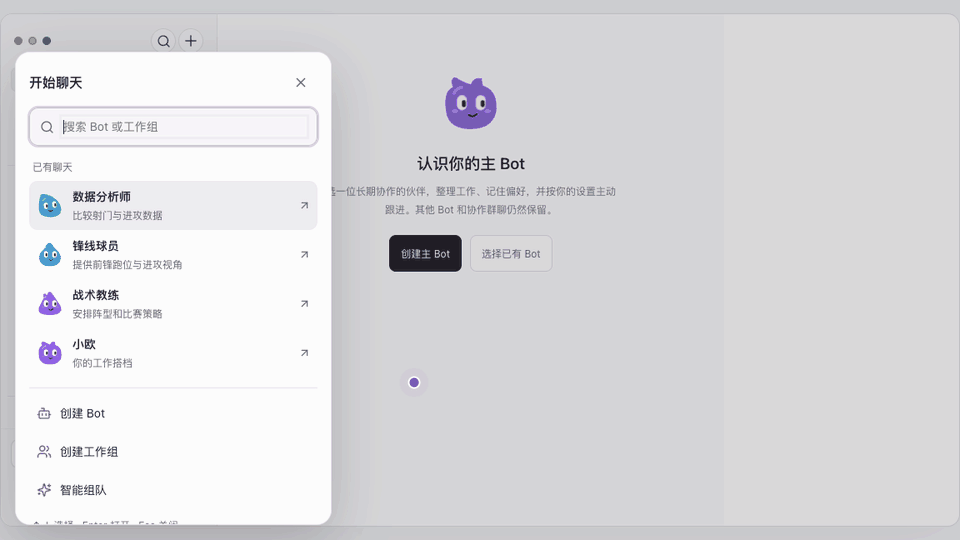
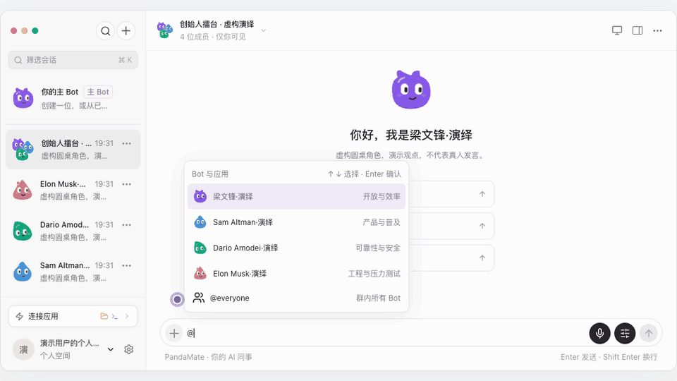
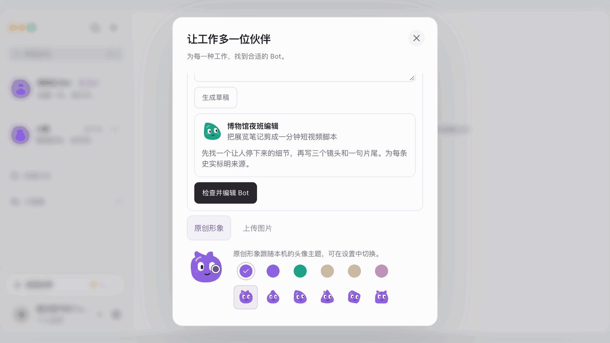
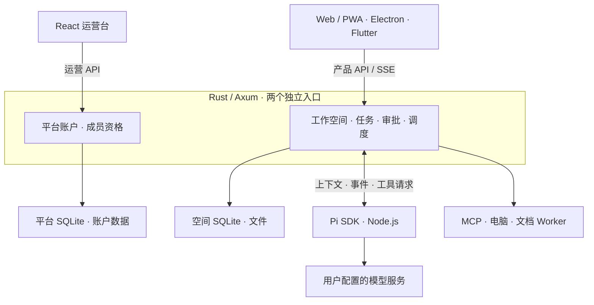

# BambooShift

简体中文 · [English](README.md)

**BambooShift是开源自托管的 AI 同事团队。** 作为 Grok Bot 平替，你可以在聊天里组队派活、审批操作，直接打开同事交付的网站和文件。Pi 驱动任务委派、联网调研和电脑操作。

**[直接试玩](https://zhiruiai.github.io/BambooShift/zh.html)** · **[下载最新版本](https://github.com/zhiruiai/BambooShift/releases/latest)** · **[支持的平台](#支持的平台)** · **[启动工作空间](#快速开始)** · **[参与共建](CONTRIBUTING.md)** · [技术栈与架构](#技术栈与架构) · [更多演示](#功能演示) · [创作者取材](#创作者取材)

**给一队 AI 同事一句话，拿到点开就能玩的小游戏。** 在星港任务小队打开交付卡，切到源码查看五个文件，再回到预览操纵飞船完成软着陆。



以下演示在独立工作区录制，使用示例对话、文件和预设的模型回复。

## 支持的平台

| 平台 | 怎么用 |
| --- | --- |
| **Web / PWA** | Windows、macOS、Linux 和移动浏览器可打开工作空间。浏览器支持时可安装 PWA。 |
| **Windows x64** | 选择提供 Windows x64 客户端 ZIP 的版本，完整解压后运行 `BambooShift.exe`。便携包未签名，需要连接已有服务。 [Windows 使用说明](docs/desktop-client.md#windows-x64) |
| **macOS Apple Silicon** | 下载桌面 ZIP 并连接运行中的服务。应用托管的个人空间是源码预览，尚未提供正式下载。客户端采用临时签名。 [桌面连接说明](docs/desktop-client.md) |
| **Linux x64** | 发布页提供预编译服务端。按包内 README 安装，再通过浏览器进入工作空间。 [服务部署](server/api/deployment/README.md) |
| **Android / iOS** | 通过移动浏览器使用。原生 Flutter 客户端以源码提供。 [移动端源码](mobile/README.md) |

网页、Flutter 和连接服务的桌面端共享已部署的工作空间。桌面端单独启动的个人空间将数据保存在当前电脑。 [最新发布](https://github.com/zhiruiai/BambooShift/releases/latest)

## 快速开始

已有服务的用户可以在浏览器打开工作空间，或将桌面客户端连接到服务地址。首次自托管可[安装 Linux x64 服务包](server/api/deployment/README.md#install-and-configure)，也可以从下方的源码步骤启动。

### 本机个人空间预览

桌面源码已包含应用托管的个人空间：点击 **在这台电脑开始**，配置 **设置 → 模型配置** 后无需账户密码即可使用。源码集成验证已覆盖启动及模型配置恢复。完整安装包仍在补齐原生依赖再分发材料和打包验收，严格打包检查目前会阻止发布，尚未提供正式下载。当前请使用下方源码启动方式或已发布的连接客户端。 [桌面说明与平台支持](docs/desktop-client.md)

### 从源码启动

下载或克隆本仓库。安装 Rust 稳定工具链、Node.js 22.19 或更高版本（推荐 24）及 npm，然后在仓库根目录运行。

```sh
npm ci
npm run configure:local
npm run dev
```

1. 打开终端显示的产品地址，注册个人或团队账号。
2. 在工作空间打开 **设置 → 模型配置**，填写模型服务地址、模型名称和 API Key。保存后点 **设为默认**。
3. 打开一个 Bot 单聊，复制下面的示例，完成第一次文件交付。
4. 如果服务能通过 HTTPS 访问 Exa，在该空间的 Bot 单聊试试「查找 Pi Coding Agent 的官方文档，总结三点并附来源」。展开回复上方的检索记录可以核对来源。 [联网检索配置](server/api/deployment/README.md#execution-boundary)

`configure:local` 用于首次创建本地配置。已有配置时直接运行 `npm run dev`。首次初始化独立运营账户时，运行 `npm run dev -- --init-operator`。 [运营入口与初始化](docs/operations-console.md)

### 试做第一个任务

把这条消息贴进 Bot 单聊，然后打开回复里的交付文件查看行动清单。

```text
把这三条模拟会议笔记整理成 Markdown 行动清单，列出负责人、截止时间和待确认事项。
林晓周三提交脚本，李宁周五完成封面，发布时间待全组确认。请在聊天里交付文件。
```

### 给 Bot 装一项技能

在 Bot 设置中选择技能，或在网页、桌面端打开 **连接应用 → 内置技能**。预览工作指令并为该 Bot 保存草稿。审核通过后，在该 Bot 的单聊输入 `/` 来选择技能。Flutter 客户端可从输入区打开 **+ → 使用技能**。Bot 会在这轮任务中使用选中的已审核指令。

Web、桌面和 Flutter 的 Bot 技能编辑器均可通过 **导入 SKILL.md** 读取本地技能文件。核对导入的指令后，保存草稿并审核启用。

每个 Bot 也能选择独立模型或继承空间默认模型，群聊委派同样生效。中英文技能库包含网页流程验收、代码安全审查、产品文档写作、团队决策简报，以及调试、交接和 Agent Desktop 操作指导。Agent Desktop 需要在已授权的执行电脑上另行安装 CLI；选择技能不会安装程序
或开启整机访问。[各 Bot 的模型、技能与使用条件](docs/bot-models-and-skills.md)

### 选择本机或云端工作电脑

- **本机浏览器。** 「设置 → 电脑 → 本机」使用服务所在电脑的隔离浏览器。客户端与服务在同一台电脑时，浏览器就在当前设备运行。
- **Mac 原生应用。** 使用含内置运行环境的 macOS 客户端，启动本机空间时勾选 **允许整机操作**。授予屏幕录制和辅助功能权限，再在会话电脑面板启用桌面操作。已部署的空间也可连接专用 Worker。 [Mac 整机操作](docs/desktop-client.md#macos-整机操作)
- **云端执行。** 使用部署者已绑定的云电脑，或连接自己在另一台电脑、云服务器上运行的 Worker。 [选择执行位置](docs/computer.md#选择执行位置)

想收藏项目，可以点 Star。想收到发版提醒，可选 **Watch → Custom → Releases**。欢迎在 [Issues](https://github.com/zhiruiai/BambooShift/issues) 分享第一个任务，或用[安装与兼容性表单](https://github.com/zhiruiai/BambooShift/issues/new?template=installation.yml)反馈问题。

## 功能演示

### 学习、创作与办公

| 场景 | 看点 | 演示 |
| --- | --- | --- |
| 课后探险队 | 把等值分数做成披萨实验，点错一题，再用两片四分之一拼出半张。 | [披萨分数实验室](docs/demo/pizza-fractions.gif) |
| 短视频制作组 | 一滴水、一个手机、三个镜头。在网页交付里切换分镜和口播。 | [一滴水的电影](docs/demo/short-video-storyboard.gif) |
| 会议行动组 | 从模板建立小组，把虚构会议纪要变成可核对的负责人、截止时间和行动清单。 | [会议行动清单](docs/demo/meeting-actions.gif) |

在 **Bot 模板库 → 团队模板** 可以找到这三组角色，改分工后再创建。头像也会随状态变化：[待机、工作、等你回答和完成](docs/demo/avatar-states.gif)。

<details>
<summary>三个短视频案例 · 星际象群、足球战术、创始人擂台</summary>

**给工作区换一支星际象群。** 描述你想要的太空大象头像，预览生成的配色，保存后回到工作区看角色换装。



**七人制足球，怎么踢出法式快攻？** 把教练、前锋和数据分析师拉进一个群。在问题卡选中前场压迫和边路快攻，看教练根据选择安排打法。



[看教练收到战术选择后的续答](docs/demo/chat-choices.gif)

**创始人擂台。** 用 `@everyone` 问四位演绎角色「一台旧电脑，怎么做 AI 助教？」对照各自从产品、效率、安全和工程出发的点子。



</details>

<details>
<summary>更多演示 · 用一句话招同事、组队、定时简报、技能、检索与交付</summary>

**博物馆夜班编辑。** 描述你需要怎样的短视频编导，核对生成的 Bot 档案，改名后打开新会话。



**给全队换头像。** 在熊猫、恐龙、小鸡和大象之间切换，看看整个群聊的变化。 [头像主题 GIF](docs/demo/avatar-themes.gif)

还可选择两套离线社区系列：**Open Bot Avatar 的 22 款角色**和**社区 GrokBot 的 18 款造型**，保留各自眼型与 Bot 颜色，在网页、客户端和移动端分组选择。[系列说明与许可](shared/avatar-packs/README.md)

**给新品发布拉一支小队。** 从团队模板接手三位有分工的 Bot，调整群名并创建群聊。 [团队模板 GIF](docs/demo/team-templates.gif)

**把工作日简报排进日历。** 设好星期和时间，在例行任务里核对下次执行。 [定时简报 GIF](docs/demo/scheduled-brief.gif)

**让下次调研也带上来源。** 预览内置技能的核对步骤，并给指定 Bot 保存待审核草稿。 [技能草稿 GIF](docs/demo/skill-library.gif)

**顺着答案去找原文。** 展开检索记录，核对 Bot 访问过的网页。 [网页检索 GIF](docs/demo/web-research.gif)

**一间可以点进去的书店。** 打开多文件网站，进入书单，再切到源码看样式文件。 [网站预览 GIF](docs/demo/website-preview.gif)

</details>

## 能做什么

如果你用过 Grok Bot，可以按下面的顺序开始。在同一个工作空间完成组队、审批、接管和交付。

| 要做什么 | 在 BambooShift 中怎么做 |
| --- | --- |
| 组队并派任务 | 从 Bot 或团队模板开始，也可以用一句话生成草稿。通过单聊、群聊和 `@` 点名安排工作，Bot 也能把任务交给同事。 [团队配置](docs/bot-settings-and-teams.md) |
| 让 Bot 搜索、用应用和电脑 | Bot 可以搜索公开网页并附来源，或通过 Model Context Protocol（MCP）调用已连接应用。在「设置 → 电脑」可用服务所在电脑的隔离浏览器、已配置的云电脑或配对 Worker。 [电脑设置](docs/computer.md) |
| 审批操作或接管 | 需要确认时，在原消息查看请求并审批。打开 Bot 画面可以查看进度。私密接管期间，Bot 暂停观察和输入。 |
| 拿到能用的交付物 | 在聊天里直接打开文档、表格、媒体和多文件网站。网站可以试玩、切换到源码或下载整个项目。 [文件预览](docs/file-previews.md) |
| 把做法变成技能和例行任务 | 审核后启用可复用的智能体技能。按时区定时运行，或用 Webhook 触发工作，把结果送回原会话。 [Webhook](docs/routine-webhooks.md) |

## 技术栈与架构

BambooShift 把模型推理、工作空间权限和电脑执行分开。你在群聊里发出任务后，Rust 按当前空间的配置启动 Pi。Pi 流式返回消息和工具请求，需要审批的操作会留在聊天里。执行结果和交付文件回到原会话，网站交付物可以当场预览、试玩或查看源码。



| 层 | 技术与职责 |
| --- | --- |
| 用户界面 | React、TypeScript、Vite 构建网页和 PWA。Electron 可连接已有服务，也可启动内置个人空间。Flutter 提供移动端源码。 [Web](web/src/) · [桌面](desktop/) · [移动端](mobile/) |
| API 与持久化 | Rust、Axum、Tokio 和 SQLx/SQLite 管理身份、空间数据、会话事件、审批回执和例行任务。产品与运营入口使用独立会话。 [Rust 服务](server/api/) |
| 智能体运行时 | 受监督的 Node.js Worker 通过 Cordis 加载经过审查的引擎插件。Pi Coding Agent 是当前唯一内置的生产实现，SDK 和会话生命周期封装在引擎接口后；Rust 管理任务预算、委派和权限。 [引擎契约](server/workers/plugin-runtime/README.md) · [Pi 实现](server/workers/engines/pi/) |
| 工具与执行 | 独立 Worker 负责 MCP、文档解析和电脑操作。Playwright 驱动隔离浏览器。内置 macOS 运行环境用 Cua Driver 执行用户主动启用的桌面操作，Rust 核验审批与执行目标。 [执行层](server/workers/) · [电脑设置](docs/computer.md) |

[完整架构与权限边界](docs/architecture.md) · [桌面与云端执行](docs/architecture.md#desktop-and-cloud-execution) · [源码发布与验证](docs/source-release.md)

## 创作者取材

### 20 秒｜聊天里飞进一座星港

开场口播「我让 AI 同事交付一个小游戏，聊天里就能试玩。」

| 时间 | 画面与字幕 |
| --- | --- |
| 00–03 秒 | 先闪过飞船即将着陆的画面。字幕「聊天里也能开飞船？」 |
| 03–08 秒 | 回到对话，展示需求和网页交付卡，点开预览。字幕「交付的是可以打开的网页」。 |
| 08–16 秒 | 剪进飞船下降和调整操作，留出一拍给触地。字幕「调整推力，准备着陆」。 |
| 16–20 秒 | 停在着陆结果上。片尾字幕「BambooShift · 开源、自托管」。 |

[星港降落 GIF](docs/demo/orbital-landing.gif)

### 28 秒｜让 AI 教练为七人制足球安排法式快攻

| 时间 | 画面与字幕 |
| --- | --- |
| 00–04 秒 | 闪过教练的续答。开场口播「一支 AI 球队，会怎么安排法式快攻？」 [问题卡 GIF](docs/demo/chat-choices.gif) |
| 04–10 秒 | 选角色并创建群聊。字幕「教练、前锋、数据分析师，就位」。 [组队 GIF](docs/demo/group-chat.gif) |
| 10–18 秒 | 勾选前场压迫和边路快攻，切到教练的续答。字幕「教练收到新战术」。 [问题卡 GIF](docs/demo/chat-choices.gif) |
| 18–28 秒 | 快切熊猫、小鸡和大象主题，以换装后的群聊收尾。 [头像主题 GIF](docs/demo/avatar-themes.gif) |

另一个选题是「四位创始人角色，一台旧电脑」。让每位角色各出一招，结尾请观众选择一份方案。 [创始人擂台 GIF](docs/demo/founder-debate.gif)

剪成竖屏时，将画面裁到正在操作的区域。保留交付卡上的按钮、群聊角色名和着陆结果，便于观众在静音时看懂。

## 开发与部署

| 命令 | 用途 |
| --- | --- |
| `npm run build` | 编译 Rust 服务，构建产品站点和运营站点 |
| `npm start` | 使用本地配置启动已构建的服务 |
| `npm run client:dev` | 运行 Electron 客户端并连接产品服务 |
| `npm test` | 运行后端、网页、执行进程与桌面客户端测试 |
| `npm run check:source` · `npm run check:privacy` | 检查源码规范与发布范围内的隐私信息 |
| `npm run backend:package -- --release --out release/backend` | 组装当前平台的发布包 |

生产部署使用 HTTPS。分别配置产品与运营入口，并把数据目录放在发布包外。模型、第三方应用、远程电脑与本地语音各有配置要求。Flutter 提供 Android 和 iOS 源码及测试流程，原生安装和真机验证单独进行。 [服务部署](server/api/deployment/README.md) · [源码发布](docs/source-release.md) · [验证范围](docs/verification.md)

首版和每日构建的下载包由 GitHub Actions 生成。 [自动发布与下载包说明](docs/source-release.md#github-自动发布)

## 源码导航

开发者和 AI 智能体可以按改动范围定位入口、实现和相关检查。

| 改动范围 | 从这里开始 | 相关检查 |
| --- | --- | --- |
| 产品界面 | [网页入口](web/src/main.tsx)、[界面源码](web/src/)、[静态资源](web/public/) | `npm run test:web` |
| 独立运营站 | [运营入口](operations/main.tsx)、[运营页面](operations/src/) | `npm run build:operations` |
| Rust API、权限与持久化 | [服务入口](server/api/src/main.rs)、[API 实现](server/api/src/)、[集成测试](server/api/tests/) | `npm run backend:test` |
| Pi、MCP、文档及电脑执行 | [server/workers/](server/workers/) 与 [server/native/](server/native/) | `npm run test:runtime` |
| Electron 与 Flutter | [desktop/](desktop/) 与 [mobile/](mobile/) | `npm run client:test` · [Flutter 检查](mobile/README.md#develop-and-verify) |
| 跨端类型与协议 | [shared/](shared/) | `npm run test:web` · `npm run test:runtime` |
| 构建、导出与隐私检查 | [scripts/](scripts/) 与 [scripts/source/](scripts/source/) | `npm run check:source` · `npm run check:privacy` |

开发命令定义在 [package.json](package.json)，持续集成流程位于 [.github/workflows/ci.yml](.github/workflows/ci.yml)。权限和任务状态由 Rust 服务判定。涉及权限或数据写入的改动，可沿 API、持久化与测试核对行为。 [贡献指南](CONTRIBUTING.md)

## 数据与外部服务

工作空间数据存储在部署者管理的服务上。模型请求发送给配置的模型服务。公开检索将关键词或公开链接发给 Exa，连接应用和执行电脑则使用各自配置的目标与权限。部署配置、模型密钥、运行数据和浏览器资料应保存在源码版本控制之外。 [外部应用](docs/app-connections.md) · [安全说明](SECURITY.md)

## 鸣谢与开源组件

感谢试用 BambooShift、报告问题、提供复现步骤以及改进文档和翻译的每一位贡献者。也感谢以下上游项目的维护者。

| 用途 | 上游项目与组件 |
| --- | --- |
| 智能体执行与工具接入 | [Pi Coding Agent](https://github.com/earendil-works/pi) 提供 Bot 执行框架，[MCP TypeScript SDK](https://github.com/modelcontextprotocol/typescript-sdk) 用于连接外部工具，[Cordis core](server/workers/plugin-runtime/) 管理内置 Worker 插件的生命周期。 |
| 服务端与存储 | [Tokio](https://tokio.rs/) 和 [Axum](https://github.com/tokio-rs/axum) 支撑 Rust 服务，[SQLx](https://github.com/transact-rs/sqlx) 访问 [SQLite](https://sqlite.org/)。 |
| 网页、桌面与移动端 | [React](https://react.dev/) 和 [Vite](https://vite.dev/) 用于网页开发和构建，[Electron](https://www.electronjs.org/) 和 [Flutter](https://flutter.dev/) 分别用于桌面端和移动端。 |
| 文档、图标与字体 | [PDF.js](https://mozilla.github.io/pdf.js/) 和 [Mammoth.js](https://github.com/mwilliamson/mammoth.js) 用于文档预览与解析，[Lucide](https://lucide.dev/) 提供界面图标。Flutter 网页端的中文字体派生自 [Noto Sans SC](https://fonts.google.com/noto/specimen/Noto+Sans+SC)。 |
| Markdown 与图片 | [react-markdown](https://github.com/remarkjs/react-markdown) 和 [remark-gfm](https://github.com/remarkjs/remark-gfm) 渲染消息与技能文档，[sharp](https://sharp.pixelplumbing.com/) 用于处理图片附件。 |
| 可选执行环境 | [Playwright](https://playwright.dev/) 和 [Chromium](https://www.chromium.org/) 用于浏览器操作。[Cua Driver](legal/third-party/cua-driver-0.47.8/) 为内置 Mac 运行环境提供屏幕和输入能力，[whisper.cpp](https://github.com/ggml-org/whisper.cpp) 用于本地语音转写。 |

BambooShift 是独立开发的项目。作为产品参照，可查阅 [Grok Bot 官方介绍](https://x.ai/news/introducing-grok-bot)。

依赖版本由锁文件记录，各依赖保留原许可证。服务发布包包含所编译 Rust 与网页依赖的许可清单。 [NOTICE](NOTICE) · [第三方许可](THIRD_PARTY.md)

## 贡献与许可

欢迎提交缺陷复现、文档补充与代码改进。请使用示例数据复现问题，并注明相关验证。 [贡献指南](CONTRIBUTING.md)

安装依赖后运行 `npm run dev:preview`，用本地脚本模型体验真实对话和文件交付，无需模型密钥。[首次贡献](CONTRIBUTING.md#run-a-sample-task-locally)

BambooShift 自有代码采用 [MIT 许可证](LICENSE)。第三方组件的许可见 [第三方声明](THIRD_PARTY.md)。
