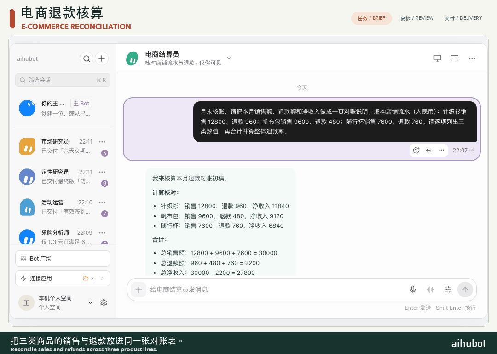
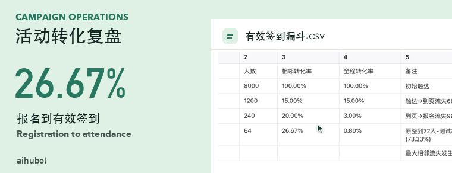
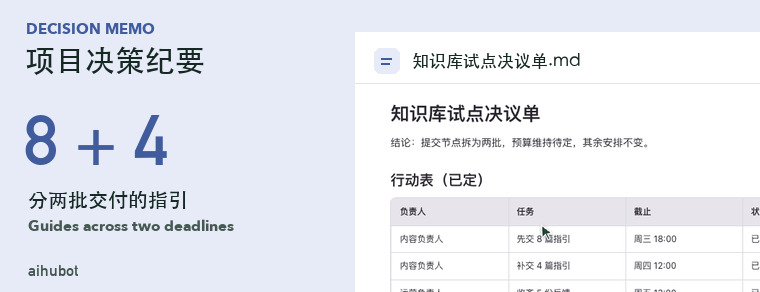
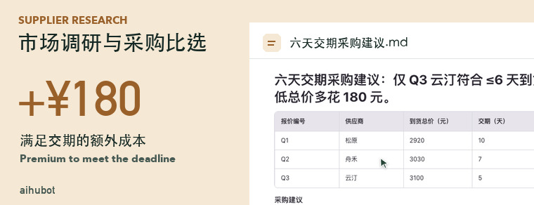
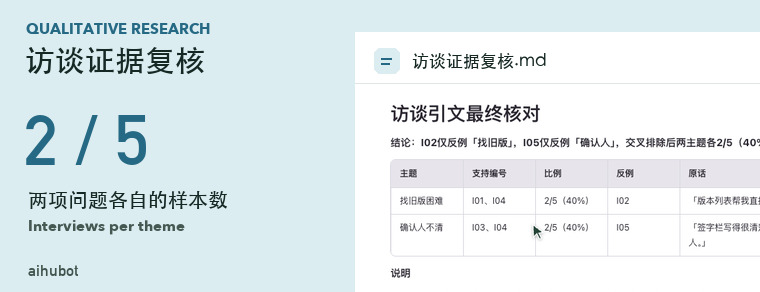

<h1 align="center"></h1>

**简体中文** · [English](README.md)

**把任务交给 Bot，打开初稿提修改，在原对话里收到可以核对的终稿。** aihubot 是可自托管的团队工作空间，模型由你选择。

[看六个办公实录](docs/office-workflows.md) · [快速开始](#快速开始) · [下载](https://github.com/zhiruiai/aihubot/releases/latest) · [试玩交付的网站](https://zhiruiai.github.io/aihubot/zh.html)

## 纠正一笔重复退款

店铺报了 2,200 元退款，复核时发现有 200 元重复入账。打开初稿、提出修正，再看终稿里的净收入和退款率如何变化。

[](docs/office-workflows.md#refunds)

[打开这份对账终稿](docs/demo/office-results/refunds.md)

## 六个办公场景

点封面可看动画、复核要求和实际交付文件。六个任务均由真实模型连接 Rust 服务执行，使用独立工作空间和虚构业务资料。动画在产品界面中回放留存的对话和文件，省略等待时间，配有中英文字幕。

| 经营与决策 | 内容与研究 |
| --- | --- |
| [](docs/office-workflows.md#refunds)<br>[电商退款核算](docs/office-workflows.md#refunds) | [](docs/office-workflows.md#editorial)<br>[自媒体口播送审](docs/office-workflows.md#editorial) |
| [](docs/office-workflows.md#funnel)<br>[活动漏斗复盘](docs/office-workflows.md#funnel) | [](docs/office-workflows.md#minutes)<br>[项目决策纪要](docs/office-workflows.md#minutes) |
| [](docs/office-workflows.md#sourcing)<br>[供应商报价比选](docs/office-workflows.md#sourcing) | [](docs/office-workflows.md#interviews)<br>[访谈证据复核](docs/office-workflows.md#interviews) |

## 快速开始

- **加入已有团队。** 在浏览器打开管理员提供的产品地址，也可在 Apple 芯片 Mac 或 Windows x64 连接客户端里输入同一地址。Windows 下载后请完整解压 ZIP。
- **自己部署。** Linux x64 服务包包含 Rust API、产品站、运营站和 Worker。按部署说明安装 Node.js 运行依赖，并设置私有数据目录。[Linux 安装说明](server/api/deployment/README.md#install-and-configure)
- **在这台 Mac 上执行。** 包含运行环境的 macOS 源码构建版可以启动本机个人空间，执行已授权的任务。公开下载的 v0.0.8 客户端需要连接单独运行的服务，该历史版本的安装包沿用旧名 **BambooShift**。若旧版更新检查无法跟随仓库改名，可从新仓库的 Releases 手动下载后续版本。[桌面端说明](docs/desktop-client.md) · [下载版本](https://github.com/zhiruiai/aihubot/releases)

### 从源码运行

准备稳定版 Rust、Node.js 22.19 或以上版本，以及 npm。

```sh
git clone https://github.com/zhiruiai/aihubot.git
cd aihubot
npm ci
npm run configure:local
npm run dev
```

打开终端显示的产品地址。在 **设置 → 模型配置** 填写服务地址、模型名称和 API Key，保存后点 **设为默认**。Bot 会使用空间默认模型，也可以为某个 Bot 单独选择。

### 试做第一个任务

> 请把会议速记整理成 Markdown 行动清单，并把文件交回聊天。内容组周三交 12 篇指引，运营负责人周五收齐 5 份反馈，预算仍待确认。

打开文件卡片，再告诉 Bot「把 12 篇指引拆到周三和周四两批」。打开修订稿，检查总数是否仍为 12、预算是否仍为待定。想先体验文件交付，可运行 `npm run dev:preview`，使用预设模型和临时空间。[预览说明](CONTRIBUTING.md#run-a-sample-task-locally)

## 网站、技能和对外发布

- **交付网站。** 从聊天打开成品，对比修改，回看第一版，再回原线程继续改。版本历史动画展示了真实模型留下的交付记录，「星港降落」试玩来自预设对话。[版本回看实录](docs/demo/website-delivery.gif) · [试玩星港降落](https://zhiruiai.github.io/aihubot/zh.html)
- **安装并运行技能。** 在 Bot 设置中打开 **选择与管理技能 → 从技能库选择**。检查「数据质量核对」包内文件并安装，附上 CSV，在聊天中用 `/` 选择该技能。脚本会返回退出码和统计结果，执行端需要 Python 3 和本机命令权限。[技能包与脚本执行](docs/bot-models-and-skills.md)
- **组队与发布。** 在 Bot 广场选取现成团队，或向招聘助理描述所需角色。对外发布时需配置相应账号并核对平台回执。本页自媒体实录的交付范围是送审稿。[团队模板](docs/bot-templates.md) · [发布账号](docs/publishing.md)

## 架构与贡献

Web 与 Electron 共用 React 界面。Rust 管理任务状态、权限、回执及工作空间 SQLite 数据，Pi 在独立 Worker 中调用模型，工具执行由 Rust 校验。已授权的外部工具可通过 MCP 连接，移动端提供 Flutter 源码。[系统架构](docs/architecture.md) · [协议与能力范围](docs/capabilities-and-protocols.md)

项目原创代码使用 MIT 许可，随附的头像、技能和依赖保留各自许可。[贡献指南](CONTRIBUTING.md) · [报告问题](https://github.com/zhiruiai/aihubot/issues) · [安全反馈](SECURITY.md) · [MIT 许可](LICENSE) · [第三方声明](THIRD_PARTY.md)
