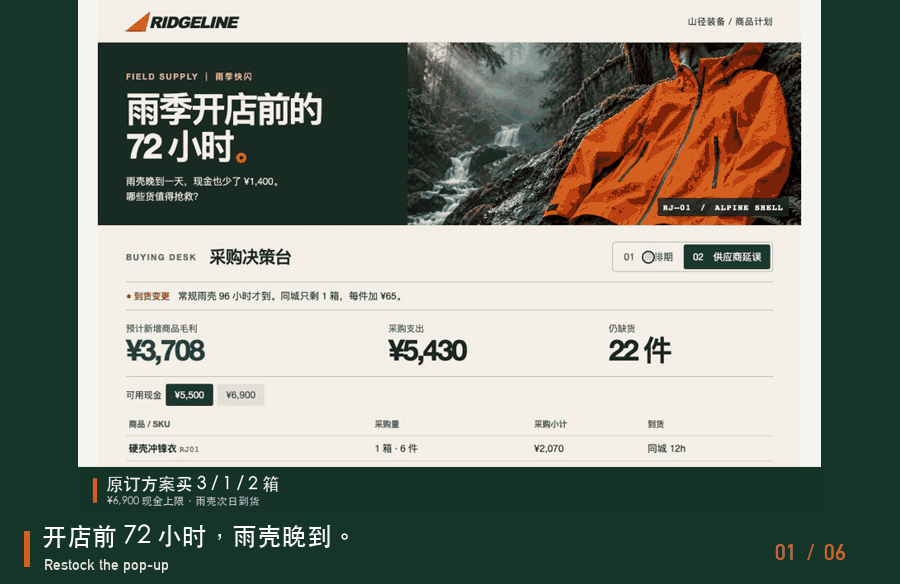
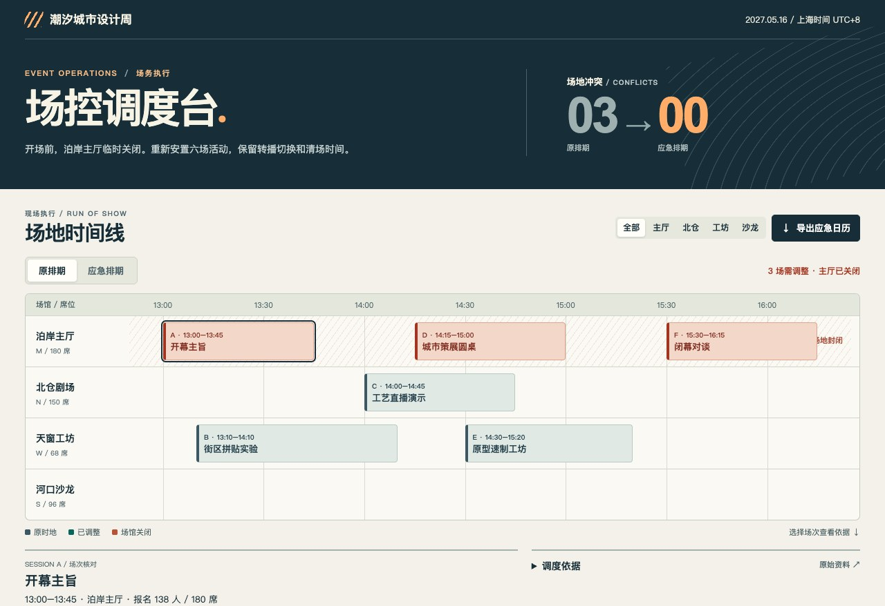
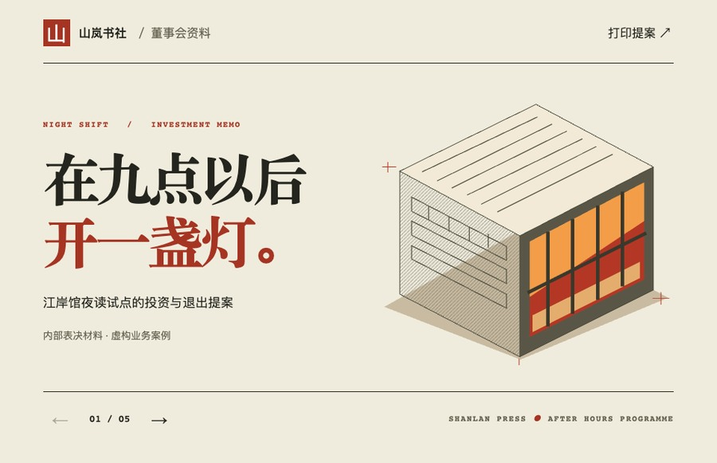
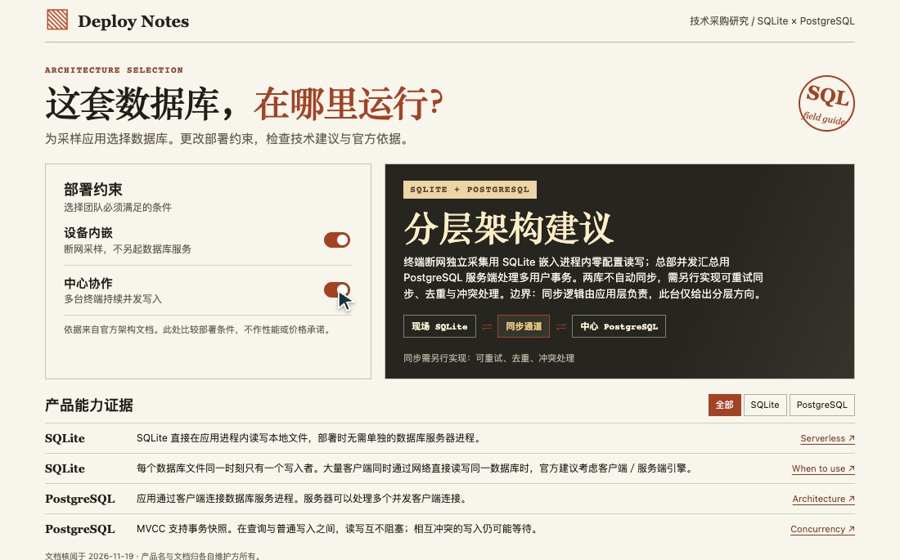
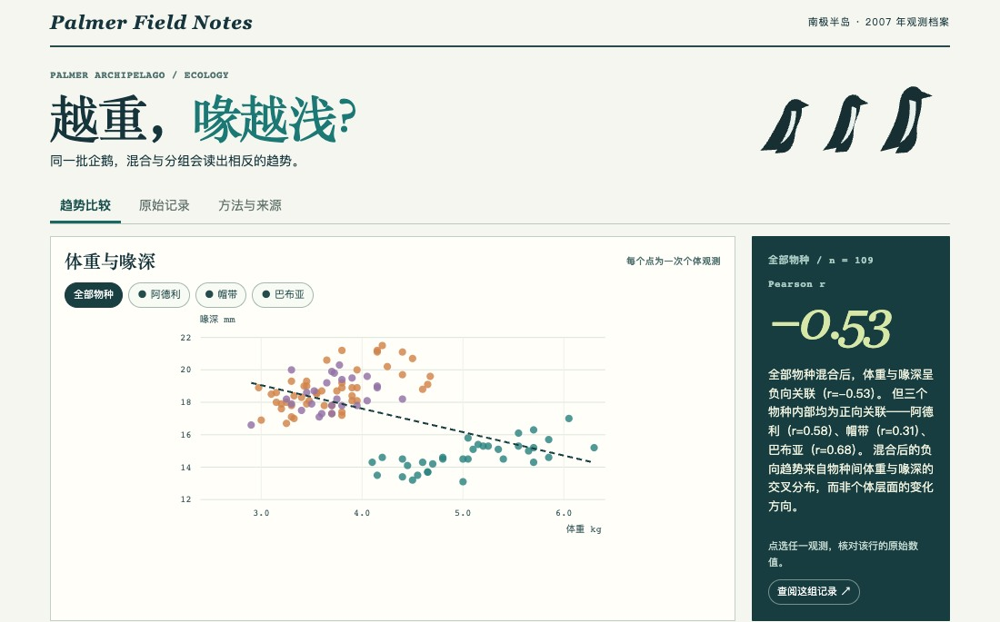

<h1 align="center"></h1>

**简体中文** · [English](README.md)

**aihubot 是一个可以自托管的 Bot 工作空间。** 在聊天里交一份简报，打开交付物，告诉 Bot 哪个条件变了，再回到同一条对话核对新版。

[打开六件作品](https://zhiruiai.github.io/aihubot/work/) · [看实录与验收依据](docs/office-workflows.md) · [快速开始](#快速开始) · [下载客户端](https://github.com/zhiruiai/aihubot/releases/latest)

## 开店前 72 小时，主力商品晚到了

雨壳要 96 小时才到，采购预算也从 ¥6,900 缩到 ¥5,500。采购 Bot 将三款商品从 **3 / 1 / 2 箱改为 1 / 3 / 2 箱**。打开采购台，切换交期和预算，对照预计毛利，再下载对应采购单。

[](https://zhiruiai.github.io/aihubot/work/)

## 亲手试一次

点封面打开成品，无需登录。四组业务资料为虚构示例，选型与研究使用公开资料。每个案例都经过真实模型与 Rust 服务的交付、修改和复核。

| 经营与现场 | 内容与决策 |
| --- | --- |
| [](https://zhiruiai.github.io/aihubot/work/commerce/)<br>**[雨壳晚到，重新开采购单](https://zhiruiai.github.io/aihubot/work/commerce/)**<br>供应商延期与预算削减后，重算整箱件数、毛利和到货。 | [](https://zhiruiai.github.io/aihubot/work/editorial/)<br>**[把周末拍成一支 30 秒短片](https://zhiruiai.github.io/aihubot/work/editorial/)**<br>从修订分镜到可播放、可下载的竖屏咖啡成片。 |
| [](https://zhiruiai.github.io/aihubot/work/operations/)<br>**[主厅关闭，六场活动照办](https://zhiruiai.github.io/aihubot/work/operations/)**<br>查看原排期与应急排期，把调整后的活动导入日历。 | [](https://zhiruiai.github.io/aihubot/work/board/)<br>**[夜读试点，投还是不投？](https://zhiruiai.github.io/aihubot/work/board/)**<br>翻看修正后的 600 席议案，检查盈亏线与退出条件。 |
| [](https://zhiruiai.github.io/aihubot/work/market/)<br>**[现场离线，中心多机写入](https://zhiruiai.github.io/aihubot/work/market/)**<br>改变部署约束，看数据库选型何时翻转，逐条核查官方来源。 | [](https://zhiruiai.github.io/aihubot/work/research/)<br>**[一张会翻转结论的散点图](https://zhiruiai.github.io/aihubot/work/research/)**<br>检查 110 条原始观测，按物种拆开总体负相关。 |

## 快速开始

- **加入已有团队。** 在浏览器打开管理员提供的产品地址，也可在 Apple 芯片 Mac 或 Windows x64 连接客户端里输入同一地址。Windows 下载后请完整解压 ZIP。
- **自己部署。** Linux x64 服务包包含 Rust API、产品站、运营站和 Worker。按部署说明安装 Node.js 运行依赖，并设置私有数据目录。[Linux 安装说明](server/api/deployment/README.md#install-and-configure)
- **在这台 Mac 上执行。** 包含运行环境的 macOS 源码构建版可以启动本机个人空间，执行已授权的任务。公开下载的 v0.0.8 客户端需要连接单独运行的服务，该历史版本的安装包沿用旧名 **BambooShift**。若旧版更新检查无法跟随仓库改名，可从新仓库的 Releases 手动下载后续版本。[桌面端说明](docs/desktop-client.md) · [下载版本](https://github.com/zhiruiai/aihubot/releases)

### 从源码运行

准备稳定版 Rust、Node.js 22.19 或以上版本，以及 npm。

```sh
git clone https://github.com/zhiruiai/aihubot.git
cd aihubot
npm ci
npm run configure:local
npm run dev
```

打开终端显示的产品地址。在 **设置 → 模型配置** 填写服务地址、模型名称和 API Key，保存后点 **设为默认**。Bot 会使用空间默认模型，也可以为某个 Bot 单独选择。

### 试做第一个任务

> 请把会议速记整理成 Markdown 行动清单，并把文件交回聊天。内容组周三交 12 篇指引，运营负责人周五收齐 5 份反馈，预算仍待确认。

打开文件卡片，再告诉 Bot「把 12 篇指引拆到周三和周四两批」。打开修订稿，检查总数是否仍为 12、预算是否仍为待定。想先体验文件交付，可运行 `npm run dev:preview`，使用预设模型和临时空间。[预览说明](CONTRIBUTING.md#run-a-sample-task-locally)

## 网站、技能和对外发布

- **交付网站。** 从聊天打开成品，对比修改，回看第一版，再回原线程继续改。版本历史动画展示了真实模型留下的交付记录，「星港降落」试玩来自预设对话。[版本回看实录](docs/demo/website-delivery.gif) · [试玩星港降落](https://zhiruiai.github.io/aihubot/zh.html)
- **安装并运行技能。** 在 Bot 设置中打开 **选择与管理技能 → 从技能库选择**。检查「数据质量核对」包内文件并安装，附上 CSV，在聊天中用 `/` 选择该技能。脚本会返回退出码和统计结果，执行端需要 Python 3 和本机命令权限。[技能包与脚本执行](docs/bot-models-and-skills.md)
- **组队与发布。** 在 Bot 广场选取现成团队，或向招聘助理描述所需角色。对外发布时需配置相应账号并核对平台回执。本页咖啡短片支持播放、下载和逐镜复核。[团队模板](docs/bot-templates.md) · [发布账号](docs/publishing.md)

## 架构与贡献

Web 与 Electron 共用 React 界面。Rust 管理任务状态、权限、回执及工作空间 SQLite 数据，Pi 在独立 Worker 中调用模型，工具执行由 Rust 校验。已授权的外部工具可通过 MCP 连接，移动端提供 Flutter 源码。[系统架构](docs/architecture.md) · [协议与能力范围](docs/capabilities-and-protocols.md)

项目原创代码使用 MIT 许可，随附的头像、技能和依赖保留各自许可。[贡献指南](CONTRIBUTING.md) · [报告问题](https://github.com/zhiruiai/aihubot/issues) · [安全反馈](SECURITY.md) · [MIT 许可](LICENSE) · [第三方声明](THIRD_PARTY.md)
