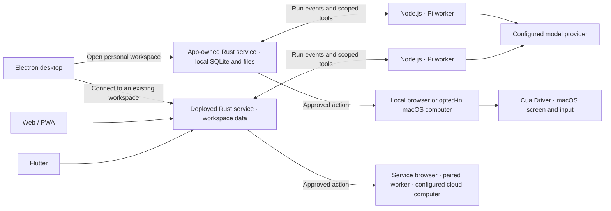

# Architecture

BambooShift uses a modular Rust backend, separate product and operations sites, SQLite and supervised integration workers. The retired Node business server is no longer part of the runtime.

```text
React product / Electron / Flutter → Product listener → Workspace services
React operations                  → Operator listener → Platform services
                                                       ↓
                                               SQLite repositories
                                                       ↓
                                Pi / MCP / Computer / Document workers
```

## Desktop and cloud execution

The Electron app can start a personal workspace using its bundled Rust service and Node.js workers. Its main process owns startup, local session bootstrap, and shutdown. The Rust product API and authorization rules are shared with Web and Flutter. A deployed service can use its own browser, a paired worker, or a provisioned cloud computer.



- [Electron main process](../desktop/main.cjs) and [local launcher](../desktop/local-runtime.cjs) start the bundled service on a private loopback origin and exchange a fresh, process-specific token for a local product session. The Rust listener on that origin keeps personal workspace data in the app profile.
- [Rust service](../server/api/src/) owns task state, credentials, workspace authorization, and approvals. The same product API serves the React UI inside Electron and over Web, as well as the Flutter client for deployed workspaces. The operations listener applies to separately deployed servers.
- The supervised [agent worker](../server/workers/pi-worker/) owns the framed protocol, cancellation, task budget and terminal receipt. MIT [Cordis core](../server/workers/plugin-runtime/) supplies reviewed engine providers and the Rust tool bridge. The [Pi provider](../server/workers/engines/pi/) is the only bundled production engine; SDK loading, model configuration, event adaptation and session cleanup are private to it. An alternative provider must implement the same tested contract. Historical worker entry paths remain compatible with existing deployments.
- [Computer runtime](../server/workers/computer-runtime/) uses Playwright for isolated browser work. In the opted-in macOS personal workspace, Electron supervises the MIT [Cua Driver](../legal/third-party/cua-driver-0.47.8/) and the computer worker connects to it through a private socket. System permission and chat approval apply to native input. Remote and cloud execution use their configured worker connection.

[Desktop setup](desktop-client.md) · [Computer configuration](computer.md)

## Business backend

`server/api/src` owns Axum HTTP routes, identity, workspace repositories and domain services. One startup acquires the data lock and starts one scheduler. The operator listener does not create another writer or scheduler.

The platform database stores users, memberships, invitations and separate operator sessions. Each workspace has its own database and private files. Requests bind the authenticated account, expected user and active membership. Operator permission is independent of workspace ownership. Authorization is rechecked after asynchronous work.

Avatar theme preferences use the account and workspace as a composite key in the identity database. Clients read the current selection when opening a workspace. Explicit saves use an expected revision and a membership check in the same transaction. Clearing a synced theme advances its revision and restores each device's own preference. Only the theme selection and validated recipe travel between devices. Uploaded Bot pictures retain priority in the renderer.

Domains include agents, primary Bots, sharing, templates, memories, skills, scheduling, application connections, teaching and computer control. Handlers validate requests and call services; repositories own transactions and serialization. Durable receipts prevent duplicate mutations after uncertain responses. Restart never automatically replays unknown external actions, and expected revisions reject stale changes.

## Agent engines and workers

Rust selects a workspace-owned model profile and asks `server/workers/pi-worker` to run the real Pi SDK session. Pi returns streaming events and tool requests; Rust authorizes business tools. The run registry owns roots, children, queues, generations and cancellation. Trusted Bot identity and actual requester metadata are distinct from message contents.

A personal primary Bot may delegate to eligible colleagues in their existing private conversations; workgroups keep their own members. Child sessions inherit root authority and cancellation without importing unrelated histories. Memory and skill proposals persist in Rust; proposed skills require review before activation.

[Cross-owner Bot collaboration](bot-federation.md) is a future extension design, not a shipped federation feature. It preserves Rust authority and uses a reviewed Cordis transport adapter for optional cross-server task exchange.

Small sets of approved skills and memories fit directly into the Pi system prompt. Larger sets use bounded listings and explicit continuations. Skill reads use the approved versions captured for the run family. Shared skill reads also recheck the current share grant. Recall searches the current Bot's own memories, with a run-start snapshot for daily check-ins. A long conversation drops the oldest eligible history first and includes the omission count. The current request and structured clarifications retain their own fields.

Teaching records bounded successful manual actions for one Bot/computer lease, excludes typed contents and allows review before one model request creates a proposed skill. It does not replay demonstrations. Usage records actual reported tokens with deduplication; unknown usage and cost remain unknown.

- `server/workers/pi-worker`: supervised run protocol, tool receipts, budget and cancellation. The entry path remains compatible with existing deployments.
- `server/workers/agent-runtime`: engine-neutral host/worker protocol.
- `server/workers/engines/pi`: the current production engine's SDK, model configuration, session lifecycle and event adapter.
- `server/workers/plugin-runtime`: [Cordis lifecycle and service injection](../server/workers/plugin-runtime/README.md) for statically bundled trusted worker plugins. Rust remains the authority for every forwarded tool request.
- `server/workers/mcp-worker`: MCP transport, schema discovery and OAuth protocol.
- `server/workers/document-worker`: bounded text, PDF, DOCX and image parsing.
- `server/workers/computer-runtime`: computer surfaces and their HTTP adapter; Express serves only this worker protocol, not account or business routes.

Workers have narrow protocols, deadlines and supervised cancellation. Production packages build their entrypoints and omit development loaders. App actions freeze the connection, schema, arguments and requester. Optional unattended read policies require explicit owner consent, match one routine and exact parameters, and permanently expire after relevant configuration changes. Remote annotations alone grant no authority.

The application catalog in `shared/app-providers.json` describes public endpoints and their authentication methods. Web and Rust read it directly, and Flutter bundles generated catalog assets for offline use. After editing the catalog, run `npm run sync:app-catalog` to refresh the Flutter assets. App connections and their permissions belong to the workspace. The Rust API authorizes tool actions, and the MCP worker handles discovery, OAuth and transport. A catalog entry or import only supplies a connection draft for review.

The workspace owner can enable or disable an individual app tool from its connection details. Each tool has a separate access revision. The server leaves the connection revision and provider catalog intact, filters Pi discovery, and checks the tool revision before dispatch and publication. An access change expires that tool's pending actions and exact approvals, including routine and shared Bot grants. A running action with an unconfirmed external effect follows the existing unknown-result path. OAuth refresh remains a connection operation and can finish while the original tool call is cancelled.

Public web research is an independent routine permission. An owner can approve up to four exact queries for a local Bot's direct conversation. Rust records the issuer and grant revision with the routine and checks both again for each run and provider response. Pi exposes only the approved query strings and accepts a page URL only after a search in that run returned it. Pausing or editing the routine invalidates in-flight access, and transferring it clears the permission. Existing routines start with search disabled.

The [routine Webhook](routine-webhooks.md) adds a bearer-only ingress for local direct conversations. The platform database stores a key digest, issuer and target generation. Rust checks the current key under an identity fence while committing the run and its idempotency receipt together in the workspace database. Pi receives the event JSON separately from the routine instruction. Small skill sets load inline. Larger sets enable only the scoped skill listing and reading tools. This mode excludes memories, prior chats and other tools. Event-only routines have no next scheduled time. Additional Webhook triggers leave the next scheduled time intact.

Interactive app permissions are separate from routine policies. In a personal Bot's direct chat, the owner can save permission for an exact GitHub issue read after explicitly selecting the official read-only connection. Rust binds the rule to the issuer, Bot, conversation, connection and exact arguments. The rule and first execution receipt are committed together. A repeated call in the same root run returns the existing receipt. Connection, Bot or conversation changes invalidate the rule. The MCP worker compares the live catalog before the call, and SQLite serializes revocation with result publication.

The personal skill shelf projects reviewed originals and active pinned copies from the existing skill version records. The owner reviews the full text and binds the assignment to a source revision and a target Bot in the same workspace. Enabling and disabling use one workspace transaction. Pinned copies follow the normal Pi skill-loading path and stay on their reviewed revision. Team imports and pinned copies are excluded from the shelf's sources. A pinned copy is also excluded from portable Bot exports.

Connect apps and the skill editor share the same bundled bilingual workflow recipes. The catalog and passive preview operate on those local assets. An owner can hand a recipe to the existing editor for an eligible local Bot. Explicit submission creates a proposed version through the existing workspace route. Enabling it uses the existing approval transaction with the expected active version.

The personal shelf publishes reviewed originals. A team owner can opt in to member publishing. A member's request binds the exact policy revision along with the personal skill revision and reviewed team publication revision. Rust commits the team snapshot and request receipt in the same team transaction while holding the source and membership checks. Team readers receive skill text and neutral provenance. The original publisher can sync or withdraw. The team owner can withdraw another publisher's skill and block the same lineage from reposting. Previously imported copies keep their reviewed versions. An explicit cancellation can fence an outstanding request by ID.

An authenticated team skill link identifies one active publication epoch. Sync keeps the link ID. Withdrawal removes it, and republishing assigns a fresh ID. Link previews check current membership and return only the reviewed skill. The document entry point supports a signed-out login round trip without widening cross-origin API access.

Computer actions bind an instance, Bot-owned screen and surface, with separate manual takeover and approval. Each surface reports its real capabilities. Screen release/reset uses recoverable lifecycle receipts rather than silently allocating another screen.

Private takeover frames require `private-takeover-frames-v1` from the computer worker. Rust binds the temporary lease to the exact account, login session, Bot and target. The client sends the lease in a request header from the current window. The worker checks its own lease before and after capture in the same queue as manual input. Ordinary previews and Bot observation are paused for that physical screen. Private frames use a separate response and are never stored in action history. Clients clear private media on release, expiry, identity changes and target changes. A legacy worker must be upgraded for private takeover.

## Frontend and clients

`web/src/` contains the product site, with static assets in `web/public/`. Its `PlatformRoot` owns account and workspace routing. Workspace controllers coordinate reusable views and feature hooks. Forms preserve drafts and recovery state. Shared appearance tokens and controls keep the sites consistent. `operations/main.tsx` mounts `OperationsRoot`, and `operations/vite.config.ts` builds `operations-dist` with only operator endpoints.

`shared/` holds cross-client types. Chinese and English catalogs use the same namespaced keys and placeholders; user content remains untranslated. Original code files are limited to 500 lines, comments use English and UI text is at least 12px.

Electron loads one chosen product origin in an isolated view without renderer Node integration. Narrow native bridges validate current frames and accounts. Notifications require consent, exclude conversation bodies and focus the existing window. Device preferences such as appearance, avatar theme, local voice and notification settings are scoped appropriately; account changes fence late results.

### 语音输入

User-triggered dictation records a bounded clip. Rust invokes a separately installed local whisper.cpp engine, then places the text in an editable draft for manual sending. The private `data/speech/config.json` uses version 1, enabled, binaryPath, modelPath and threads fields. An optional voiceModelPath selects a faster local recognition model for short call turns. Set absolute deployment paths for the executable and models. Local speech synthesis uses device voices that can run offline.

A foreground call belongs to one account, workspace and direct chat. Rust associates transcribed turns with an active call and uses the existing Pi admission, queue, permissions and message receipts. The client reads only the exact turn's final reply. Ending a call releases capture and cancels recognition in progress. Pi work that has already been accepted follows the normal task lifecycle. The conversation retains a text transcript, and the recognizer removes its temporary audio.

For a Bot voice memo, the owner opts in to a voice reply on one message in a direct chat with a local Bot in their personal workspace. Rust starts an independent run and offers Pi the memo tool for that input. The tool uses an offline server voice and commits one canonical WAV file with its transcript. The clients fetch the authorized file only when the user plays it and verify the format, length and digest against the delivery. The memo stays available after the task ends. File removal leaves the transcript in the conversation.

Enable synthesis by creating `speech/memo-synthesis.json` under the server's data directory with permissions `0600`. Install both configured voices on the server.

| Host                            | Example configuration                                                                                |
| ------------------------------- | ---------------------------------------------------------------------------------------------------- |
| macOS                           | `{"version":1,"enabled":true,"engine":"macos-say","voices":{"zh-CN":"Tingting","en-US":"Samantha"}}` |
| Linux with `/usr/bin/espeak-ng` | `{"version":1,"enabled":true,"engine":"espeak-ng","voices":{"zh-CN":"cmn","en-US":"en-us"}}`         |

## Deployment and source release

`npm run dev:preview` builds the product UI and workers into a temporary runtime, then starts the regular Rust service with an isolated database. A loopback fixture implements the model protocol. The sample request passes through the same account session, chat API, Pi run and authorized workspace tools as a deployed workspace. The automated check opens the resulting file through the product download route and compares the bytes.

Private deployment settings hold listeners, data paths and runtime locations. Model keys and computer credentials stay in restricted files, not public DTOs. Examples contain placeholders. SQLite keeps local deployment simple, while repositories separate storage, transport and domain behavior.

`scripts/package-backend.mjs` assembles Rust binaries, both sites and worker runtimes. It builds workers from `server/workers/` and places them in the release's `runtime/packages/` directory. `scripts/source/` contains the source policy, privacy checks and exporter. The exporter selects public source, scans known private values and writes content hashes. See [source release](source-release.md) and [verification](verification.md).
