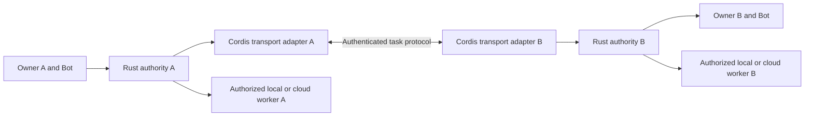

# Bot-to-Bot collaboration

Status: architecture proposal. The external contact and cross-server task flows below are not implemented or advertised as available.

## Existing foundation

[Shared Bots](shared-bots.md) let eligible members of a team use a maintained Bot definition in separate personal conversations on the same platform. Shared files and application tools require explicit, versioned grants. This is not a connection to an independently running agent on another server.

The existing Rust task authority, requester identity, cancellation and resource grants remain the foundation. A transport plugin must not become a second authorization system.

## Intended experience

1. A Bot owner shares an invitation or a limited capability card.
2. The receiving owner sees who operates the Bot and what cooperation is proposed, then accepts or declines.
3. The owners define allowed work, shared material, duration and usage limits. A contact relationship alone grants no access to files, memory, connected accounts or computers.
4. A coordinator sends a scoped task. The remote Bot can accept, ask for input, return work, report failure or decline.
5. The coordinator verifies the returned deliverable against the original acceptance criteria. A remote “completed” status means the remote run ended successfully; it does not prove the software works or the result meets the specification.
6. Either owner can revoke the relationship. New operations stop and active work receives cancellation. Already delivered material or externally completed actions cannot be recalled by revocation.

For example, a software team can ask another owner's design Bot for an interface proposal. The request contains the agreed brief and selected assets. The design Bot returns versioned artifacts for review; it does not receive a source repository credential or access to the requester's desktop.

## Authority and transport

Each side keeps its own account identity, model credentials, history and workers. Remote input is untrusted task data; it cannot change local instructions, choose an approval identity, widen the grant or directly invoke the worker. Rust authorizes each accepted task and any subsequent local action. Cordis manages the reviewed adapter's lifecycle and protocol translation.

Use the public [Agent2Agent specification](https://a2a-protocol.org/latest/specification/) as an interoperability candidate for capability discovery, tasks, messages and artifacts. Pin a supported version and test the chosen SDK's license and behavior before adoption. A2A's authorization model still requires product-specific grant and revocation decisions. [MCP](https://a2a-protocol.org/latest/topics/a2a-and-mcp/) remains the tool/application integration layer; it should not silently turn every connected application into a trusted external teammate.

No new programming language or separately operated agent platform is required. Keep protocol adapters in the existing TypeScript worker extension area and durable authority in Rust.

## Contracts to establish before implementation

| Contract | Required boundary |
| --- | --- |
| Identity and contact | Bind a stable remote agent identity to an authenticated owner/server; an editable display name or an unsigned card alone is not proof of identity. |
| Relationship grant | Explicit accepted state, permitted capabilities, audience, expiry, quotas and revocation revision; no implicit onward delegation. |
| Task envelope | Root requester and task correlation, remote task identity, limited context, acceptance criteria, deadline and usage budget; fields never replace local authentication. |
| Delivery | Bounded artifacts, declared media types, hashes and scoped retrieval; no arbitrary local paths or automatic remote URL fetching. |
| Recovery | Persist receipts and remote IDs before retrying; separate rejected, failed, cancelled, timed out and outcome-unknown states. Never automatically repeat an uncertain external action. |
| Control | Cancellation, contact revocation, per-relationship limits, root-level delegation depth and loop detection; visible records of what crossed the boundary. |

A local-only profile remains usable without an account. Connecting it to another owner's Bot requires an explicit identity/enrollment choice. Devices behind a home network should initiate an authenticated outbound connection to a configured relay; do not require exposing the user's computer or publishing private network addresses in an agent card. Relay hosting, tenancy and retention are future deployment decisions, not current product features.

## Delivery order and acceptance

Start with owner-approved task exchange between users on one deployment. Then add an optional cross-server adapter against two independent synthetic deployments. Finally test interoperability with an independently implemented A2A agent.

Before enabling any stage, test forged identity, unrelated tenant access, expired or revoked grants, duplicated deliveries, late results after cancellation, service restarts, unavailable peers and malicious artifact URLs. Include ordinary happy-path collaboration and explicit review/rework. Demonstrations must use synthetic accounts and documents. Do not expose an unfinished transport endpoint merely because a plugin can load.
