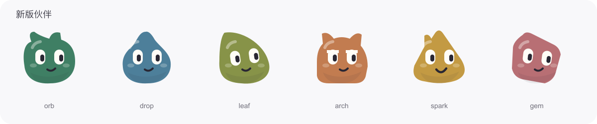

# MosoCrew 产品与设计

## 参考与边界

视觉依据：用户提供的 Grok Bot 桌面、移动端及后续设置与交互截图。行为依据为已记录的官方文档，完整参考范围见[参考核对](reference-audit.md)。保留 MosoCrew 现有风格，不把未展示的私有页面推断为已复刻。

- https://docs.x.ai/grok-bot/overview
- https://docs.x.ai/grok-bot/bots
- https://docs.x.ai/grok-bot/chat-and-collaboration
- https://docs.x.ai/grok-bot/computer-and-apps
- https://docs.x.ai/grok-bot/skills-routines-and-automations
- https://github.com/earendil-works/pi

MosoCrew 是独立实现，不使用 Grok 商标或冒充其服务。参考截图提供布局、密度、色彩和交互方向；没有访问原应用的全部私有页面，因此不宣称所有未展示页面与原产品逐像素一致。

## 视觉系统

让 AI 同事像联系人一样存在。主界面是会话列表、聊天记录和可收起详情栏；不把工作改造成另一套仪表盘。浅灰侧栏、白色内容、极轻分隔线，用户消息用近黑色气泡，机器人消息用浅灰气泡。头像是界面主要色彩来源。

原创角色家族名为「种子」：柔和、不规则的几何轮廓，倾斜的白色眼睛和轻微表情。紫色圆形、蓝色水滴、绿色叶片、橙色拱形、黄色火花与粉色宝石通过形状和颜色共同区分角色；群聊使用叠放头像。SVG 使角色在手机小头像、桌面列表和详情页大头像中保持清晰，Flutter 客户端也使用同一原创视觉语言；另有熊猫与小恐龙主题，上传头像优先。

头像资产位于 `web/public/avatars/`：每个角色提供独立 SVG 与 512 × 512 透明 PNG。`npm run avatars` 直接从界面中的同一头像组件导出，避免多端版本出现差异。

## 交互原则

1. 从消息开始工作，过程、交接、结果与错误进入同一会话。
2. 详情栏围绕当前同事/项目展开：电脑、资料、成员、记忆、技能和例行任务。
3. 能力状态必须真实。示例历史标记为示例；未连接模型或电脑时展示原因。
4. 有记忆的角色可编辑、可删除；进化表现为可检查的技能版本，批准后才影响后续任务。
5. 用户可以停止工作；电脑动作的授权与模型的自由文本输出分离。
6. 桌面显示三栏，窄屏在会话、聊天和详情之间切换；触控区域、输入法组合输入和键盘操作均需考虑。

聊天支持对具体消息引用回复、轻量回应，以及搜索历史后跳转到原位置。Bot 工作时仍保留发送入口和独立停止入口，可选择补充当前任务或等本轮完成后继续。投递状态区分等待、已进入上下文、已取消和中断；不把“消息已保存”暗示为“任务已执行”。群聊引用保留原作者身份，原作者被移除后也不会把其历史消息归给其他成员。

手机首页采用头像菜单、搜索和创建的紧凑顶栏，下方是可横向浏览的 Bot 快捷入口。快捷项从真实置顶及最近私聊生成，同一 Bot 只出现一次，点击打开已有会话。桌面的筛选框在手机隐藏时不参与筛选，切回桌面仍保留其内容。主要顶栏按钮提供 44 px 触控区域。

聊天输入框支持直接粘贴图片，沿用附件上传、大小校验与所属会话逻辑；只读取本次粘贴手势提供的文件，不主动读取系统剪贴板。普通文本保留原粘贴行为，含图片的粘贴不会把替代文本混入已有草稿。

语音输入沿用圆形按钮和紫灰反馈样式，手机按钮及结束/取消操作至少 44 px。录音与识别状态靠近草稿显示，说明最多一分钟、由服务器识别、结束后删除录音。听写先转成文字，保留引用、附件与投递方式，由用户检查并手动发送；识别期间可继续编辑，结果不会覆盖新输入。输入框内 Cmd/Ctrl+D 开始或结束录音，输入法组词与重复按键不触发。语音结束与停止 Bot 工作使用不同控件；尚未实现双向实时通话。

账号设置独立于工作空间，可从空间选择页或账号菜单进入。姓名、密码与登录设备沿用相同的卡片、表单、按钮和反馈样式；即使团队被停用，成员仍可管理自己的登录。记忆和技能编辑在保存失败时保持内容，错误留在表单附近，成功后才重置。

例行任务支持每天、工作日、每周指定日期和固定间隔；工作日明确指周一至周五，不包含节假日调休规则。每周可选择一个或多个执行日，编辑时回填原计划，日期按钮提供至少 44 px 触控区域。每天与每周按任务自身保存的时区安排；旧记录无时区时按北京时间，新计划从空间默认时区取快照。只改任务名称或内容不重排下次时间；暂停后重新启用则从现在安排，不补跑暂停期间的任务。每周任务当天遇到忙碌会等到空闲；后台离线或忙碌跨过计划所属时区的日期时，跳过该次，等待下一个选定时间。「立即运行」仍可在任意星期使用。

例行任务编辑器显示服务端实际保存的下次时间；暂停显示重新启用后安排，到期显示等待调度，不把过期日期当成未来预约。保存失败保留草稿，提交过程中不允许关闭表单。聊天详情和空间管理共用例行任务编辑器及计划说明，沿用相同的紫灰色控件、表单与错误反馈。

技能按「当前使用」「待确认」「历史版本」浏览，分别保留 `active`、`proposed`、`archived` / `disabled` 的区别；历史版本和已停用使用灰色标签。新草稿需批准，旧版本通过恢复重新启用，当前版本可以停用。每项操作先进入独立确认视图，展示所选内容、操作影响，并可展开对照同一 Bot、同名技能的当前版本。该范围内至多有一个当前版本，启用另一版会将原版移入历史；停用不删除内容。变更只影响新启动的任务，正在进行的任务不切换方法。

聊天中的技能管理与空间拥有者的管理页面复用同一个版本确认组件。审阅期间若所选状态或当前版本发生变化，先返回重新查看；失败留在确认视图，提交期间禁止重复操作或关闭。普通成员可查看技能，批准、恢复、停用和创建由空间拥有者操作。这些实现与源码检查不替代新增界面的实机视觉验收。

## 多端边界

React Web 客户端通过版本可演进的数据类型和 HTTP/SSE 与服务通信。SQLite、模型凭据、任务执行和电脑会话均在服务端，浏览器不是任务所有者。个人与团队共用产品账户，团队只设拥有者和成员；平台运营在 `/admin` 使用独立入口、会话与权限，管理全平台用户及空间。`/w/:workspaceId/manage` 属于当前空间的拥有者，用于管理该空间的资源与配置，不代替平台运营。业务 API 显式指定空间，服务端核验成员关系，各空间独立存储并持有运行状态。

当前包含响应式 Web、PWA 安装资源、可撤销登录设备，以及连接同一后台的 Electron 桌面客户端。桌面客户端使用原生窗口和独立连接页，复用真实聊天界面；关闭客户端不会停止服务器上的任务。已提供 macOS 本地安装包及 Flutter 原生客户端源码。发行签名、公证、应用商店和实际公网部署仍需独立完成；Flutter 安装包与设备验收不由源码测试替代。页面可在客户端保持运行且用户明确开启后发送本人完成或待审批通知，不提供关闭客户端后的后台推送。实际网页验收范围见[验收记录](verification.md)。

电脑面板同时承担观察与接管：用户可随时接手正在工作的浏览器，结束后交还给同事；短期接管期间暂停模型键鼠和截图读取。手机可放大截图并滚动定位，避免把桌面操作目标压缩成无法触控的小点。当前画面采用定时截图，界面明确显示采集时间和静态/更新状态。

本轮 [Linux 专用虚拟桌面](linux-desktop.md) 继续使用同一电脑面板、审批卡和接管控件。界面应按实际 `kind` 区分专用虚拟桌面与 macOS 整机主屏，显示真实尺寸及可用状态；只有空间拥有者明确开启后才接受桌面操作。会话换代使旧审批失效，需要重新连接和申请，不能让旧坐标落到新画面。取消预览或人工输入后不再发送排队请求，正在执行的输入等待清理再交还控制。

组件已在唯一 VM 实测并接入 Worker，当前桌面无网络、没有带窗口的图形浏览器，不承诺将独立浏览器的登录共享到 GUI。虚拟桌面的“粘贴文本”已改为受控的临时 X11 selection；真实中文、表情与换行文本逐字节通过，300 单位上限及取消后临时内容清理也已验证。后续已在唯一 VM 验证固定两槽的每 Bot 独立画面、并行输入及释放/重置；不自动扩容。该历史桌面批次曾被工作设置禁止产品浏览器控制；截图组件与受控 HTTP 测试只证明相应执行合同，后续产品页面验收另行记录。

对应参考图 1，完成的电脑操作卡可展示该次操作后的实际画面，标注采集时间与「历史截图 · 非实时」。点击仅放大历史图，不控制电脑或重新截图。旧记录没有画面时不补示意图，加载失败保留文字结果。截图、文字结果和打开电脑面板是独立区域，手机放大页可双向滚动，沿用已有弹窗与紫灰色控件。新增组件仍需真实 GUI 验收。

远程代码请求沿用聊天操作卡及电脑面板的同一审批组件，显示完整命令、相对工作目录、30 秒与无网络限制，以及工作区文件会被修改的提示。结果使用同一折叠区域展示纯文本输出、退出码、耗时和取消/资源限制原因，长输出在卡片内部滚动；没有增加另一套终端页或不同风格的确认弹窗。实际生成文件经已有资料库入口交付，新卡片仍待真实 GUI 验收。

输入栏已增加语音听写，录音转文字后先进入草稿，由用户编辑与发送。实时双向语音、朗读和语音消息仍有差距。连接入口已提供独立 MCP 应用及 OAuth 授权，使用相同的列表、详情与表单样式，文件、电脑和模型留在工作环境区域；电脑内网页登录与应用授权分别管理。详见 [参考完成度审计](reference-audit.md)。

Bot 设置沿用既有头像组件、分段页签、表单和弹窗，资料与工作方式分开编辑，相关内容直接进入真实技能、文件与电脑。创建入口保留手动方式并加入智能组队，先展示可编辑的成员和负责人，再明确创建；创建后的开始协作是独立动作。按钮沿用紫灰色样式，头像作为主要色彩，窄屏触控目标至少 44 px。未保存草稿的导航需明确放弃，读取与轮询不触发生成或创建。详见[功能说明](bot-settings-and-teams.md)。

聊天组队使用内嵌方案卡，显示真实状态、目标、负责人和分工摘要，拥有者从卡片进入原有组队编辑器。成员可看摘要，创建权限仍留在拥有者；已创建卡只进入经过确认仍存在的群聊，打开卡片不自动创建或启动任务。编辑和确认后更新同一卡片，沿用原有头像、浅色边框、间距与移动触控尺寸。

主 Bot 入口沿用会话行、原创头像、浅紫灰标签和相同的菜单组件。尚未选择时介绍创建与选择两条路径；已有主 Bot 的行参与正常搜索筛选，不重复出现在普通列表。创建、替换与每日跟进共用一个弹窗，手机保留可直接点击的菜单入口。跟进状态与未保存表单分开显示，等待、未连接模型或失败均依据后台状态；自动消息用小字“主动跟进”标识。切换不会抢走当前会话，只有用户明确确认才导航到经服务端核对存在的单人会话。

头像选择器保持同一表单风格，用“原创形象 / 上传图片”切换；拖放与文件选择进入同一个裁剪区域。图片可拖动、缩放或用方向键微调，圆形遮罩对应实际头像显示范围。确认裁剪只改变资料草稿，完整保存仍是原有表单动作；尚未确认的裁剪会阻止误保存，放弃时有明确反馈。四种创建/编辑表单复用该组件，最终图片统一交给 Avatar 展示并在加载失败时回到原创形象，没有单独的图片头像样式体系。

名单整理使用现有会话行、主 Bot 标识、三点菜单和弹窗。桌面可右键打开，手机保留可点击的按钮；置顶、分区、未分组使用同一行组件，主 Bot 移动后不在两个位置重复显示。已隐藏入口置于手机和桌面都可见的名单底部。搜索会临时展开匹配分区，保留原折叠偏好；显示空名单、全部隐藏和无匹配的不同原因。分区编辑在保存失败或冲突时保留输入，先同步并由用户明确继续，未知结果不自动重复创建分区。详见[名单整理](sidebar-roster.md)。

复制与分享沿用 Bot 设置中的动作、同一弹窗、头像和表单。完整配置以可展开的指令、技能和例行任务呈现，复制前可以改名并选择任务开关。草稿编辑、发布确认、聊天摘要卡和独立分享页共用预览组件；公开范围明确说明会进入模板库。公开页继续使用账户页面的品牌、字号和紫灰按钮，手机改为单列。跳转分享页前检查现有聊天草稿和未确认发送；恢复旧导入时区分原确认版本与最新预览。个人分享策略从账号菜单进入，团队策略与简单成员管理放在同一页面。新增页面尚待真实 GUI 验收。
