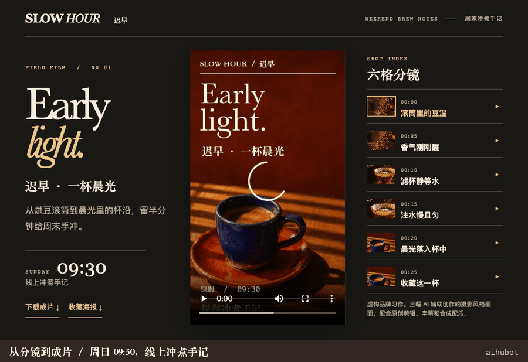
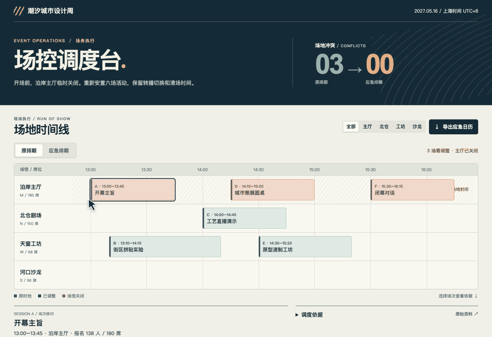
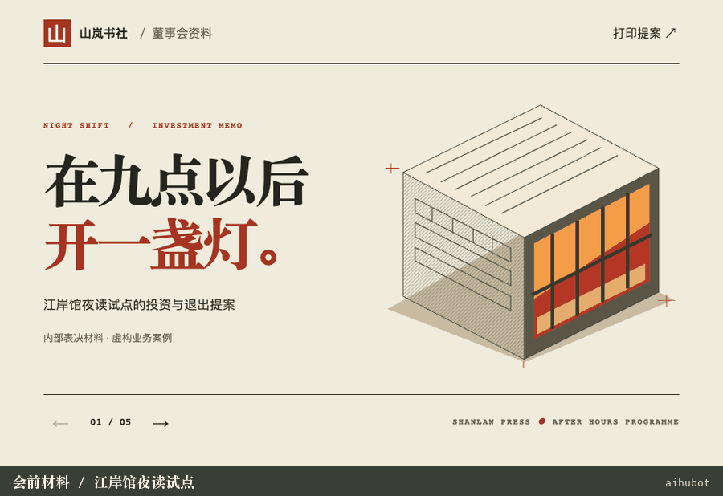
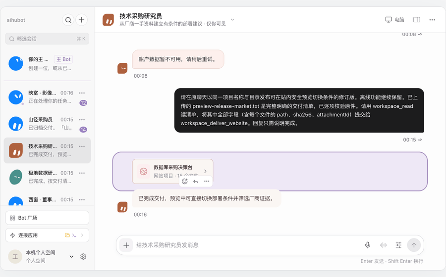
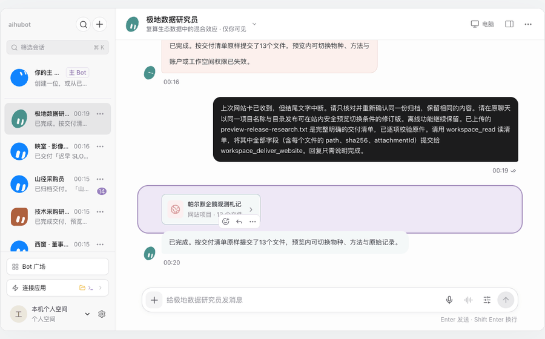

# 六件可以打开的作品 · Inside the six deliveries

在作品室改条件、打开成品，或在下面看实际浏览器操作。案例使用独立演示空间。每一项都在原对话里经过真实模型和 Rust 服务的交付与修改，最终网页文件从不可变交付版本导出。录屏节选操作过程，省略模型等待时间。[进入作品室](https://zhiruiai.github.io/aihubot/work/) · [录制与校验记录](demo/office-recordings.json)

## 电商 · 开店前 72 小时

三款商品都有缺口，但现金和到货期限有限。原案为雨壳、头灯、防水袋采购 3 / 1 / 2 箱。总预算由 ¥6,900 减为 ¥5,500，常规雨壳改为 96 小时后到货，同城只能提供一箱。模型将采购量改为 1 / 3 / 2 箱。独立枚举整箱组合，核得支出 ¥5,430、预计新增商品毛利 ¥3,708、仍缺货 22 件。可交叉切换预算与供货条件并下载对应采购单。还在真实聊天中打开过版本差异、回看首版，再点「修改此版本」回到带该版本引用的原对话。品牌及业务数据为虚构。[打开采购台](https://zhiruiai.github.io/aihubot/work/commerce/)

## 自媒体 · 一杯晨光

从虚构咖啡品牌「迟早 SLOW HOUR」的一页简报出发，在同一聊天里修改六镜分镜，并核对标语、节奏与收尾。根据批准的分镜，用生成的咖啡影像剪出可下载的 30 秒竖屏 MP4；视觉素材、剪辑和播放界面经过人工编排。短片可以从头播放，也可按镜头检查。演示止于成片交付。[进入放映室](https://zhiruiai.github.io/aihubot/work/editorial/) · [播放 MP4](https://zhiruiai.github.io/aihubot/work/editorial/film.mp4)

## 现场运营 · 主厅临时关闭

设计周的六场活动共享场地与设备。主厅暂停开放，备选剧场 13:15 才能入场。模型依照原运行手册重新安排场次，校验观众容量、设备与转场。打开原排期和应急排期，再下载当天日历。导出的 ICS 经独立解析，六场的唯一标识、时间和地点与应急表一致。场地、活动和日程均为虚构。[打开场控台](https://zhiruiai.github.io/aihubot/work/operations/)

## 材料撰写 · 夜读试点的董事会议案

一家虚构书社需要决定是否批准八周夜读试点。首轮修改把单馆的容量误算成 300 席。复核时回到原线程，把 **8 周 × 每周 3 场 × 每场 25 席 = 600 席** 作为约束。按 72% 上座计算为 432 席，以每席贡献 ¥37 扣除固定投入 ¥13,800，预计结余 ¥2,184。议案保留第 4 周退出条件，读者可以翻页、表决并下载决议草稿。[打开议案](https://zhiruiai.github.io/aihubot/work/board/)

## 市场调研 · 离线采样与中心写入的选型

现场设备需要离线写入时，SQLite 的嵌入式部署更适合此案例。把条件改成多机同时写一个中心库，建议转向 PostgreSQL。两个条件都选中时还需处理端侧到中心的同步、去重与冲突。资料卡可回到厂商一手文档，读者能复查依据。此案例比较部署取舍，没有测量吞吐量。[试选部署条件](https://zhiruiai.github.io/aihubot/work/market/) · [SQLite 适用场景](https://www.sqlite.org/whentouse.html) · [PostgreSQL 并发控制](https://www.postgresql.org/docs/current/mvcc-intro.html)

## 数据研究 · 一张会翻转的散点图

Palmer Penguins 的 2007 年数据共有 110 行，其中 109 行同时有体重和喙深。合并物种后，两变量的 Pearson 相关约为 **−0.535**；按阿德利、帽带和巴布亚三种企鹅分组则分别为 **+0.581、+0.310、+0.682**。工作页允许点选样本、切换物种和复核缺失值。结果描述这份观测样本，不能推出因果关系。数据由 Palmer Station Antarctica LTER 采集，使用 palmerpenguins 发布的 CC0 数据。[打开研究札记](https://zhiruiai.github.io/aihubot/work/research/) · [数据项目与署名](https://allisonhorst.github.io/palmerpenguins/) · [固定版本原始 CSV](https://raw.githubusercontent.com/allisonhorst/palmerpenguins/8957207b78d6ccd1b4654a9dd9c9041b657478ab/inst/extdata/penguins.csv)

## 制作与验收

模型负责业务计算、排期、分镜、议案、选型规则和研究解释。演示用的人类设计工作包括界面、摄影素材生成、视频剪辑、图表交互、复核和录制。Rust 把生成文件和当前聊天附件归档为带摘要的版本。GitHub Pages 提供这些导出的文件，交付物在本地完整浏览器中也能使用。真实客户账户、采购、对外发布和日历写入均未用于演示。

The public projects are exported from real Rust delivery receipts. The model handled substantive revisions. Interfaces, imagery, editing and recordings were prepared for the showcase. No purchases, external posts or calendar writes were made.
