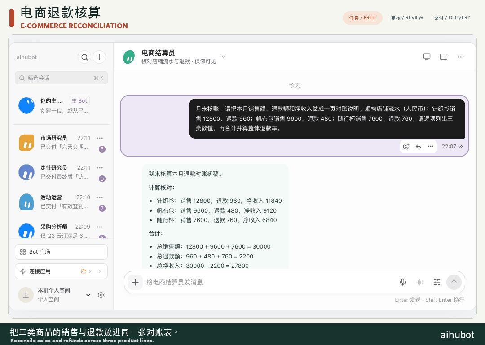
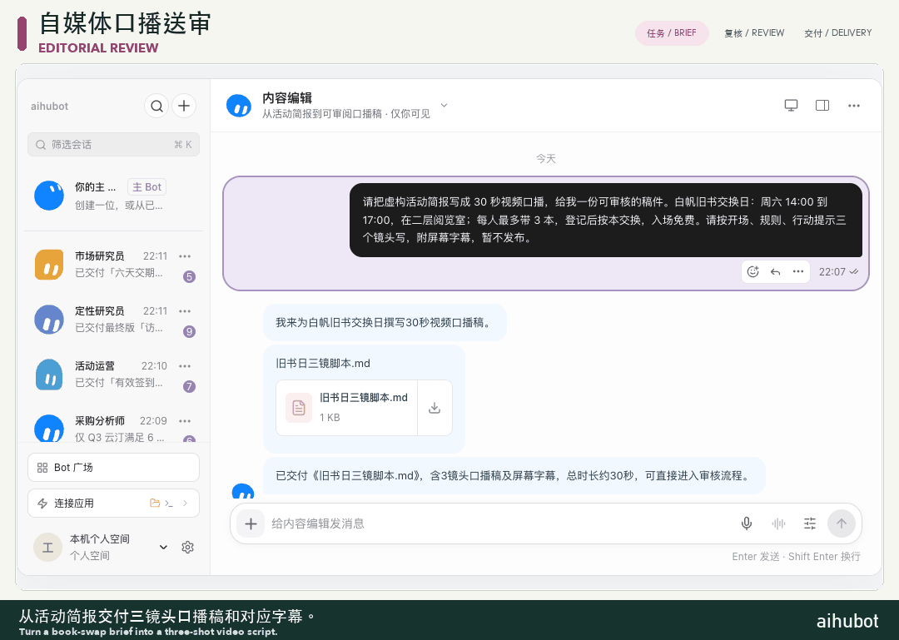
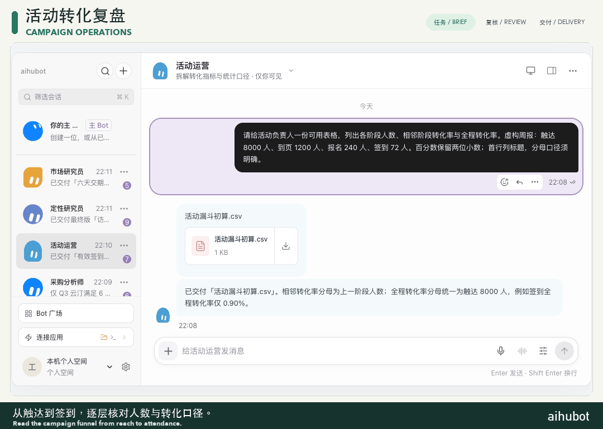
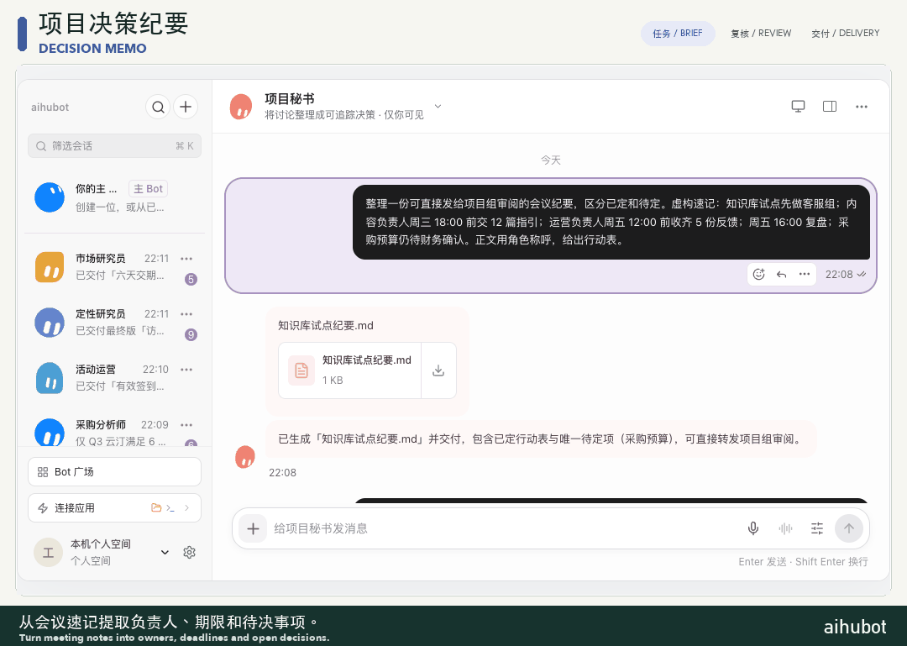
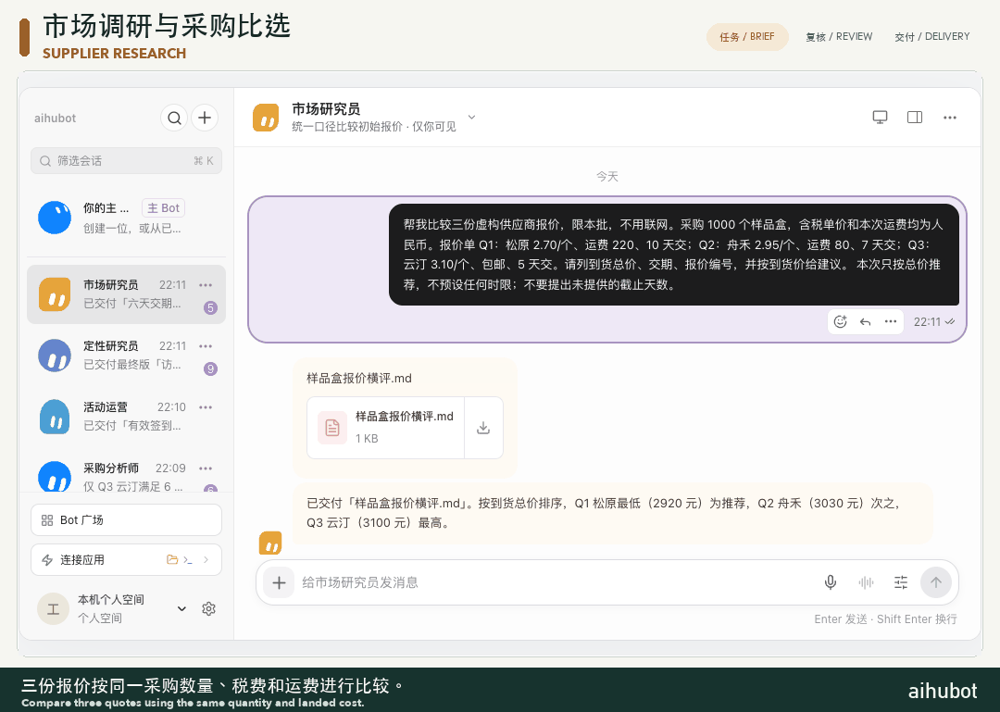
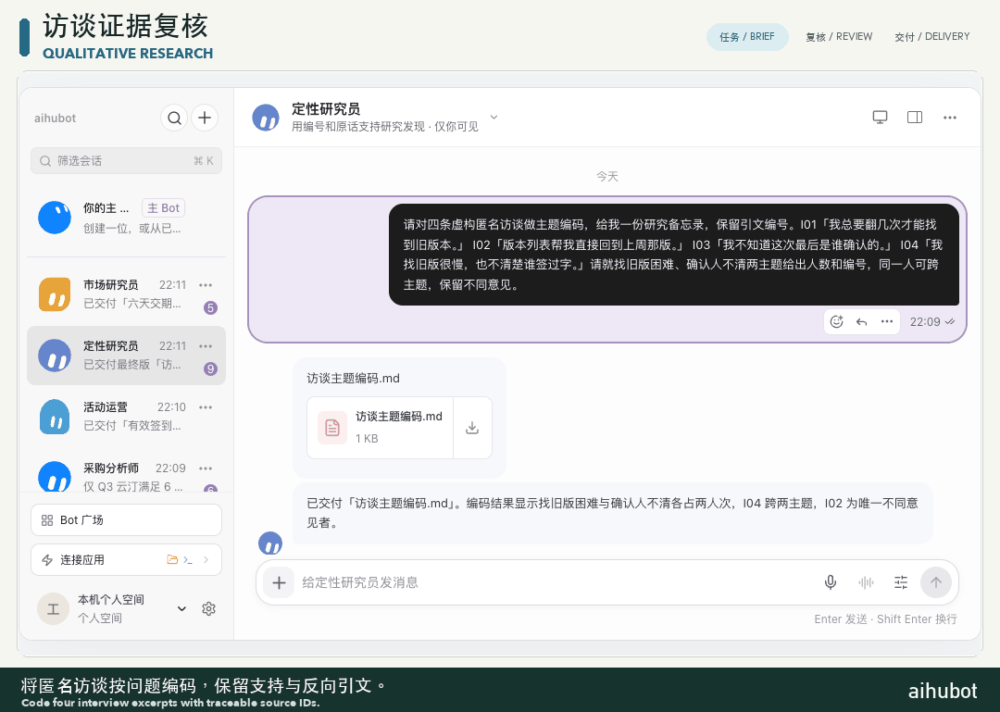

# 办公场景实录 · Office workflows

六份真实交付，来自同一个隔离的 aihubot 工作空间。订单、报价、访谈和活动简报均为虚构演示数据。每个案例都由真实模型通过 Rust 服务接收任务、交付初稿，再按同一会话中的反馈交回修订文件。动画回放已保存的会话与文件，省略模型等待时间。下方可打开交付回执对应的原始文件，下载字节已与回执中的 SHA-256 校验一致。

Six real deliveries from one isolated workspace, using fictional briefs and business data. Each recording replays a model-generated draft, the user's review and the revised delivery. Model wait time is omitted. The linked final files match their delivery receipts byte for byte.

[录制与文件校验 · Recording notes and checksums](./demo/office-recordings.json)

[电商对账 · Refunds](#refunds) · [内容审核 · Editorial](#editorial) · [运营漏斗 · Funnel](#funnel) · [决策纪要 · Minutes](#minutes) · [供应商比选 · Sourcing](#sourcing) · [访谈研究 · Interviews](#interviews)

## 电商退款核算 · E-commerce reconciliation

三类商品共销售 30,000 元，初稿记入退款 2,200 元。财务复核发现随行杯的一笔 200 元退款重复导入。修订稿保留原退款、调整后退款与各品类净收入。最后一次复核还区分了退款金额和退款率的变化单位。

**复核结果**　退款合计 2,000 元，净收入 28,000 元。按未舍入数值计算，退款率从约 7.33% 降至约 6.67%，下降 0.67 个百分点。

A duplicated ¥200 refund is removed without altering sales. The corrected report records ¥28,000 in net revenue and a 0.67 percentage-point decrease in the refund rate. [打开最终对账单 · Final report](./demo/office-results/refunds.md)

## 自媒体成稿审核 · Editorial review

活动编辑把旧书交换日简报写成约 30 秒的三镜口播，逐镜配字幕。主办方随后把开始时间推迟一小时，并补充不收教辅书。编辑在口播、字幕和事实核对表中同步修改，交回审核稿。

**复核结果**　开放时段为 15:00–17:00，每人最多带 3 本，入场免费，不收教辅书。此案例止于交稿，未向社交平台发帖。

The revised script synchronizes the spoken copy and captions with the new opening time and book policy. The deliverable is a review draft. No social post was published. [打开口播与字幕 · Final script](./demo/office-results/editorial.md)

## 运营转化漏斗 · Campaign funnel

从 8,000 人触达、1,200 人到页、240 人报名、72 人签到开始核算。现场回报签到含 8 条工作人员测试记录。运营复核了有效人数、各步转化率和流失最大的环节，并交回可直接在表格软件打开的 CSV。

**复核结果**　有效签到 64 人。报名到有效签到为 64 ÷ 240 ≈ 26.67%，触达到有效签到为 64 ÷ 8,000 = 0.80%。最大流失发生在触达到到页，减少 6,800 人，占触达人数的 85%。

Removing eight test check-ins leaves 64 attendees. The final CSV shows 26.67% registration-to-attendance conversion and 0.80% overall conversion. [打开漏斗明细 · Final CSV](./demo/office-results/funnel.csv)

## 材料撰写 · Decision minutes

项目秘书把客服组知识库试点速记整理为决议单。最初要求周三交 12 篇指引。主持人随后要求拆成两批，并保留原反馈和复盘安排。交付文件分别列出负责人、动作、期限及仍需决定的事项。

**复核结果**　内容负责人周三 18:00 先交 8 篇，周四 12:00 补 4 篇。运营负责人仍于周五 12:00 前收齐 5 份反馈，周五 16:00 复盘。采购预算仍待财务确认。

A single 12-guide deadline becomes two accountable handoffs. Feedback and review times stay on the agenda, and the budget is explicitly pending. [打开试点决议单 · Final minutes](./demo/office-results/minutes.md)

## 市场调研 · Supplier comparison

采购 1,000 个样品盒，三份虚构报价单 Q1、Q2、Q3 的单价、运费和交期均随请求提供。第一轮按含运费总价排序。客户随后新增“6 天内到货”的硬约束，重新评估三个选项。

**复核结果**　Q1 为 2,920 元、10 天，Q2 为 3,030 元、7 天，Q3 为 3,100 元、5 天。只有 Q3 满足交期，较原最低总价多 180 元。此案例采用给定报价，没有访问供应商或实际下单。

Three fictional quotes are normalized for 1,000 boxes. A six-day delivery requirement changes the choice from Q1 to Q3 at an additional ¥180. [打开采购建议 · Final recommendation](./demo/office-results/sourcing.md)

## 匿名访谈研究 · Qualitative coding

研究员先给四条虚构访谈做主题编码，再纳入第五条反例。复核要求每个比例回溯到受访者编号，每个反例只用于其实际谈到的主题。最终表格并排显示支持编号、比例、反例编号和原话。

**复核结果**　I01、I04 提到找旧版困难，I03、I04 提到确认人不清，各为 2/5（40%）。I02 和 I05 分别为两主题提供反例。I04 可跨主题计数。这五条样本的比例只描述本组访谈。

Each theme appears in two of five fictional interviews. The memo maps both themes to participant IDs, quotes the two counterexamples and limits interpretation to this sample. [打开访谈证据表 · Final research memo](./demo/office-results/interviews.md)

