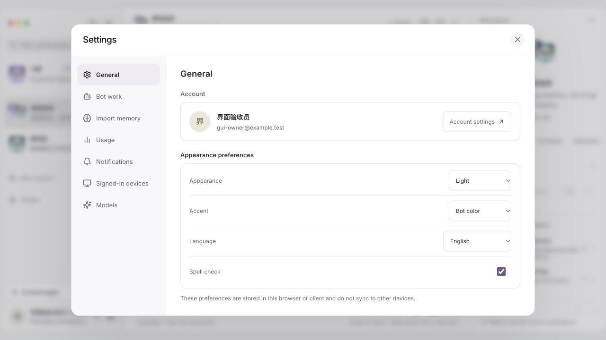
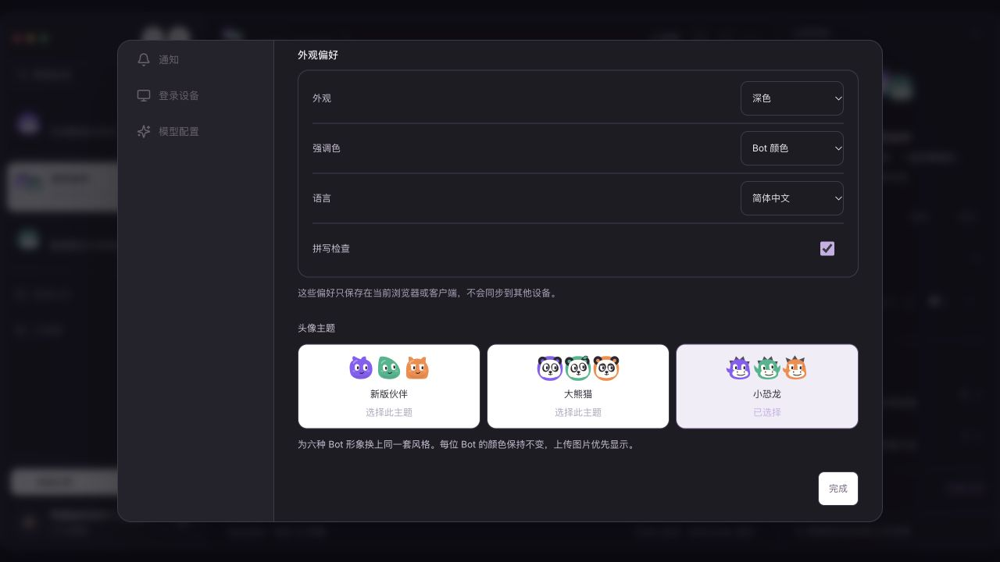

# 当前验证范围

本页区分模块、浏览器、部署和客户端验证。公开证据使用合成资料，较早的记录保留原时间和范围。Flutter 已构建 Android 调试包并在模拟器验证部分原生流程。iOS 签名、真机和远程 Linux 浏览器新增部署仍待验收。

## 设置与页面滚动布局（2026-11-14）

- 设置通用页整理为账户、外观偏好和头像主题；头像目录随正文滚动，标题与完成按钮固定。切换设置分类回到顶部。Chromium 使用真实滚轮、键盘和滚动条拖动验证，覆盖 320–1440px、中英文、全部内置主题及社区目录；短内容没有多余纵向滚动。
- 连接应用和开始聊天额外覆盖 320×330、568×320 等矮窗口，核对搜索、关闭和底部入口仍可点击，聊天结果只有一个纵向滚动区域。模板、技能、模型配置、电脑、文件与网站预览通过相邻浏览器回归。
- 登录、注册、账户设置、后台外壳与网站分享失效页另通过 30 组中英文及宽窄窗口几何检查，长内容由页面滚动，后台窄屏导航和表格保留必要横向滚动。团队、公开模板和独立运营业务页完成源码检查；此轮未重新执行其完整业务流程。
- Flutter 修复新建分区和重新连接应用弹框的键盘遮挡。26 项相关测试通过，包含 9 个页面的中英文、亮暗布局，以及 320px 宽度、300px 键盘和 130% 字号。短弹框在空间充足时不滚动，头像主题通过实际滚动后选择验证。
- 这些检查使用合成数据；浏览器与 Flutter 组件测试不代表 Windows、iOS 或手机真机键盘已验收。

## 连接应用中的内置技能

- 七套中英文内置技能共用原有工作流模板。320px Chromium 检查搜索、完整指令、键盘焦点和成员只读。预览与打开草稿均为本地操作。拥有者选择本地 Bot，提交编辑稿后生成待审核版本。
- 使用同一隔离团队在英文 Web 提交编辑稿，在打包的 macOS Electron 核对该版本并单独批准。390px Flutter Web 预览了完整格式化指令，并向另一个 Bot 提交了一份仍待批准的草稿。团队成员可预览，直接提交被 Rust 拒绝。
- 用从网页实际提交的合成正文复测最终包。实际 Pi 在批准前收不到正文，批准后收到完整编辑版本。另测成员与共享别名写入拒绝、跨域拒绝和过期审批不能替换新版。
- Web 705 项、Electron 66 项、Flutter 519 项测试通过。Android ARM64 在 320dp 模拟器完成搜索、选择 Bot、编辑和待审核提交。最终 Android 版复核了 Markdown 标题、步骤换行和底部控件。iOS 和手机真机仍待验收。
- 产品、独立运营和 Flutter 网页预览已切换到本机验证版。切换前保留 7 份数据库快照，复核 6 份私有配置摘要。

## 长技能、记忆与对话上下文

- Rust 8 项单元检查通过，覆盖 8 份满长技能、105 条记忆、Unicode 分页、JSON 转义、旧版超长记录及 Pi 启动帧限制。较小的知识集合保持原有格式，较大的集合通过目录及分页读取。
- 实际 Pi 4 项专项通过。群聊分页核对 105 条记忆、当轮新保存记忆的召回，以及任务开始时捕获的技能版本。每日跟进与 Webhook 按各自的范围读取，共享委派撤权后停止。最终源码另通过 16 项共享委派、私有技能、记忆导入、Webhook 和主 Bot 回归。
- 优化发布版使用实际 Pi 和当前 GLM 在隔离空间运行 8 份近 16,000 字符的已审核技能与 6 条长记忆。模型调用 `read_skill`，工具返回指定技能的完整末尾标记，最终回复原样输出标记。两次模型请求均返回成功。
- 旧包与发布版使用同一隔离历史测试。18 条旧消息合计 522,181 个 UTF-16 单元，旧包在调用模型前失败。发布版保留最新 8 条，报告省略 10 条旧消息，完整保留当前请求和明确引用。实际 Pi 完成任务，原有 18 条消息的存储内容保持一致。
- 本版的真实 Exa 回归通过，12 条不同查询、重复复用、第 13 条限额和新任务恢复均正常。产品和独立运营入口使用同一个验证过的 Rust 发布包。切换前保留 7 份数据库快照，复核 6 份私有配置的摘要，Flutter 预览登录页正常。

## 头像主题跨设备同步

- Rust 和 SQLite 的 4 项专项通过，覆盖账号与空间隔离、成员资格变更、并发保存、旧库迁移和重启回读。保存内容为所选主题及校验后的自定义设计。既有上传头像继续使用原文件。
- 优化发布版用同一合成账号串联 Web、打包的 macOS Electron 和 390px Flutter Web。网页明确同步旧设备主题，桌面选用大象并保留自定义设计，Flutter 再选回该设计。个人空间的变化未写入团队空间。网页明确清除同步后，两端各自恢复本地偏好。
- Chromium 另测保存冲突、回执丢失后继续预览、账号切换和取消清除。Web 705 项、Electron 66 项、Flutter 515 项测试通过，TypeScript 和 Flutter 静态检查通过。产品、独立运营和 Flutter 预览入口已切换，保留切换前数据库快照与原有私有配置。
- Android ARM64 调试包在 320dp 模拟器上实际读到另一会话保存的主题，验证预览不写入、显式同步、移除后恢复本地小鸡主题，以及个人和团队空间隔离。iOS 和真机仍待验收。
- 本版 Rust 与实际 Pi 通过真实 Exa 回归。12 条不同查询成功，重复查询复用结果，第 13 条触发单次任务限额，另起任务恢复。

## 自定义 MCP 聊天建议

- Rust 和实际 Pi 的 14 项专项通过，包含旧目录卡、自定义地址伪造和截断、引用与历史隔离、个人空间与 Bot 权限、重启持久化及连接失败。同一完整地址冲突会返回明确的重复状态。
- 当前 GLM 在隔离账户生成了 Context7 审核卡，连接列表仍为空。签名 Electron 通过显式共享确认连接该公开服务，再批准一次只读的 `resolve-library-id`，实际收到 React 文档库结果。优化发布版又批准一次 `query-docs`，实际返回 Next.js 文档内容。再次打开建议卡复用已有连接。 [Context7 工具说明](https://context7.com/docs/resources/all-clients#mcp-tools)
- Web 705 项与 Flutter 506 项测试通过，TypeScript 和 Flutter 静态检查通过。320px Web 及 390px Flutter 浏览器覆盖中英文审核、锁定地址、显式同意、并发重复恢复和打开已有连接。Flutter 浏览器也在隔离环境完成了 Context7 的实际连接和复用。原生手机和真实第三方 OAuth 凭据验收仍待完成。
- 优化发布版的产品和运营入口通过隔离启动。切换前确认无运行中的用户任务，保留 7 份数据库快照并复核 6 份私有配置摘要。产品、运营及移动网页预览均返回正常。

## Bot 澄清问题

- Rust 使用实际 Pi 和本机合成模型通过 5 项专项与 16 项相邻回归。覆盖同时点名多位 Bot 后由非首位 Bot 提问、提问轮已完成后提交、原请求人及线程校验、22 条中间消息后带回原请求、重复提交去重，以及停止或重启后不重放。结构化选择按数据传递，保持既有审批边界。
- 优化版使用当前 GLM 模型和隔离账户验证单聊提问。模型发出实际工具调用，用户提交单选后由原 Bot 继续回答。三次模型请求均成功。
- 优化版服务、桌面与 390px Chromium 用隔离账户通过真实群聊流程。签名 Electron 客户端打开网页已经回答的卡片，并提交新单选。Flutter 的 390px Chromium 私聊与团队群聊验收通过，保留未发送草稿，普通消息不会回答卡片。Web 705 项、Electron 66 项和 Flutter 502 项测试通过。
- 真实 Exa 回归通过。12 条不同查询成功，重复查询复用，第 13 条触发当前任务限额，另起任务恢复。产品、运营和移动网页预览已更新。本机服务切换保留了 7 份数据库快照和 6 份私有配置的原摘要。

## 历史搜索和移动头像

- Web 705 项测试、TypeScript 检查及 Chrome 专项通过。专项覆盖 118 条混合结果、分类与范围切换、键盘定位、准确打开来源，以及 320×330 中文窗口。
- Flutter 496 项测试及静态分析通过。移动端支持全角字母与数字，分类结果可继续滚动到旧记录。390px 网页回归通过单聊和独立入口的智能起草、确认保存与导航。
- 移动端相机通过系统相机界面拍照，客户端只上传重新编码的图像。专项覆盖取消、权限拒绝及原空间失效。Android 11 ARM64 模拟器使用合成相机验证取消零写入、预览、裁剪、保存后取得一个 WebP 头像，以及清理临时相机文件。iOS 相机用语、项目配置和 Swift 语法已检查，签名构建和物理设备仍待验收。

## 移动端智能起草 Bot

- 390px Flutter Web 使用真实 Rust、Pi 和本机合成模型验证两个入口。直接输入任务描述可得到可编辑草稿。单聊中由 Pi 生成的草稿可核对原请求后打开同一编辑表单。两条路径都在明确确认后提交一次，并打开新 Bot 会话。
- Flutter 全量 494 项通过，静态分析无问题。专项覆盖中英文、未配置模型、失去拥有者权限、编辑后确认和源线程不一致时拒绝。头像主题复用了源消息的权限校验，已通过相邻测试。移动网页预览已更新并校验实际服务中的资源。
- ARM64 Android 发布模式构建通过。网络配置明确限制明文 HTTP 只适用于列出的三个本地回环地址。调试签名的验收包已校验签名，解包扫描 134 个条目未匹配本机用户名、已知个人标识或私有配置值。Android 11 ARM64 模拟器实际安装并登录，在未连接模型时打开智能起草页。模型生成与创建提交使用 Flutter 网页验收。iOS、正式发行签名和物理设备仍待验收。

## 应用连接建议和 OAuth 恢复

- Pi 按应用名称、类别和中英文关键词查询当前空间的目录。Rust 31 项连接、授权、聊天提议与相邻回归通过。请求中断后可读取原授权状态，重复确认只兑换一次，取消后拒绝迟到结果。若浏览器已打开授权、提供商尚未返回，可取消并重新发起。
- 打包版 Web 和签名 macOS 客户端使用隔离账户、实际 Pi 和本机合成模型完成 Cloudflare Docs 与 DeepWiki 的真实只读查询。确认共享后只建立一条连接，打开原卡片复用已有连接。具体工具仍需用户批准。macOS 早期的 Cloudflare 失败在迁移后复跑时没有重现。
- 390px Flutter Web 和 Android ARM64 模拟器使用同一打包服务完成 DeepWiki 连接，确认回到聊天后状态更新并复用已建连接。Android 无障碍树包含卡片标题与状态。iOS、TalkBack 实际朗读和真实第三方 OAuth 仍待验收。
- 工作区迁移后，修正 4 份本地配置中的 9 个路径并恢复产品、运营和移动预览入口。保留 7 个数据库快照。重新执行了真实 Exa 的 12 条新查询、缓存复用、第 13 条触发任务限额与新任务额度恢复。

## 例行任务 Webhook

- Rust 发布版 21 项测试通过。新测试覆盖仅拥有者可管理密钥、单次显示、权限和路由隔离、正文大小、暂停、并发去重、重启后原回执、轮换及持续限流。转交和删除重建的旧密钥失效。
- 正式包使用实际 Pi 和本机合成模型运行三次 Webhook 及一次手动任务。运行历史记录正确区分触发方式。Webhook 的已启用技能、独立 JSON、空聊天历史和空工具列表符合执行权限。重复投递只产生一个结果，附加触发不推进原定时安排。
- Web 704 项、Electron 66 项、Flutter 482 项测试和前端静态检查通过。320px Web 浏览器覆盖创建、复制、未知轮换回读、撤销、仅事件方式和只读边界。
- 签名 macOS 客户端、390px Flutter 网页和 Android ARM64 模拟器使用打包服务，完成密钥生成、Webhook 投递、查看已完成的运行记录，以及撤销后拒绝旧密钥。macOS 复制动作在隔离的客户端剪贴板替身上核对。Android 回到前台后清除一次性密钥。iOS、物理设备和真实第三方事件来源仍待验收。
- 产品、独立运营和移动网页预览入口已更新。切换前备份了 7 个数据库，6 份私有配置摘要保持一致。

## 团队技能发布权限和私有链接

- Rust 发布版 12 项 HTTP 检查通过。覆盖成员默认拒绝、拥有者明确开启、权限过期拒绝、旧回执恢复、成员资格、撤回和重发链接轮换、模板来源限制和旧数据迁移。
- 390px Chromium 用隔离打包版完成团队设置保存、成员发布、真实剪贴板复制、登录回跳和团队外拒绝。关闭再开启权限后，旧的同步请求被拒绝，重新核对后成功同步。原链接打开新版本，成员撤回后失效，拥有者对同一版本执行管理撤回后阻止重新发布。Web 699 项测试通过。
- 签名 macOS 客户端打开同一打包服务，用实际点击和隔离的剪贴板写入替身核对完整地址。实际登录回跳、当前账户校验和撤回后清除旧内容均通过。系统剪贴板保持原有内容。
- Flutter 静态分析通过，476 项测试通过。390px Flutter 网页和 Android 11 模拟器使用隔离打包服务，完成团队权限保存、成员核对后发布和复制团队链接。团队外的读取被拒绝。原生客户端复制的是可在浏览器登录后访问的团队地址。iOS 签名构建和物理设备验收仍待完成。
- 打包版用实际 Pi 和本机合成模型验证，已有导入在同步和撤回后仍运行原审核版本。本机产品、独立运营和移动网页预览已更新，入口通过访问边界和已服务资源校验。切换前备份了 7 个数据库，6 份私有配置摘要保持一致。

## 原创 Bot 模板和个人技能发布

- Web、桌面和 Flutter 共用七套中英文原创 Bot 模板。打包版 Web 在 390px Chrome 中验证筛选、长期指令核对、编辑后持久创建，并验证编辑团队模板后创建群聊。Flutter 在同宽度验证目录、搜索、核对和编辑表单。
- 使用隔离账户和打包版 Rust，在实际签名 macOS 客户端验证了发布回执丢失、完全退出重开后核对、同步第二版，以及团队目录的中性来源显示。Flutter 网页在 390px Chrome 中验证先选目标团队、按复核版本精确提交，以及同步完成回读。
- 使用打包版 Rust、实际 Pi 和本机合成模型验证了团队隔离、导入后的审核、源技能更新和撤回后仍运行已审核版本。Rust 三项发布 HTTP 检查及库测试 56 项通过，库测试有三项依赖外部条件。Web 694 项、Electron 66 项、Flutter 469 项测试通过，Web 和 Flutter 静态检查通过。
- Android 11 模拟器安装了这一版经过签名校验的 arm64 调试 APK。使用隔离 Rust 服务，验证七套原创模板、复核及编辑后创建一个 Bot，并同步个人技能到明确选定的团队。第二个团队的目录为空。外观设置可查看五套头像主题，并成功切换小鸡和大象。iOS 构建和物理设备仍待验收。
- 本机产品、运营和 Flutter 网页预览已更新。产品入口和运营入口分别校验了访问边界，7 个数据库已备份，6 份私有配置摘要保持一致。
- 用本轮 Rust 代码、实际 Pi、本机合成模型和真实 Exa 重跑了联网回归。12 条不同查询均返回结果，重复查询命中缓存，第 13 条新查询触发本地限额，另起任务后恢复额度。独立的真实 Exa 搜索和网页读取测试也通过。

## Flutter 团队模板入口

- 390px Flutter 网页使用隔离账户，在 Bot 模板库预览三套模板，展开产品发布的三位成员，取消后核对零写入。再次载入中文版方案，无模型即可编辑名称。确认创建后新增三位 Bot、三个单聊和一个群聊，协作仍待单独启动。320px 普通成员仍可浏览原创 Bot 模板。
- Android 11 ARM64 模拟器在 320dp 验证相同入口、展开分工、取消和重新载入。只产生一份可编辑方案，Bot 与会话集合保持一致。Flutter 525 项测试通过，专项静态分析通过。本轮 iOS 与物理设备待验收。
- 六项 Rust 专项测试通过。发布包使用合成模型和实际 Pi，验证单独启动时只派发一次任务，收到编辑后的负责人指令与分工。
- 本机 Flutter 网页预览已更新并核对所服务资源的摘要。

## 连接应用逐工具启停

- 正式包使用隔离账户、本机合成模型和真实 Pi 连接 Microsoft Learn MCP。停用文档搜索后，它从工具目录移除，直接调用被拒绝，文档读取经审批后仍取得真实结果。重新启用后，文档搜索恢复并经新的单次审批完成。整个过程使用公开查询，不需要第三方账户。 [Microsoft Learn MCP](https://learn.microsoft.com/en-us/training/support/mcp)
- Rust 共 34 项专项与相邻测试通过。覆盖所有者和成员权限、过期配置、连接重连、单工具待审批撤销、在途结果、OAuth 凭据轮换、例行授权和共享 Bot 的精确范围。未受影响的工具实际完成调用。
- Web 693 项、Electron 66 项和 Flutter 应用相关 31 项测试通过。320px Web 和 390px Flutter 在实际 Chrome 验证了修改、配置冲突、未知提交结果回读和中英文界面。Flutter 浏览器流程使用合成账户与连接目录。
- macOS 客户端连接真实 Microsoft Learn，验证两个工具独立启停、刷新和重启回读、团队成员只能查看。正式产品与运营监听及手机网页预览已更新。切换前备份了 7 个数据库，6 份私有配置的摘要保持一致。
- Android arm64 调试 APK 已重新构建并通过签名校验。Android 11 模拟器安装了此 APK，使用独立正式包和 Microsoft Learn 实测停用、重开详情回读和重新启用。目标工具每次保存产生新版本，连接及另一个工具的版本保持一致。Android 真机及 iOS 安装和签名仍待验收。
- 同一 Android APK 的原生外观设置可查看五套头像主题，成功选中小鸡和大象。由中文切换到英文后，仍可看到大象主题处于选中状态。

## 例行任务公开搜索

- 正式服务包以隔离账户和本机合成模型驱动实际 Pi，未分配电脑。两条公开查询由真实 Exa 各返回五条结果，重复查询复用本轮结果，剩余新查询数依次为 1、1、0。清除授权后第二次运行完成，Pi 的工具列表不再包含公开搜索或网页读取。运行记录未返回私有授权版本。
- Rust 24 项 HTTP 与相邻回归通过，覆盖未授权任务、团队成员、受管 Bot、旧配置冲突、转交和既有应用权限。Web 692 项、Electron 66 项、Flutter 456 项通过。Chromium 在 320px 宽度走通核对查询、创建、遇到冲突后重载和清除授权。
- 实际 Pi 与隔离搜索端点的 3 项集成测试通过，覆盖定时及手动启动、仅可读取本轮返回的公开链接、撤销后拒绝迟到结果，以及旧群聊任务无法借委派获得搜索工具。
- macOS 客户端在隔离服务上通过创建、刷新回读、清除授权和再次刷新。正式服务已切换，产品和运营入口分别通过健康与权限边界检查，7 个数据库已备份，6 份私有配置的摘要保持一致。
- 390px Flutter 网页在实际 Chrome 中使用合成账户走通拒绝重复词、原样核对授权、重开查看与清除。本轮原生 Android 和 iOS 安装包尚未重建验收。
- Flutter 网页预览随包加载中文备用字体。390px Chrome 在阻止外部资源请求时能正常渲染中文登录页和例行任务编辑器，包括临时输入的中文查询。字体调整后 12 项 Flutter 专项测试通过，静态分析无问题。字体来源和许可证见[第三方软件](../THIRD_PARTY.md)。

## 个人空间私有技能

- Rust 技能和模板专项 16 项通过。实际 Pi 会话只加载目标 Bot 明确启用的固定版本。源技能更新后旧版仍生效，停用后新任务不再加载，重新启用同版会复用已有记录。
- 正式服务包在 Chromium 的 390px 窗口完成核对全文、选择 Bot、启用和停用，实际 Rust 和 Pi 用隔离模型验证了三轮聊天上下文。打包版 macOS 客户端使用隔离服务验证了核对全文、停用旧版、启用新版和两次回读确认。
- Web 690 项、Electron 66 项、Flutter 448 项测试通过。Flutter 中英文窄屏测试覆盖精确版本复核、同名冲突和请求结果不明确时的回读。当前移动网页构建包含私有技能，私有技能的新版 Android 安装包和 iOS 真机仍待验收。

## 聊天应用审批与撤销

- Rust 应用专项 27 项通过。实际 Pi 会话通过隔离的 MCP 工作进程验证保存、精确复用、同一任务内去重、不同参数恢复审批、群聊隔离以及撤销后的迟到结果处理。HTTP 检查覆盖发起人隔离、授权上限、连接版本变化与旧的一次性审批。
- Chromium 在 320px 视窗走通确认、保存和撤销。正式服务包通过 `@GitHub` 从输入框提交，验证真实 Rust、Pi 与合成 MCP 结果的完整流程。实际 macOS Electron 客户端也使用临时配置和隔离服务核对了保存和撤销。
- Flutter 443 项测试通过，包含中英文窄屏流程。ARM64 Android 11 模拟器安装实际调试包，连接隔离的打包版 Rust 和 Pi，验证核对、取消时零写入、保存、复用和撤销，撤销后同一读取重新等待审批。已部署的移动网页预览通过浏览器登录页检查，完整的 Flutter 网页审批流程和真机仍待验收。
- 这轮使用合成的 GitHub 工具结果。需要真实 GitHub 账号完成连接授权后，才能验收该账号对实际仓库的访问。

## 私密电脑接管

- 同一个打包版先后通过 Web 和独立 Electron 客户端连接实际本地 Chromium 工作进程。在隔离团队中验证当前窗口收到私密 PNG，同一账号的另一次登录、团队成员和共享本机浏览器的另一个 Bot 入口均被拒绝。结束后撤销私密画面地址，普通预览恢复。
- Rust 电脑和示教专项 30 项通过。模拟远程工作进程覆盖独立画面、失效凭证、旧工作进程和工作进程遗留接管。工作进程全量 182 项通过，8 项按条件跳过，两项真实 Chromium 测试单独运行并通过。
- Web 682 项、Flutter 438 项、Electron 66 项通过。Android 11 模拟器用最终 APK 验证了合成云电脑画面、确认接管、输入遮挡和结束清理。实际远端云电脑与 iOS 真机仍待验收。

## Bot 语音留言

- 打包版在隔离账户通过 Pi 和 Mac 本地声线分别生成中英文 WAV。Chromium 和独立运行的 Electron 客户端用真实媒体解码器播放两条留言，确认授权下载、暂停、进度跳转和文字稿。测试在静音状态运行。另用已配置的 GLM 生成一条中文留言并校对文字稿。
- 390px Flutter Web 使用合成 WAV 验证点击才下载、展开文字记录、播放进度、暂停和续播。Android 11 模拟器用最终调试包播放了 27 秒音频，暂停后进度保持，续播后前进，回到桌面停止播放。
- Web 679 项、Flutter 432 项和 Electron 66 项测试通过。Rust 专项覆盖独立排队、幂等、普通文件回归、原音频保护、删除后保留文字稿。iOS 完成 Swift 语法与项目配置检查。Linux 离线合成需要部署者显式配置 eSpeak NG，其实际 Linux 运行仍待验证。

## 语音通话与团队技能导入

- 打包版 Web 在隔离账户用合成中英文音频驱动实际浏览器采音处理、工作空间的本地 Whisper 和 Pi。两轮转写进入同一通话，接收和完成回执均与对应轮次匹配。挂断后留下通话卡并释放音频轨。Pi 接入测试模型，浏览器使用模拟朗读适配器。
- Chromium 另行验证静音、打断朗读、继续听、回执丢失时去重，以及从历史通话卡重播。Rust 五组专项共 14 项通过，包含转写中挂断、通话归属、线程和团队技能权限。Web 677 项、Flutter 428 项、Electron 66 项通过。
- Android 11 模拟器安装了实际 APK，验证系统录音权限提示、拒绝指引和原生听写。测试输入由模拟器生成，转写结果进入可编辑草稿。该模拟器无离线语音引擎，客户端给出了声线配置提示。Android 真机完整通话和 iOS 签名验收待完成。
- 普通团队成员可将当前发布版本导入个人空间 Bot，且仅生成待审核草稿。已验证无权限的目标、重复提交与撤回后的拒绝。桌面和 390px 浏览器核对了选择工作空间与 Bot 的交互。

## 本轮已完成的模块检查

| 模块 | 已通过的检查 | 范围 |
| --- | --- | --- |
| 独立运营 | Rust 两监听与路由隔离、临时账户注册/运营全用户管理、停用恢复 GUI | [运营证据](evidence/operations-separation.json)；正式运营账户未代建。 |
| 真实模型配置 | 原空间 GLM 默认、DeepSeek 手动备用，各一次真实 Pi 请求 | [脱敏证据](evidence/current-model-configuration.json)；新账户不继承密钥。 |
| 退役 Node 业务服务 | 必要执行适配迁移到 packages，旧业务/兼容测试删除前核对 | [清理记录](evidence/node-retirement.json)和[逐文件表](evidence/node-retirement-files.json)。 |
| 教学 | 真实 Pi/Worker、取消、撤权、所选模型变化、重启与未知结果恢复，前端事件检查 | 录制不收输入正文/截图，产物是待审核技能。 |
| 例行只读应用授权 | Rust 27 项、MCP 23 项、Web 39 项模块/相邻检查 | [验证证据](evidence/app-routine-policies-verification.json)，使用本机模拟 OAuth/MCP。 |
| 例行任务转交 | Rust 20 项、Web 55 项模块/相邻检查 | 个人空间本地单聊转交；旧群聊负责人编辑保留。 |
| 原创模板 | 7 项新增、相邻合计 47 项 | 实际组件事件和原持久创建流程，无虚构历史与自动任务。 |
| 语音与通知 | 语音及相邻 27 项、语言 2 项；通知模块及桌面逻辑验证 | 未实际开启设备麦克风、播放系统声线或调用 OS 通知。 |
| 更新检查 | Rust 9 项、Web 17 项、桌面全套 64 项 | 本机模拟 GitHub API，未联网查询或安装发行版。 |
| 文件交付 | 新增 2 项真实 Pi，合计文件工具相邻 7 项 | 实际文件卡、同版本去重、原文件修改保留交付副本、越界/未登记/旧摘要拒绝。 |
| 联网 Linux 浏览器候选 | 本机代理协议、清理、双独立 Chrome 登录同步及原电脑回归 | [本机证据](evidence/linux-browser-local-verification.json)；没有新远端验收声明。 |

以上项目有相邻测试重合，不能相加当作唯一全量总数。各测试使用隔离临时目录、虚构账户和本机合成模型，除明确列出的两次模型连通性检查外没有付费模型调用。

## 历史整合回归

该阶段 Web 全量 **648 项通过，0 失败、0 跳过**，产品与运营站点构建通过。Rust 全量 **323 项通过，0 失败、0 跳过**。检查覆盖多 Bot 交接后的流式状态、未读事务、创建草稿的结构校验与撤权，模拟模型通过实际 Pi 工作进程运行。该阶段 Flutter 源码 **349 项通过**，静态分析无问题，见[移动端范围](../mobile/README.md)。

SDK/执行层与发布工具整合为 **184 项：176 通过、0 失败、8 项条件跳过**。真实 Chromium 的文件预览检查已另行开启并通过，保留脚本、网络、导航、手机布局、身份变化和字号检查；不能将其余条件跳过当作通过。桌面策略全套 64 项通过。

较早的正式服务包逐一核对了 577 个文件与 283 个分发依赖的许可文本。包内生产依赖和本机模拟模型完成注册、运营隔离、图像处理、实际 Pi 工作流、记忆写入、退出与优雅关闭。见[历史服务包与升级证据](evidence/current-release-service.json)。

新版 [0.1.0 服务包证据](evidence/release-0.1.0.json)记录了 622 个文件的完整性、许可和隐私核对。以原样打包的二进制和生产依赖完成了独立试运行，使用虚构数据与本机模拟模型。

本机正式服务已升级；事先在停止写入后备份 7 个数据库和 6 份私有配置，升级后 6 份配置摘要与 0600 权限均保持。未读取运营初始化码，未创建正式运营账号，未重复真实模型调用。macOS 客户端已重新打包，20 个源码/许可文件白名单和私密值检查通过，系统严格签名校验通过；签名仍为本机 ad-hoc，新增原生系统权限没有代替用户实际授权。

干净源码预检完成 npm 锁定安装、类型检查、两个网站和四个 SDK 工作进程构建。最终导出使用新的清单，安装过依赖的预检目录不作为交付。

## 当前实际 GUI

本机临时 3198/3199 站点使用虚构资料，独立于正式数据。已通过真实页面检查登录、独立运营、设置中英文与头像主题、实际用量空态、已有会话选择、应用目录及授权前核对。可见文字检查没有发现小于 12px 的界面字号。另外完成 HTML 预览/源码切换、原创模板选择与编辑创建、暂停任务真实转交并刷新验证、语音设置、通知默认关闭，以及未配置发行源时的真实版本提示。没有开启麦克风、声线播放或系统通知。教学的远端操作与手机实际设备仍未验收。

[独立运营浏览器验收记录](evidence/operations-separation.json)保留了用户注册、停用与恢复的历史检查结果。

这些图片只包含虚构账户、示例资料或原创界面，不含用户模型密钥或远程主机信息。浏览器截图和组件事件测试分别记录，不互相代替。

## 历史与部署边界

原 Rust 切换的数据一致性、旧版本双屏/文件往返/生命周期和客户端签名检查可见[重构验收](refactor-validation.md)及其带日期的 JSON。它们不能证明本轮新增有头浏览器已部署，或新增页面已经在所有设备验收。

自动审批拒绝了恢复专用沙箱、执行远程检查后再暂停的动作，理由是需要明确授权这次生命周期操作。实例保持暂停；本机 SSH 转发已恢复。Flutter 已生成 Android 调试包，真机验收和正式桌面发行签名、公证仍待完成。
